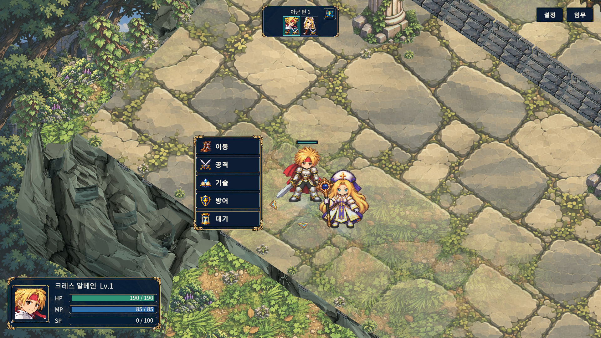
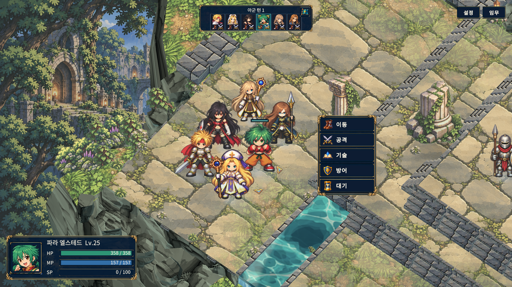

# 전투 HUD 분리와 정보 정리

2026-11-01에 승인된 목업을 기존 전투 화면에 적용했다. 이 문서의 캡처는 실제 실행본의 화면이며, 이전 생성형 이미지 목업과 구분한다.

## 적용한 동작

- 전투 명령은 선택한 캐릭터 옆의 세로 메뉴로 나타난다. 이동·공격·기술·방어·대기를 기본으로 하고, 되돌릴 수 있는 이동에만 이동 취소가 추가된다. 카메라와 유닛을 따라가며 화면 끝과 상태창·다른 캐릭터를 피할 위치를 선택한다.
- 상태창은 좌측 하단에 고정한다. 초상화·이름·레벨·HP/MP/SP를 표시하며, 지도나 상단 초상에 마우스를 올리면 해당 캐릭터 정보를 보여준다. 초상 클릭으로 상세 정보에 접근한다. 수치만 바뀔 때 버튼과 입력 포커스를 다시 만들지 않는다.
- 기술 목록은 지역 명령창을 대체한다. 대상 선택 중에는 좌측 하단 상태창 자리에 전투 예측이 나타나고, 취소하면 원래 위치의 상태창이 돌아온다.
- 긴 임무 목표와 자동 첫 사용 설명 카드는 상시 표시하지 않는다. 목표·위험 범위 토글·전술 도움말은 임무 안에서 조회한다. 명시적으로 시작한 연습의 설명과 실제 전투 피드백은 유지한다.
- 방향 선택은 발밑 일러스트 표식 클릭으로 확정한다. 방향키로 고른 뒤 Enter, Esc 취소도 유지한다. 아군 전체 턴 종료는 상단 턴 패널에 따로 둔다.
- 머리 위에는 이름·숫자 없이 작은 청록/가넷 HP 게이지만 표시한다. 선택·호버·피격 직후와 부상 상태를 우선하고, 건강한 비선택 유닛은 숨긴다. 주변 공간이 없으면 게이지를 멀리 이동시키지 않고 숨겨 고정 상태창에서 확인하도록 한다.

전투 규칙·난수·저장 형식·캐릭터 원화·맵과 효과를 재작성하지 않았다. 기존 금속 장식과 일러스트 아이콘을 재사용했다.

## 실제 Windows 화면

2인 전투의 캐릭터 옆 명령과 좌측 하단 고정 상태창:

6인 전투에서도 같은 고정 상태창과 독립 명령창을 사용한다:

[대상 예측](Evidence/03-target-forecast-allies2-1920x1080.png) · [6인 방향 선택](Evidence/18-facing-allies6-1920x1080.png) · [6인1280×720](Evidence/24-command-allies6-1280x720.png) · [6인줌·글자130%](Evidence/31-zoom-text130-allies6-1280x720.png). 이 여섯 파일은 원본과 바이트가 같은 캡처이며 [32장 전체 출처와 SHA](Evidence/actual-capture-manifest.json)를 함께 남겼다.

## 검증 방법

`BattleHudRedesignReview`는 실제 전투 장면에서 아군2/6명 × 1920×1080/1280×720 × 명령·기술·방향·예측·적 호버·좌우 가장자리·줌/글자130%를 캡처한다. 총32상태의 TMP 넘침, 화면/프레임 경계, 버튼 중앙 레이캐스트, 상태창 고정, 기존 도크/목표 카드 부재를 검사한다.

아군의 첫 선택이 정상적으로 수행하는 턴 초기화를 먼저 실행하고 허용된 TurnsStarted 증가만 확인한다. 이후 조회 동안 전투·격자·난수 스냅샷이 그대로인지 비교한다. 저장 격리와 사용자 캠페인/설정 파일 불변도 확인한다. 이것은 자연 성장 캠페인 완주나 물리 마우스의 모든 경로 검사가 아니다. 별도 PlayMode 테스트는 가상 입력 장치로 실제 지도 호버와 방향 선택을 검증한다.

## 최종 검증 — 2026-11-02

실제 Unity 전체 **[EditMode448/448·15.56초](Validation/editmode-final.json)**와 **[PlayMode264/264·649.44초](Validation/playmode-final.json)**를 통과했으며 실패·건너뜀·미결정0이다. 앞선 실패·표적 통과를 합산하지 않은 별도 전체 실행이다. 최종 [Editor05 검수32/32](Validation/editor-final.json)와 아래 Windows32/32를 확인했고, [소스·메타·머리 좌표54개 SHA](Validation/source-manifest.json)가 검증한 파일과 일치한다. 기존 수정 파일11개는 생성 변경3개만 이번 작업 초기 바이트 백업으로 복원한 뒤 모두 초기SHA와 일치함을 확인했고 커밋에서 제외한다. [보존·복원 근거](Validation/protected-restoration.json).

## 실패와 보완 이력

1. 첫 Editor 검수는 기존 실행 게임이 잠근 Player.log를 읽으려다 중단됐다. 저장/설정 파일만 명시적으로 스냅샷하는 것으로 수정했다. 원본 로그 발췌를 `Validation/editor-attempt1-error.txt`에 보존한다.
2. 두 번째 검수는8화면 배치 검사0건이었으나, 새 아군 첫 선택의 정상 턴 초기화를 전투 변경으로 잡아 실패했다. 초기화와 조회를 분리한 검수기로 수정했고 원본 결과를 `Validation/editor-attempt2.json`에 보존한다.
3. 실제 방향 캡처에서 아이콘이 보이지 않아 CanvasRenderer 누락을 수정했다. UI 객체 존재뿐 아니라 실제 렌더 메시·텍스처·색상·컬링까지 검사한다.
4.32상태 자동 검사를 통과한 뒤 육안 검수에서 밀집 아군의 옷자락/명령창 겹침과 투명 여백/무기로 인해 높은 HP 앵커를 발견해 추가 보완했다. 방향 선택 중 선택 캐릭터의 발밑 장식도 유지한다.

5. 첫 전체 PlayMode는263개 중251통과·12실패였다(`Validation/playmode-attempt1.json`). 기존 고정 좌표·도크 폭·건강한 전원 HP 표시를 전제로 한 검사를 현재 계약에 맞추고, UI가 없는 실제 드래그 경로와 렌더 이후 방향 강조를 검사하도록 바꿨다. 이 과정에서 발견한 대상 취소 버튼 여백과 숨겨진 명령창에 묶인 궁극기 초상화는 실제 제품 코드를 수정했다. 실패 실행은 통과 수치에 포함하지 않는다.
6. 표적 재검사39/41와40/41의 남은 실패는 혼합된 수동 포인터 이벤트/실제 마우스 호버, 행동 중에는 도움말이 열리지 않는 정책, 상태 전환 직후 LateUpdate 전 검사였다. 마우스 입력 큐·실제 UI 레이캐스트·렌더 프레임과 도움말의 실제 열림을 확인하는 검사로 수정했다. 각 실패 원본을 보존하며 마지막 궁극기 표적 검사는1/1·9.11초로 통과했다. 최종 전체 실행은 별도 결과로 기록한다.

7. 두 번째 전체 PlayMode는 **262/263·639.03초**였고 `GroundFacingArrowsMatchCameraAndAcceptPointerClicks`의 선택 장식 검사1건이 실패했다. 당시 `SimpleHudTests.cs:64`의 여러 조건을 합친 개수 검사에서 기대4/실제0이었으므로, 이 결과만으로 렌더러 비활성·Sprite 소멸 중 어느 조건이 원인이었는지 확정하지 않는다. 검사를 존재·활성·Sprite·Texture별로 분리했고, 별도의 수명 회귀에서 입증한 `IllustratedIcons`의 Unity-null Sprite/Texture 캐시 결함을 수정했다. 소멸한 네이티브 Sprite는 재생성하고 Texture는 다시 로드한다. 신규 수명 검사와 기존 카메라4방향×방향4개의 실제 UI 클릭16회를 포함한 **GroundFacing 표적4/4·10.93초**는 통과했다. 이는 최종 전체 결과를 대신하지 않으며, 새 회귀를 포함한264개 전체 실행 결과는 별도로 기록한다. [두 번째 전체 실패](Validation/playmode-attempt2.json) · [표적 결과](Validation/facing-cache-targeted.json).
8. 첫 일반 Windows 빌드의 BuildReport는 `Succeeded`였지만 **errors1·warnings4·77.65초**를 기록했다. 같은 실행의 Pipeline `/api/exec` 호출은 메인 스레드 작업이5초를 넘겨 타임아웃됐으므로 오류 없는 최종 빌드로 세지 않는다. 보고서와 호출 오류 원본을 보존했다. 이후 `EditorApplication.delayCall` 예약은 대기 상태로 남아 실행되지 않았으며, 최종 빌드는 한 번 실행한 뒤 등록을 해제하는 `EditorApplication.update`에서 시작했다. 최종 빌드·DLL 분리·검수 실행 결과는 아래에 별도로 기록한다. [첫 빌드 보고서](Validation/windows-normal-build-attempt1.json) · [호출 타임아웃](Validation/windows-normal-build-command-attempt1.json) · [당시 빌드 메시지](Validation/windows-normal-build-messages-attempt1.json).

[머리 좌표168개 측정·재생성·모션 적용 범위](HeadAnchorNotes.md) · [원화·피벗·측정 영역과 SHA256](Validation/head-anchor-provenance.json) · [별도 재생성의168개 데이터 SHA 일치 확인](Validation/head-anchor-regeneration.json)
## 최종 Windows 빌드와 실제 화면 검수

일반 Windows 빌드는 **21.77초·오류0·경고1**, `TALESTACTICS_REVIEW` 빌드는 **49.02초·오류0·경고6**으로 성공했다. 앞선 타임아웃 발생 빌드와 구분하며 두 최종 빌드는 일회성 `EditorApplication.update` 콜백으로 실행했다. 일반 경고는 Pipeline 런타임 설정 누락1건이고, 검수 빌드는 같은 안내에 기존 검수 도구의 사용 중단 예정 API/지시문 안내5건이 추가된다. [일반 빌드](Validation/windows-normal-build.json) · [검수 빌드](Validation/windows-review-build.json) · [일반 경고 원문](Validation/windows-normal-build-messages.json) · [검수 경고 원문](Validation/windows-review-build-messages.json).

실제 DLL 메타데이터/IL 검사에서 일반 빌드의 알려진 검수·fixture 타입 제외, 검수 빌드의 HUD 진입점과 저장 격리 진입 포함, 두 빌드의 Editor/테스트 코드 제외를 확인했다. 각 Runtime DLL과 실행 파일 SHA256도 결과에 기록했다. 이 검사는 게임을 실행한 검사와 구분한다. [일반 타입 검사](Validation/windows-normal-types.json) · [검수 타입 검사](Validation/windows-review-types.json).

검수 실행 `5e212cb8c652479093bb08880e972698`은 실제 Windows 화면 **32/32장·오류0·배치 문제0·정상 종료0**을 기록했고 강제 종료하지 않았다. 사용자 캠페인/설정 파일 가족과 격리 캠페인 상태가 유지됐으며, 기존 실행 게임도 종료하지 않았다. 살아 있는 Player.log 등은 저장 파일 불변 검사에 포함하지 않는다. [실행 요약과 원본 경로·해시](Validation/windows-summary.json) · [32상태 원시 결과](Validation/windows-final.json).

32장 중 명령2인(00), 기술2인(01), 대상 예측2인(03), 명령6인(16·24), 방향 선택6인(18),1280×720·글자130%·줌6인(31)의 원본 PNG7장을 별도로 육안 확인했다. 이 일곱 화면에서 글자 잘림·창 경계 이탈은 보이지 않았다. 다만 밀집된6인 방향 선택 화면의 좌측 방향 표식 일부가 앞에 선 민트 모델과 겹치므로, 자동 경계 통과를 모든 전장 배치의 시각적 비중첩 보장으로 해석하지 않는다. 예측2인 화면은 HP190→190의 회복 대상 조회이며 실제 회복 판정 실행 증거가 아니다. 일반 실행본의 수동 게임 플레이와 공개 릴리즈는 이 Windows 검수 결과와 별도다.
## 범위와 한계

- 검수 전용 타입과 저장 격리 진입은 `UNITY_EDITOR || TALESTACTICS_REVIEW` 조건이며 일반 배포 실행본에 포함하지 않는다.
- 화면 검사는 위 두 해상도·해당 상태와 아군2/6명 범위다. 다른PC/DPI, 초광폭·극소 창, 물리 게임패드, 모든 캠페인·모든 효과·장시간 GPU 성능을 증명하지 않는다.
- 밀집 유닛과 방향 표식이 시각적으로 겹칠 가능성을 완전히 제거하는 것은 아니다. 선택 장식과 고정 상태창으로 현재 캐릭터를 식별하고 기존 방향 조작을 유지한다.
- 기존 실행 게임과 작업 전 아트/폰트/검수 CSV 변경을 보존한다. 이번 작업은 develop 반영이며 main과 공개 릴리즈는 별도 요청 범위다.