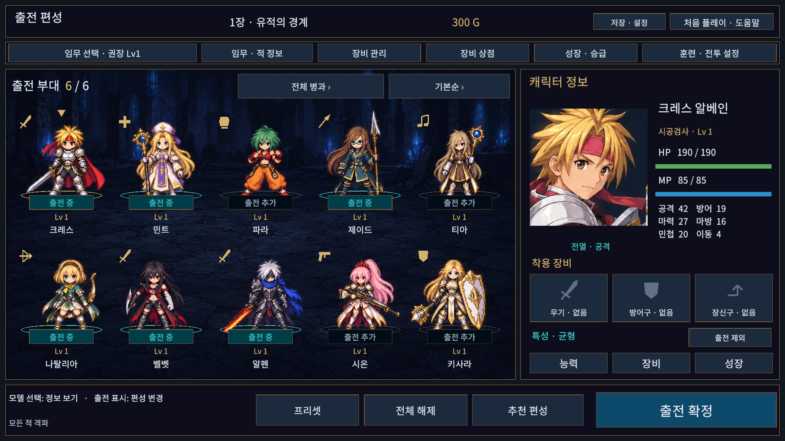
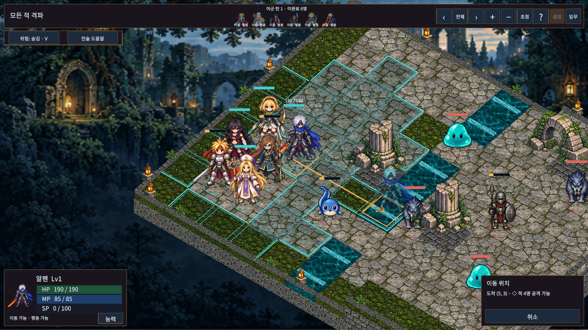
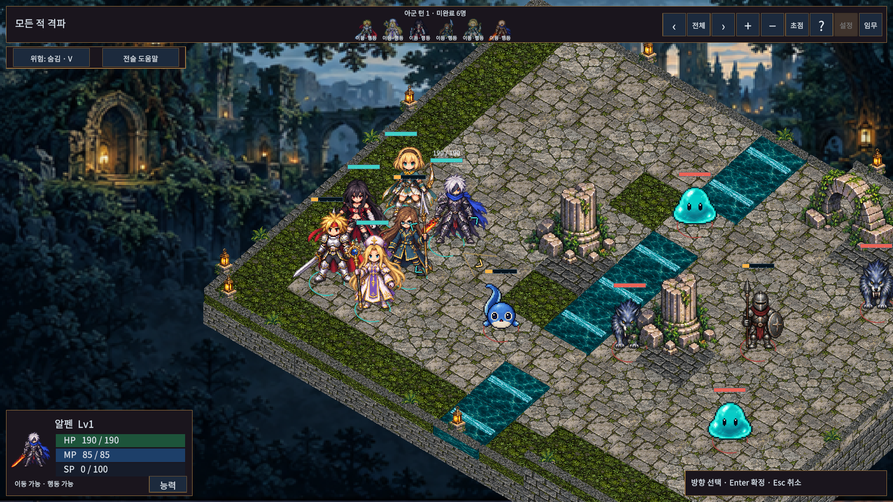

# 캐릭터 크기와 전투 표시 개선

## 변경

- 편성·장비 전신 모델은 무기를 포함한 이미지의 가로세로 비율에 맞춰 축소하던 방식에서 공통 몸체 높이와 발 기준으로 변경했다. 현재 아트의 제이드 창 끝과 민트 지팡이/모자 여백을 보정한다. 알펜의 넓은 검 때문에 몸체가 작아지지 않는다. 원본 이미지와 전투 판정은 변경하지 않는다.
- 전투는 `Body Scale` 부모에 캐릭터별 보정을 적용한다. `CharacterMotion`의 보행/공격/피격 변형을 덮어쓰지 않고, 적의 의도된 크기는 유지한다.
- HP는 화면을 향하는 고정 너비 막대로 표시한다. 어두운 최대 HP 배경, 왼쪽 기준 잔여 HP, 25% 눈금, 0.3초 유지 후 감소하는 피해 잔상, 25% 이하 황색 강조가 있다. 숫자는 선택 또는 마우스/턴 목록 호버 때 표시한다. 창 높이에 따라 크기를 제한하고 사망·모달·스토리에서는 숨긴다.
- 이동은 옅은 타일 색, 범위 외곽선, 가는 경로와 끝 화살촉, 반투명 도착 모델을 사용한다. 위험 도착지는 황색으로 구분한다. 취소/상태 전환 시 표시를 지운다.
- 상시 흰색 방향 블록은 제거했다. 진영별 얇은 발밑 링과 선택 테두리를 사용한다. 대기/방어 시 4방향 화살표를 실제 전장 방향으로 투영하며, 마우스 호버로 미리 보고 클릭으로 확정한다. 방향키는 화면 방향 기준 미리보기, Enter 확정, Esc 취소다. 미리보기는 실제 전투 방향을 바꾸지 않는다.
- 알펜 검술의 연계 플래그만으로 기술 버튼을 활성화하지 않는다. 해금/HP/MP/재사용 대기 등 `SkillResolver.CanUse`를 통과하는 Flaming Edge가 있어야 ‘연계 기술’ 버튼과 단축키가 열린다. 상단 행동 상태도 같은 자원 조건을 반영한다. 연계 해금 레벨과 전투 규칙 자체는 유지한다.
- Windows 창 테두리 드래그와 최대화/복원을 켰다. 크기 변경이 안정된 뒤 설정을 저장하고, 최대화 이전 창 크기와 최대화 여부를 구분해 다음 실행에 복원한다. 전체 화면은 별도 설정이다. 해상도 프리셋을 고르면 최대화 기억을 해제한다. 설정 파일 버전은 1을 유지하며 기존 파일의 새 필드는 false로 읽는다.

## 검증

- Unity 6000.6.0f1 실제 EditMode **202/202**, 전체 PlayMode **116/116** 통과. 마지막 이동 취소 버튼 높이/흰색 방향 표식 정리 후 관련 PlayMode **1/1** 추가 통과했다. 전체 PlayMode는 이 마지막 표시 조정 전에 실행했다.
- Runtime/Editor/EditMode/PlayMode의 실제 Unity API 참조 컴파일 경고/오류 0건. ManagedChecks는 이번에 실행하지 않았다.
- 1024×768 / 1920×1080 / 2560×1080 × 글자100/130% × 편성/장비/HP/이동/방향 **30조합**에서 텍스트 넘침·화면 밖 버튼/HP바 0건. 초기 이동 취소 글자 넘침을 수정하고 해당 화면을 재검사했다.
- 일반 Windows 빌드 **28.842초**, 개발 검수 빌드 **26.144초** 성공. 각각 오류0/기존 외부 패키지 안내 경고3건(Pipeline 런타임 미설정, URP 디버그 셰이더 stripping)이다.
- Windows 실제 제목 표시줄 최대화/복원, 테두리 가로·세로 드래그로 1280×800→1100×720 변경 및 재실행 복원을 확인했다. 최대화 상태에서도 재실행해 최대화로 열리고 복원하면1100×720로 돌아오는 것을 확인했다. 총3개 프로세스에서 오류0건이며 사용자 저장/백업/설정5개 SHA256은 모두 불변이다. 네이티브 창 검수는 동일 코드의 개발 빌드와 별도 저장 경로를 사용했다. 상세는 `window-review.json`에 기록한다.

## 실제 적용 화면

Unity Game View에서 캡처한 실제 화면이다. 전투 화면은 ‘현재 유닛 보기’ 카메라로 촬영했다.

재현 도구: `Tools/ReviewBattleVisualPolish.ps1` (열린 TestBattle Play Mode, 별도 임시 저장).

## 범위

카메라 거리 때문에 모델 자체가 작아지는 경우는 기존 확대/현재 유닛 보기로 조절한다. 광학 보정은 현재 영웅 아트 기준이며 향후 새로운 스프라이트를 교체하면 몸체 기준을 다시 점검해야 한다. 이동·공격 범위, 피해 공식, 맵 크기, 경험치와 기존 캠페인 저장 데이터는 변경하지 않는다.
