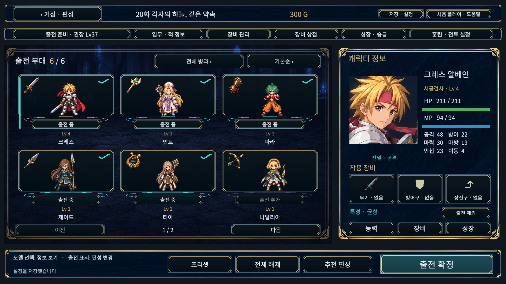
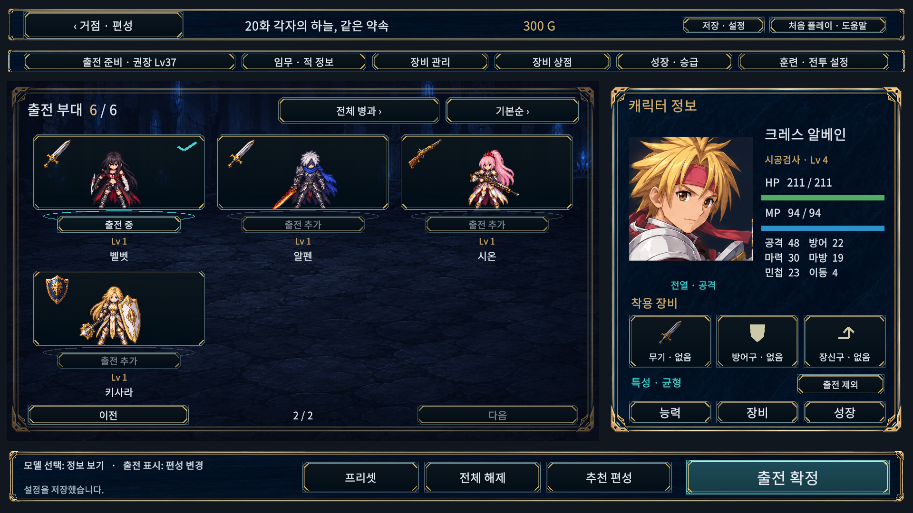

# 직업 아이콘 실제 적용

2026-10-15. 승인한 검사·치유·격투·창술·음유·궁술·사격·수호 8종을 투명 장비 일러스트로 적용했다. 편성 카드 왼쪽 위에 얼굴과 겹치지 않게 배치하고 성장·승급 및 고유 그림이 없는 무기 슬롯에도 연결했다. 6명 페이지, 미합류 숨김, 캐릭터 선택과 출전 변경 동작은 유지한다.

## 실제 Windows 캡처

[1024×768 첫 페이지](PlayerCaptures/formation-six-1024.png) · [1024×768 두 번째 페이지](PlayerCaptures/formation-next-1024.png) · [성장·승급](PlayerCaptures/growth-six-1920.png). 1024 캡처는 글자 크기130%, 1920 캡처는100%다. 모두 실제 Windows 검수 실행본의 엔진 캡처이며 시안 합성 이미지가 아니다. 검수용 저장에서 동료를 합류시켰으며 사용자 저장은 사용하지 않았다.

## 검증

- 실제 Unity6000.6.0f1 그래픽 PlayMode 관련6/6 통과(20.39초): 편성 선택/변경/6명 제한, 정렬·필터·초상화 일치, 장비·모달, 성장·승급, 전체 캐릭터 상태창, 미합류 숨김·페이지 전환. 이번 작업에서 전체 EditMode/PlayMode를 재실행한 것은 아니다.
- Windows 검수44화면×5해상도×글자100/115/130%=660/660 통과. 1280×720, 1024×768, 1920×1080, 2560×1080, 1080×1440에서 텍스트·프레임 경계·카드 경계·클릭 경로와 신규 아이콘 로드/크기/비율 보존 영역/입력 차단 여부를 검사했다. 검사 문제0·수집 게임 오류0.
- 원화 전체 alpha0 픽셀70.39%, 8개 표시 영역 가장자리 alpha 최대1/255. 투명 원화가 잘리지 않으며 인접 그림이 섞이지 않는 영역을 사용했다. 6인 및 나머지4인 페이지, 작은 화면, 성장 화면을 육안 검토했다.
- Windows 검수 빌드66.77초/오류0/경고3, 일반 빌드29.58초/오류0/경고1. 일반 DLL에 검수 타입이 없고 새 ClassArt 메서드가 포함됨을 Mono.Cecil로 확인했다.
- 별도 API 참조4개 컴파일 통과. Unity 테스트 수에 합산하지 않는다. 검증 프로젝트와 작업 소스 C#277파일 및 원화 SHA256 일치.
- 일반 실행본34.46초 시작 유지·실행 오류0. 사용자 저장/설정8파일 SHA256 불변이며 기존 실행 중인 플레이어도 유지했다.

원시 테스트 XML·화면 보고서·빌드/실행 로그·저장 보존 결과는 [Evidence](Evidence)에 있다. 기존 URP 효과 셰이더 제거 안내와 Editor 초기화/종료 진단은 해당 로그에 남긴다. 다른 PC/DPI·물리 게임패드·전체 캠페인 수동 완주 검증은 아니다.

일반 실행본: `D:/TalesTacticsHelpGuide/Builds/ClassIconsWindows/TalesTactics.exe`. 같은 폴더의 데이터/DLL이 함께 필요하다. 새 실행본을 별도 폴더에 만들었으며 기존 실행 중인 게임은 종료하지 않았다. 공개 릴리즈를 배포한 것은 아니다.

재현: `TalesTactics.Editor.UiSafeLayoutBuild.ClassIcons`로 검수/일반 빌드를 만들고, 검수 실행본에 `--ui-safe-layout-review <32자리 GUID>`를 전달한다. 원화 경로·도구 모드·최종 프롬프트는 [ART.md](ART.md)에 기록했다.
