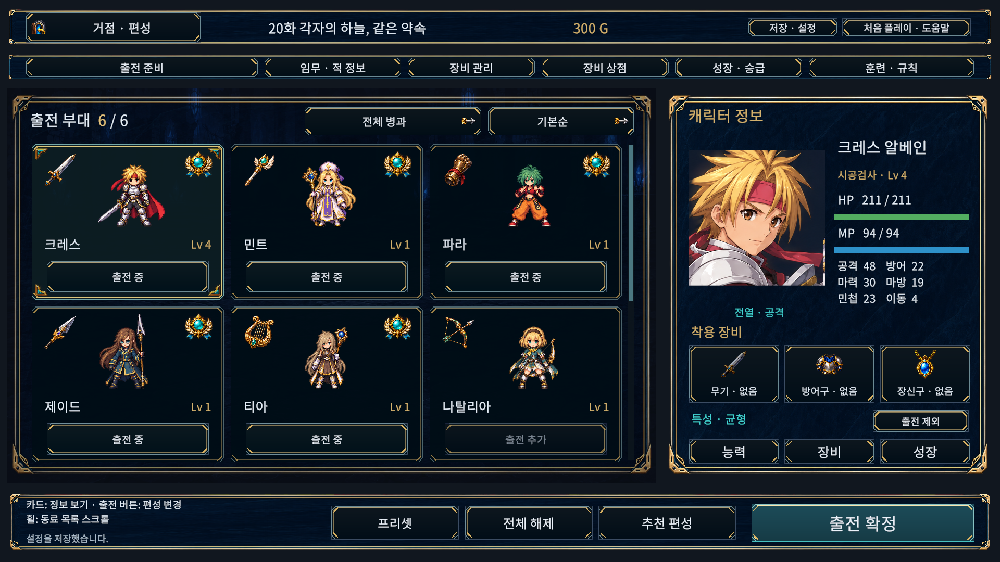
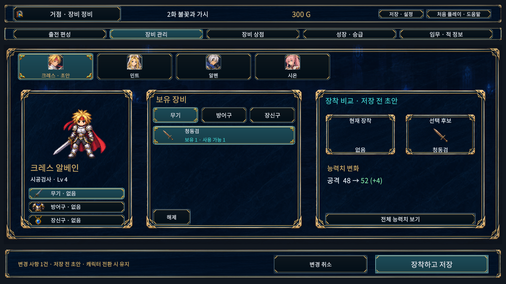
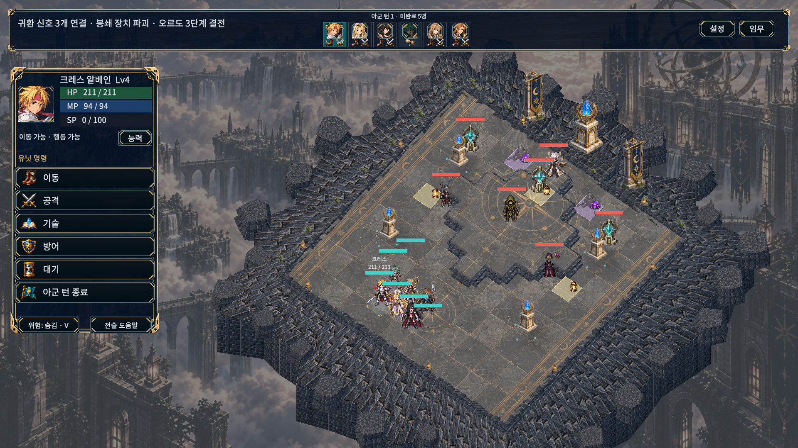

# 편성 스크롤·장비 비교·전장 가독성 적용 — 2026-10-15

사용자가 승인한 비교 시안을 기존 Unity UI에 적용했다. 편성의 페이지 이동은 후속 요청에 따라 **마우스 휠로 아래로 이동하는 세로 스크롤**로 바꿨다. 이미지 시안에 있던 새 지형·광원을 그대로 재현한 것은 아니며, 기존 게임의 맵·아트·논리 좌표를 사용한다.

## 편성

- 합류 동료 전체를 3열로 배치하고 오른쪽 스크롤바와 마우스 휠로 탐색한다. 최대 출전 인원은 6명이다.
- 카드 안에 이름·레벨·출전 상태를 배치한다. 모델 클릭은 조회, 출전 버튼은 추가/제외이며 두 동작을 구분한다.
- 동료 조회·출전 변경·정비 메뉴 왕복에서도 보던 위치를 유지한다. 필터·정렬 변경은 목록 처음으로 돌아간다.
- 키보드·패드로 목록 밖 동료를 선택하면 해당 카드가 보이도록 스크롤한다. 마우스로 목록을 내린 뒤 잘린 버튼에 키보드 선택이 남지 않도록 한다.

## 장비·상점

현재 장비와 변경 초안, 장비 이미지, 변경 능력치와 사용 가능 수량을 함께 표시한다. 좁은 화면은 캐릭터 모델을 요약하고 재고와 비교 영역을 유지한다. 전체 능력치 비교도 열 수 있다.

캐릭터·정비 메뉴 전환 중 초안을 보존하며, **변경 취소**는 현재 캐릭터에만 적용한다. **장착하고 저장**을 누를 때 공유 수량을 다시 검사한다. 수량 부족·저장 실패 때 초안을 유지한다. 초안은 메모리에서 관리하므로 저장 슬롯 교체·훈련 모드 변경·재실행 후에는 보존하지 않는다.

상점 비교는 합류한 호환 캐릭터만 표시한다. **구매 · 바로 장착**은 비교 대상에게 장비 1개를 구매·장착하고 한 번 저장한다. 실패·예외 시 장비·재고·골드를 모두 복구하며, 다른 슬롯의 미적용 초안을 함께 확정하지 않는다. 구매만 하기와 기존 보유 장비 장착도 유지한다.

## 전투

캐릭터 요약·명령·위협 범위 조작을 왼쪽 공통 패널에 모았다. 기술·대상 선택 중에는 해당 정보로 전환한다. 예측에는 실제 대상 수·격파 예상·아군 HP 감소·적 반응 공격을 요약하고 상세 조회를 제공한다. 별도 공격 확정 단계나 새로운 전투 규칙은 추가하지 않았다.

카메라 기본 각도와 전장 중심을 조정하고 장식 외벽 깊이·원경 대비·바닥 미세 명암을 낮췄다. 겹침 회피로 이동한 HP바에는 원래 위치까지 연결선을 표시한다. 기존 일러스트 아이콘과 아군 6명 상태 표시를 유지한다.

현재 메인·개인 캠페인에 효과 없는 구 임무 변형 설정을 숨겼다. 패드 방향 입력은 생성 순서 대신 화면상의 버튼 위치를 기준으로 이동한다.

## 검증과 실제 화면

일반 실행본: `D:/TalesTacticsHelpGuide/Builds/CommercialUxWindows/TalesTactics.exe`. 검증은 `C:/dev/TalesTactics`의 변경 소스36개를 일치시킨 `D:/TalesTacticsHelpGuide`에서 Unity6000.6.0f1로 수행했다. 기존 사용자 게임은 종료하지 않았다.

### 실제 실행 캡처

아래7장은 그래픽 Unity Editor Game View에서 저장한 PNG를 수정 없이 복사했다. 생성 시안이나 Windows 화면이라고 표시하지 않는다. 1920×1080은 글자100%, 1024×768은 글자130%다. 여러 합류·장비 상태를 만든 격리 검수 데이터이며, 실제 저장에서는 합류한 동료만 표시한다.

| 화면 | 확인 내용 |
|---|---|
| [편성 상단](Actual/formation-six-1920.png) | 최대6명 출전, 3열 카드, 카드 내부 이름·레벨·출전 버튼 |
| [편성 하단 스크롤](Actual/formation-scrolled-1920.png) | 페이지 전환 없이 뒤쪽 동료 탐색 |
| [장비 변경 초안](Actual/equipment-draft-1920.png) | 현재/후보 장비·능력치 비교, 저장/취소 |
| [전투 명령](Actual/battle-done-1920.png) | 상태·명령·위협 조작 통합, 상단6명, 원경 대비 |
| [작은 화면의 예측](Actual/battle-forecast-1024.png) | 대상·격파·아군 피해·적 반응 요약, 취소 아이콘 |
| [작은 화면의 기술](Actual/skills-1024.png) | 기술 이름·비용·거리와 상세 조회 |
| [다중 능력치 상점 비교](Actual/purchase-multiple-stats-1920.png) | 능력치4종의 증가/감소를2×2로 표시 |

### 테스트와 화면 검사

| 검증 | 결과 | 범위 |
|---|---|---|
| 실제 Unity EditMode 전체 | 358/358, 13.28초 | 전투 예측 집계 포함 |
| 실제 그래픽 PlayMode 전체 | 173/173, 371.23초 | 편성·장비 초안·거래·전투·입력 회귀 |
| 이후 편성 수정 | 8/8, 18.71초 | 실제 입력 모듈 휠 감도, 위치 보존, 화살표/Tab/패드 노출 |
| 이후 예측/상점 배치 | 2/2, 6.20초 | 닫기 아이콘 여백, 여러 능력치 비교 |
| 이후 요약/기술 패널 | 최초2/3, 실패 수정 후1/1 | CJK 거리 행 높이를 수정해 재통과, 최종 재검사4.86초 |
| 최종 Editor UI 행렬 | 795/795, 문제0·수집 게임 오류0 | 53화면×5해상도×3글자 크기 |
| 최종 Windows 실제 창 | 159/159, 문제0·수집 게임 오류0 | 실제604×1181 창, 53화면×3글자 크기 |
| Windows 일반/검수 빌드 | 모두 성공, 오류0 | 일반27.79초·경고1, 검수51.41초·경고3 |
| 일반 실행 시작 | 41.23초 유지, 오류0 | 일반 DLL 검수 코드 제외도 확인 |

Editor 해상도는1280×720,1024×768,1920×1080,2560×1080,1080×1440이며 글자 크기는100/115/130%다. TMP 넘침·누락 글자, 프레임 안쪽 경계, 클릭 경로, 스크롤 마스크와 카드 내부 배치, 예측 취소 버튼 여백을 검사했다. 전체 PlayMode 통과 이후 세부 배치와 테스트가 추가되었으므로 최종 단일 전체175/175 실행이라고 표현하지 않는다. 엔진 API 참조4개 컴파일도 별도 통과했으나 Unity 테스트 횟수에 합산하지 않는다.

별도 격리 검수 플레이어에서 Windows 입력으로 마우스 휠을 내리고, 스크롤한 카드의 조회 영역을 선택했을 때 알펜 정보로 바뀌면서 목록 위치와 출전6/6이 유지되는 것을 네이티브 창으로 확인했다. F12는 디스크 캡처를 생성하지 않아 이 검사는 관찰 기록만 남긴다. 위 이미지7장은 별도 성공한 Editor 화면 검사에서 얻은 것이다.

사용자 저장/설정8파일은 작업 전후 SHA256이 같고, 기존 게임 프로세스도 유지했다. 검수 캠페인은 격리 저장 경로를 사용했다. [검증 파일](../Evidence/CommercialUx/)에 XML, 화면별 결과, 빌드 결과, 소스/저장/캡처 해시를 보관했다.

### 발견 후 수정한 문제와 한계

- 최초 전체 PlayMode는170/172였다. 장비 헤더의 오래된 고정 문구 기대값과 D-pad 테스트의 초점 초기화를 수정하고 관련7/7, 이어 전체173/173을 통과했다.
- 최초 Windows 행렬780건은 요청 해상도와 실제 너비604가 달라 해상도 불일치를 기록했다. 이 결과를 통과로 사용하지 않았다. 별도로 발견한 예측 취소 버튼의 여백 문제도 수정했다.
- 최초 고정 Editor 행렬은780건 중771건 통과, 상점 비교의 장비 이름 넘침9건이었다. 여백을 수정하고 능력치4종 비교 화면을 추가했다. 추가 검수 중 수호의 메달의 구 해금 플래그가 격리 데이터에 없어 중단된 회차는 검수 데이터만 보완해 재실행했다. 최종795건은 모두 통과했다.
- 작은 화면의 기술/요약 정보는 글자와 아이콘 간격을 늘렸다. 거리 행의 한글 줄 높이를 보완한 뒤 관련 실패 테스트를 재통과했다.
- 현재 원격 데스크톱의 Windows 창 크기 제한 때문에 지정5해상도는 Editor에서 검사했다. 604픽셀 창의 통과는 경계·입력 검사 결과이며, 그 폭에서 일반 데스크톱 수준의 읽기 편의성을 보장한다는 뜻은 아니다.
- Editor 시작 시 게임 오류 수집 전 Unity Search 데이터베이스 예외가 발생한 회차와 종료 시 JobTempAlloc 경고가 있었다. 플레이어의 미사용 URP 후처리 패스 셰이더 제거 경고도 남아 있다. 게임 오류와 구분하며 전체 로그는 검증 사본 `Logs`에 보관한다.
- 다른 PC/DPI, 실물 게임패드, 전 캠페인 수동 완주, 장시간 성능을 새로 검증한 것은 아니다. 원화 시안의 새 지형·광원 전체를 제작한 것도 아니다.
