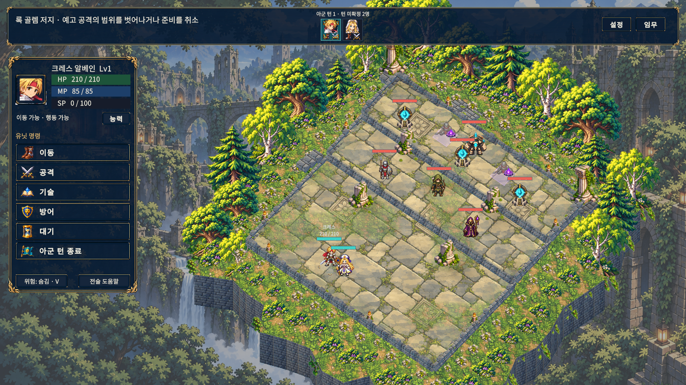
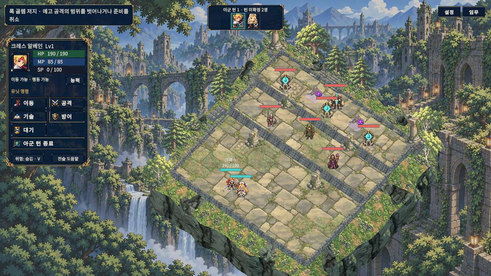
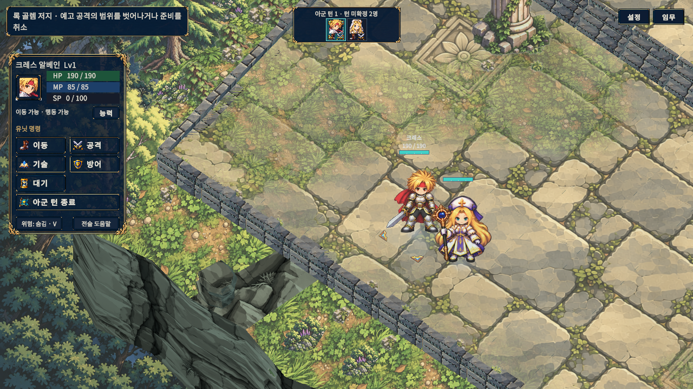
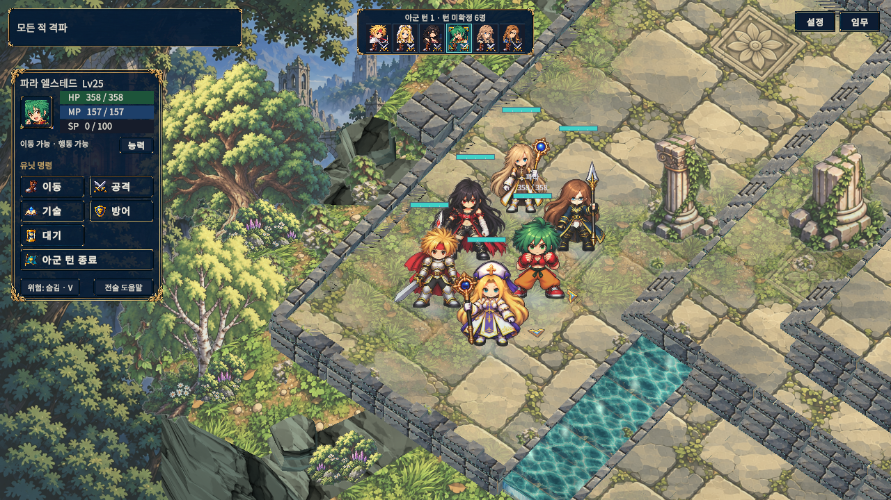

# 전장 환경 통합과 HUD 비율 개선

2026-11-01 적용 완료. 기준 커밋은 `develop`의 `0fbd0c1`이다. 캐릭터와 지형이 같은 공간에 보이도록 환경광·접지·주변 지형 표현과 전투 HUD 비율을 함께 조정했다. 아래 이미지는 새 Windows 검수 실행본의 보정하지 않은 실제 캡처다. 참고 시안의 맵 구조를 완전히 재현한 결과는 아니다.

## 유지하는 미술 방향

1. **화풍:** [기존 SD 미술 방향](../SdArtDirection/README.md)의 짙은 외곽선, 또렷한 인물 실루엣, 애니메이션풍 색면과 석조·식생 배경을 이어간다. 이번 작업에서 캐릭터 시트를 다시 그리지 않는다.
2. **팔레트:** HUD 네이비 `#0D1D30`, 본문 아이보리 `#F6F4E8`, 테두리 황동 `#D8B775`, 선택 청록 `#1B4F57`, 숲의 접지 그림자 `#172429`, 차가운 반사광 `#C7DED9`, 보조 강조 청록 `#79DCD4`. 앞의 UI 색은 `SdUiTheme`, 환경 색은 `BattleEnvironmentPalette`의 기존/이번 선택을 요약한 값이며 전역 색상 치환 지시가 아니다.
3. **빛의 분위기:** 상단의 은은한 따뜻한 빛과 발밑의 차가운 반사광을 캐릭터·식생·지면에 함께 사용한다. 사막과 차가운 실내 계열은 장별 색조를 유지하고, 행동 종료의 저채도 표시 및 HP/MP의 의미 색은 별도로 보존한다.

## 현재 구현

| 영역 | 변경 내용 | 유지하는 계약 |
|---|---|---|
| 캐릭터와 환경광 | 장별 밝은 면·반사광·수목 음영을 지면과 배우에 공유하고, 배우의 발 위치에서 같은 지면 음영을 조회한다. | 캐릭터 정체성, 기존 모션 프레임과 방향, 전용 무기, 행동 종료 표시 |
| 접지 | 넓은 부드러운 그림자와 짙은 발 접촉 그림자를 함께 표시한다. 이동·들림에 맞춰 위치·크기·농도를 갱신한다. | 실제 격자 위치·고도·충돌·이동 경로 |
| 공간 구성 | 외곽의 연속적인 나무 울타리와 꽃띠를 끊어 수목 군집, 열린 구간, 바위 노출을 만든다. 실제 고저차에 벽면·돌 테두리·얕은 계단 표현을 붙인다. | 맵의 타일·높이·이동 가능 여부·오브젝트 판정; 장식에는 새 이동 경로나 충돌을 부여하지 않음 |
| 색과 거리감 | 지형·식생·배경의 채도와 대비를 조절하고 장별 환경광을 일치시킨다. | 기존 지형/배경 원화와 장 테마; 전경과 배우를 동일한 평면색으로 덮지 않음 |
| 상단 HUD | 화면 전체 띠를 목표 카드, 최대 6인의 턴 카드, 설정·임무 버튼으로 분리한다. 빈 구간은 전장 입력을 가로막지 않는다. | 목표 문구, 자유 순서 아군 선택, 행동 가능 표시, 임무·적 조회와 설정 진입 |
| 왼쪽 HUD | 기본 명령은 2열, 아군 턴 종료는 전체 폭으로 배치한다. 기본 도크 높이는 572→438 논리 px, 너비는 일반 화면 316→288 / 작은 화면 364→316으로 줄인다. | 이름·초상화·HP/MP/SP·행동 여부·능력 창·튜토리얼과 기존 단축키/컨트롤러 바인딩 |
| 읽기 공간 | 기술·예측·행동 실행은 기존 316/364 논리 px 폭을 유지한다. 상단 제외 영역은 124→116 논리 px로 줄인다. | 긴 기술 설명·MP·예측 정보·텍스트 배율·작은 화면의 기존 안전 여백 |

표의 px는 Canvas 논리 좌표이며 실제 캡처 픽셀 크기와 같지 않다. 유닛·기술·AI·피해·RNG·보상·저장·필수 이야기 흐름은 이번 표현 변경의 대상이 아니다. 특히 실제 타일의 높이나 연결 관계를 새로 설계한 맵으로 해석하면 안 된다.

## 실제 변경 화면

이전 1920×1080 캠페인 캡처와 현재 1280×720 검수 캡처는 해상도와 카메라 조건이 다르다. 동일 픽셀 A/B나 성능 비교로 해석하지 않는다. [이전 출처](Evidence/before-manifest.json), [현재 원본 경로·SHA](Evidence/actual-capture-manifest.json).

이전 전장:

현재 전장:

현재 캐릭터 근접과 6인 배치:

## 최종 검증

- 실제 Unity 전체 **EditMode 437/437 (12.75초)**, **PlayMode 255/255 (630.07초)**, 실패·건너뜀·미결정 0. [EditMode 원문](Validation/editmode-final.json), [PlayMode 원문](Validation/playmode-final.json).
- Editor **52/52**, UI/배치 issues 0, 오류 0, 종료 0 및 `runInBackground=false` 복원. [캡처 검사 원문](Validation/editor-captures-final.json), [종료 확인](Validation/editor-exit-final.json).
- 일반/REVIEW Windows 빌드 모두 성공. [일반 BuildReport](Validation/windows-normal-build.txt), [REVIEW BuildReport](Validation/windows-review-build.txt). 일반 경고4건은 Pipeline 설정·기존 DEVELOPMENT_BUILD 안내·URP 내부 디버그 셰이더2건, 검수 경고6건은 Pipeline 설정·기존 검수기의 obsolete API4건·DEVELOPMENT_BUILD 안내다. 새 표현 코드의 컴파일 오류는 없으며 경고를 0으로 표시하지 않는다. 새 산출물은 D 드라이브의 전용 폴더에 저장했다.
- Windows **52/52 실제 PNG**, errors/issues 0, 정상 종료 0, 강제 종료 없음. 1/11/16/20화 시작과 6인 훈련에서 0/90/180°·실제 합법 이동·피격 포즈·명령/기술 목록을 1280×720·1024×768로 확인했다. [원문](Validation/windows-captures-final.json), [외부 실행 검증](Validation/windows-summary.json).
- 일반 DLL에 Review/Fixture·Editor/테스트 타입/참조와 REVIEW 저장 진입 호출이 없음을 메타데이터/IL로 확인했다. REVIEW에는 최초 저장 로드 전 격리 진입과 환경 검수 실행기가 존재한다. [타입 분리](Validation/windows-type-isolation.json). 이 결과는 일반 실행본의 실제 플레이를 별도로 수행했다는 의미가 아니다.
- Windows 실행 전후 전체 사용자 저장 트리의 파일 SHA·디렉터리가 같고, fixture 캠페인도 그대로였다. 사용자 파일 복원이나 삭제는 하지 않았다. [재현용 실행 검사](Validation/Validate-EnvironmentWindows.ps1).

지형 회귀는 전체 캠페인 맵을 반복 생성하며 타일 데이터·RNG·충돌·배칭을 검사한다. 5개 접지 회귀는 이동/4방향, 들림과 그림자, 행동 종료 명암, 테마와 그늘, 재생성 정리를 검사한다. HUD 회귀는 최대 6인·130% 글자와 빈 헤더 영역의 전장 입력을 검사한다. 민간인의 구조·호위·그림자 수명도 기존 회귀에 포함했다.

## 시각 검토와 남은 차이

표준 전장·인물 근접·6인 및 작은 기술 목록 화면을 직접 검토했다. 추가로 Editor의 협곡/후반 전장·이동·180° 회전 표본을 확인했다. 명백한 부유, 얼굴/의상 색 붕괴, 새 장식으로 인한 선택 인물 가림이나 표본 UI의 잘림을 발견하지 못했다. 자동 통과만으로 모든 PNG·모션·장비를 육안 승인한 것은 아니다.

Palette discipline: 4/5 — 남색·청록 HUD와 장별 조명, 식생·바위 채도를 통일했다.

Style uniformity: 3/5 — 배우의 셀 표현과 배경 붓질 차이는 남지만 공통 환경광과 접지로 분리를 줄였다.

Lighting depth: 3/5 — 따뜻한 윗빛·차가운 반사광·수목 그늘·발 접촉 그림자를 함께 사용한다.

Silhouette: 4/5 — 표준/근접 화면에서 캐릭터와 무기가 구분된다. 6인 밀집 시 일부 발은 서로 가려진다.

UI intentionality: 4/5 — 상단 카드를 나누고 명령 도크를 줄여 전장과 입력 공간을 확보했다.

Feedback visibility: 3/5 — 선택·명령/기술 목록과 실제 이동이 읽힌다. 이번 52장은 기술 타격 전수나 전투 판정 검수가 아니다.

이 점수는 위 대표 프레임의 자체 시각 평가이며 상용 품질 인증이나 프레임률 측정이 아니다. [현재 재질·UI·글꼴·파티클 색 스캔](Validation/visual-palette-scan.json)을 육안 검사와 별도로 보존한다. 흰 tint로 원본 일러스트 색을 유지하는 이미지는 기본 흰색 UI와 구분한다. 실제 스캔은 renderer361개·공유재질12개·TMP18개·Image29개에서 기본 재질/기본 글꼴/흰 무스프라이트 UI 후보0이었다. 중성 공유재질4개는 선택 범위 선, 정점색 접촉 그림자, 원화 텍스처를 사용하는 식생, sprite가 없는 비표시 필드 아이콘으로 확인했다. 파티클0인 순간의 검사이므로 VFX 전체 팔레트를 검수했다고 세지 않는다. 첫 성공 화면 뒤에도 녹지 외벽을 회녹색 바위로 바꾸고 나무/꽃띠 사이 바위 노출을 추가했으며 민간인 접지도 통합했다.

큰 직사각형 플랫폼과 평행 단차, 반복 바닥/물결 문양, 20화의 규칙적인 외벽은 남아 있다. 이번 변경은 기존 격자 연결·전투 규칙·Content·캐릭터 시트를 유지한 표현 개선이다. 새로운 비정형 맵 설계, 모든 장/포즈/해상도·장시간 성능·자연 성장 캠페인 완주를 완료했다고 주장하지 않는다.

## 실패 이력과 파일 보존

첫 Windows 외부 검사는 11화의 활성 아군을 6명으로 잘못 기대해 실패했다. 실제 기존 분할 전선은 활성3/대기3이며, 게임 코드가 아닌 외부 기대값을 수정했다. 두 번째 숨김 실행은 수치 검사가 통과했으나 PNG를 직접 열어 검은 화면임을 확인해 시각 증거에서 제외했다. PNG가 단색에 가까우면 실패하도록 외부 검사를 추가하고, 보이는 검수 게임창에서 최종52장을 다시 촬영해 실제 장면을 확인했다. [두 초기 실행의 원시 출처·판정 정정](Validation/windows-initial-attempts.json).

초기 Editor 검수는 MonoBehaviour 필드 초기화에서 `MaterialPropertyBlock`을 생성해 실패했다. `Initialize`에서 생성하도록 수정했고 이후 실제 검수는 통과했다. [원본 경로/SHA와 첫 오류 요약](Validation/editor-initial-failure-summary.json).

첫 전체 PlayMode는 **253/255**였다. 버튼 간격 7.99993896px와 Color의 미세한 부동소수점 차이가 exact 비교에 걸렸다. 기존 8px 기준에 좌표 변환 허용 0.001px, 색의 각 채널에 0.00001 허용치를 적용했다. 제품의 여백이나 팔레트를 검사 통과 목적으로 바꾸지 않았다. [최초 실패 원문](Validation/playmode-attempt1.json), [민간인 표적 재검사 1/1](Validation/civilian-recheck.json). 후속 HUD 표적 실행의 0개 결과는 설치된 Test Framework의 빈 assembly 캐시였으며 통과로 세지 않았다. [0개 원문](Validation/empty-test-cache.json), [중지 상태 메모리 캐시 초기화](Validation/player-test-cache-reset.json). 패키지 파일을 수정하지 않고 최종 전체 255개를 다시 실행했다.

작업 전부터 변경돼 있던 폰트/원화 메타/CSV/ProjectSettings 및 미추적 원화·복구 자료는 이번 커밋에서 제외한다. 최종 해시 대조에서 동적 폰트와 원화 메타/설정 등은 초기 값과 같고, 생성 보고서 CSV 2개는 테스트 이후 초기 해시와 다르다. 이 두 CSV는 초기 바이트 백업 없이 HEAD로 덮어써 복원하지 않았으며 이번 커밋에서도 제외한다. [초기·현재 SHA와 제외 범위](Validation/preexisting-dirty-files.json), [이번 표현·검수 소스 SHA](Validation/source-manifest.json).

## 참고 기준

`unity:craft-game-floors`와 `unity:unity-cli`의 실제 렌더 검증 기준을 적용했다. [Unity 6000.6 MaterialPropertyBlock](https://docs.unity.com/en-us/engine/6000.6/script-reference/unityengine/materialpropertyblock), [runInBackground](https://docs.unity.com/en-us/engine/6000.6/script-reference/unityengine/application/runinbackground) 문서를 확인했다. 설치된 CLI 1.0.0-beta.13 / Pipeline 0.7.0-exp.1의 명령을 사용했으며 패키지를 추가/업데이트하지 않았다. 해당 버전에는 `set_auto_tick` 명령이 없어 GameView 포커스·실제 프레임 진행·합법 이동 완료로 재생 상태를 확인했다. 시작 시 중지 상태와 `runInBackground=false`로 되돌렸다.
