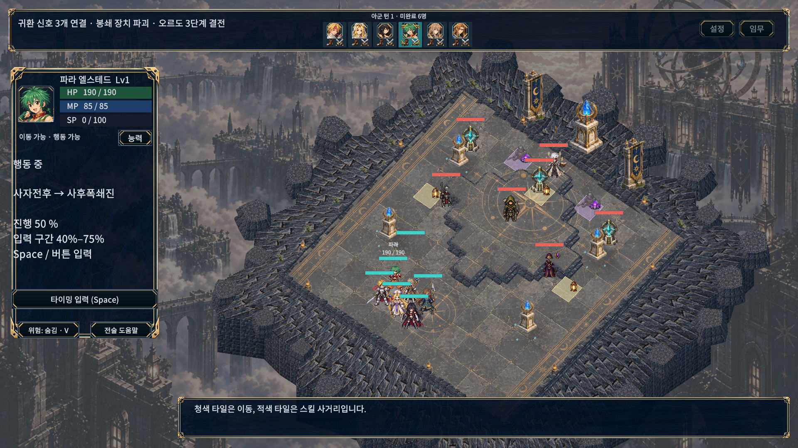
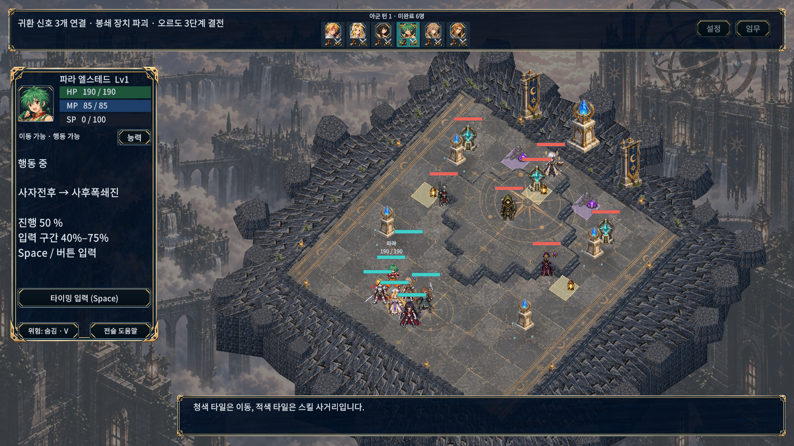
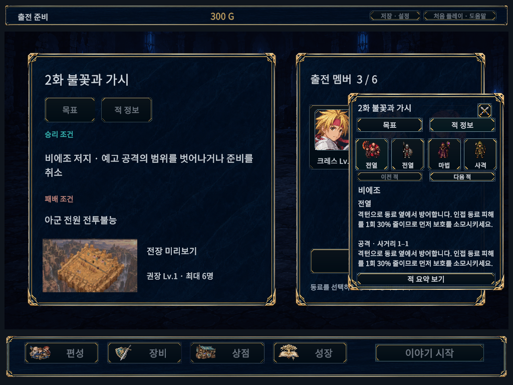
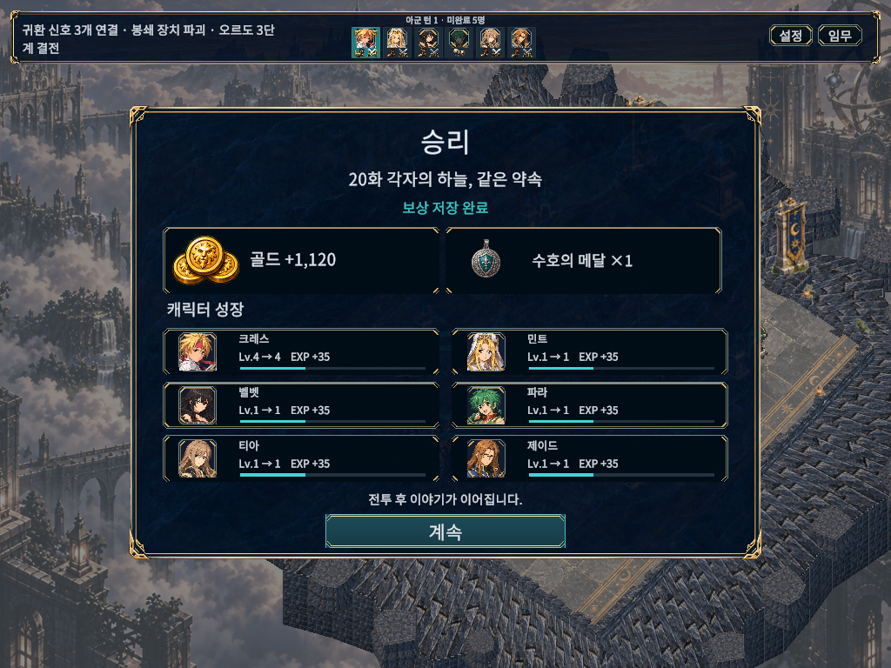
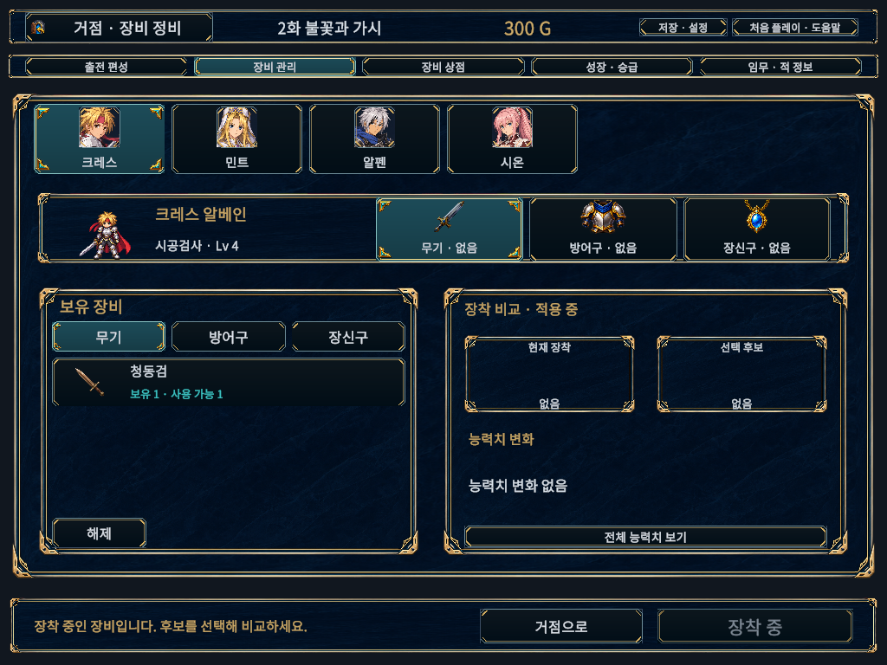
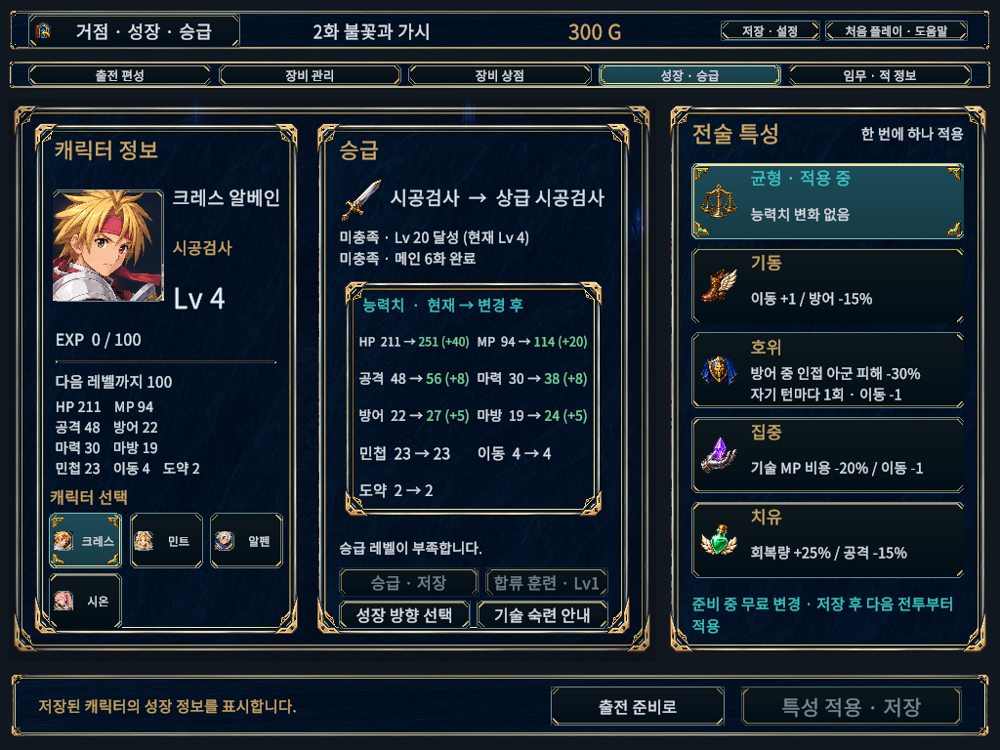
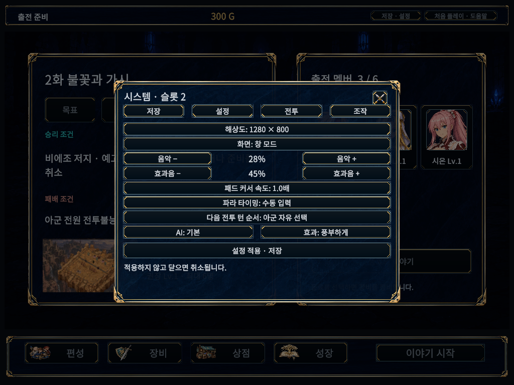
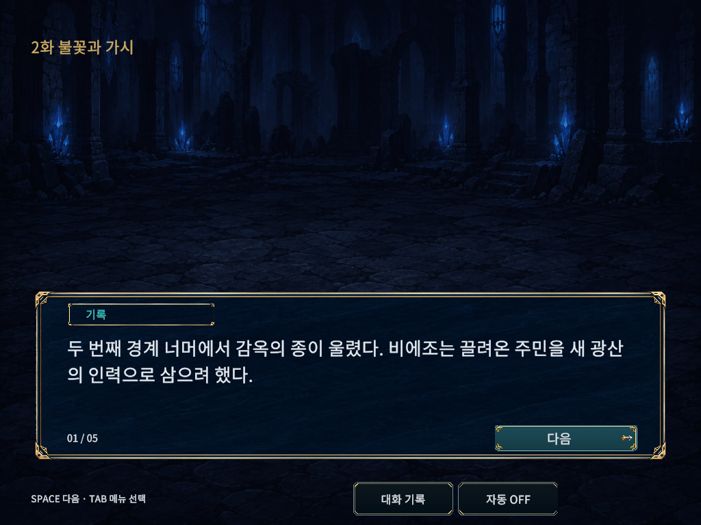
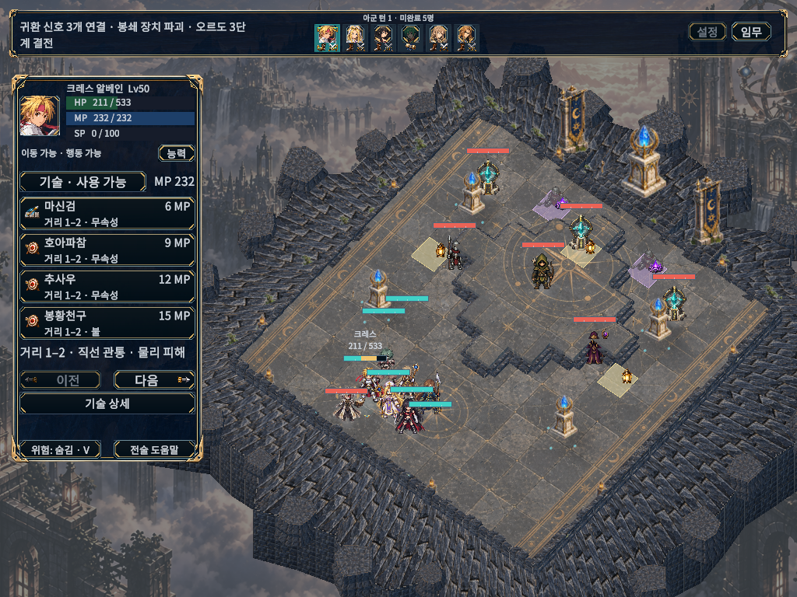
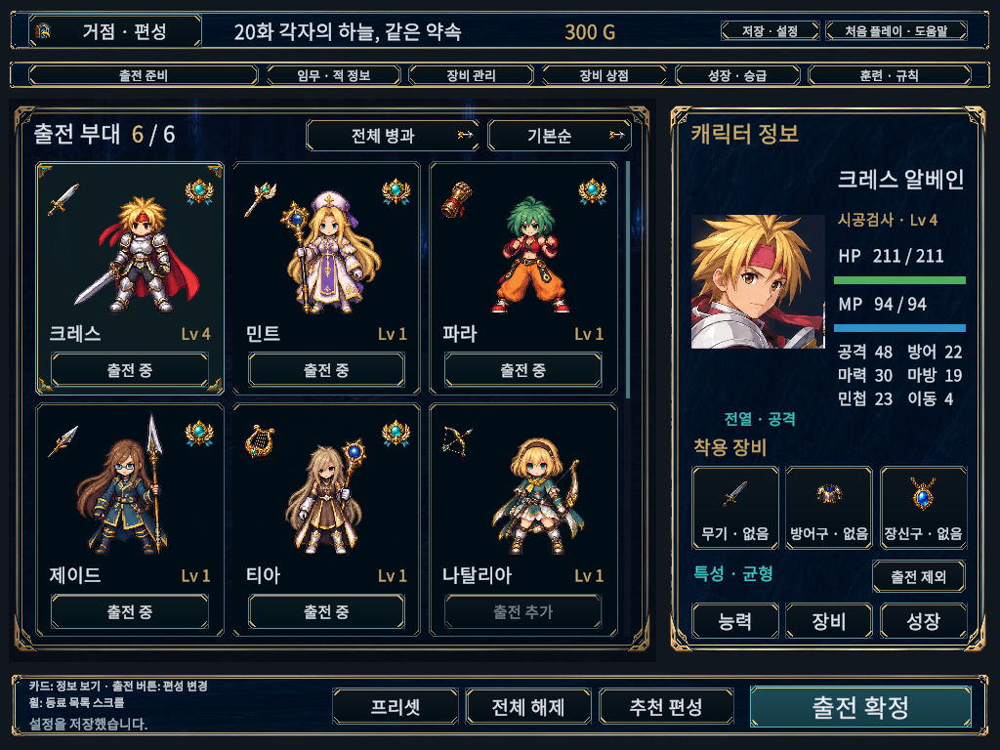

# UI 경계 최종 점검 — 2026-10-17

전투 이동·행동·타이밍 상태의 글자와 버튼, 하단 위험/도움말 버튼에 남아 있던 장식 테두리 침범을 수정했다. 공통 명령 영역에 좌우 24px 여백을 적용하고 하단 영역을 10px 늘렸다. 글자를 감추거나 기능을 삭제하지 않았다.

## 실제 Unity 화면 검사

- 71개 상태 × 5개 해상도 × 글자 배율 100/115/130% = **1,065/1,065 통과**, 게임 오류 0.
- 해상도: 1280×720, 1024×768, 1920×1080, 2560×1080, 1080×1440.
- 타이틀/슬롯/확인, 인터미션/편성/장비/상점/성장, 적 정보/상세, 저장/설정, 대화/기록, 6명 HUD/결과, 명령/이동/기술/예측/타이밍/방향, 도움말 12쪽 포함.
- 버튼 모서리와 실제 TMP 글자 영역을 검사하고 버튼 클릭 가림도 검사한다. 스크롤 항목은 화면 안에 보여야 하는 영역을 기준으로 한다.
- 공통 전투 창에만 있던 느슨한 8px 검사 기준을 실제 `FramedContent.ContentRect`로 통일했다. 강화 직후 210개 조합에서 문제가 검출되었고 수정 후 0건이다. [수정 전 원시 결과](Validation/editor-before.json), [최종 원시 결과](Validation/editor-final.json).
- 새 PlayMode 회귀 테스트 1/1 통과(15.54초): 3개 글자 배율과 명령/이동/행동/타이밍 4상태의 버튼·글자 경계 검사. [결과](Validation/tests-BattleDockKeepsCommands.json).
- API 참조 컴파일 4개 통과. 이는 Unity 테스트 수에 포함하지 않는다.

기존 추가 테스트 필터 실행은 Unity Pipeline이 0개를 선택해 유효한 재검사가 되지 않았다. 0개 결과는 통과로 세지 않는다. 이번 작업에서 전체 PlayMode/EditMode 재실행을 완료했다고 주장하지 않는다.

## 실제 캡처

아래 화면은 생성 시안이 아닌 수정된 게임의 Unity Game View 캡처다. 타이밍 화면은 1920×1080/100%, 나머지는 1024×768/130%다.

| 수정 전 | 수정 후 |
|---|---|
|  |  |

검증 범위는 위 고정 화면·해상도·배율이다. 모든 기기의 DPI/종횡비, 전체 캠페인의 모든 문장, 전장 위 유닛 라벨끼리의 겹침까지 보증하는 결과는 아니다. 전투 규칙·Content·저장 형식은 변경하지 않았다.

## Windows 실행본

- 실제 Windows 창 640×480, 71상태×3배율 = **213/213 통과**, 오류 0. [원시 결과](Validation/windows-final.json).
- 일반 빌드 Succeeded, 오류 0/경고 1. 검수 빌드 Succeeded, 오류 집계 1/경고 4: 해당 오류는 빌드 중 CLI 요청의 5초 응답 제한 초과 로그이며, 빌드는 계속되어 성공했고 실제 실행 검사도 통과했다. 원시 빌드 결과를 수정하지 않고 보존했다.
- Mono.Cecil로 일반 DLL의 검수 타입 제외와 검수 DLL 포함 확인. [결과](Validation/build-isolation.json).
- 사용자 저장/설정 8파일 SHA256 불변, 검증한 3개 소스와 develop 파일 동일. [무결성](Validation/final-integrity.json).
- 일반 실행본: `D:/TalesTacticsHelpGuide/Builds/FinalUiBoundsWindows/TalesTactics.exe`. 이번 실제 화면 검사는 별도 검수 실행본이며 일반 실행본의 수동 플레이 검수로 표현하지 않는다.
