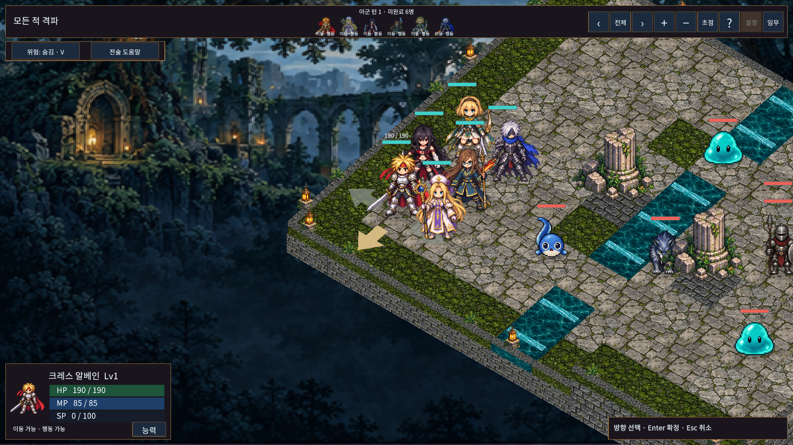
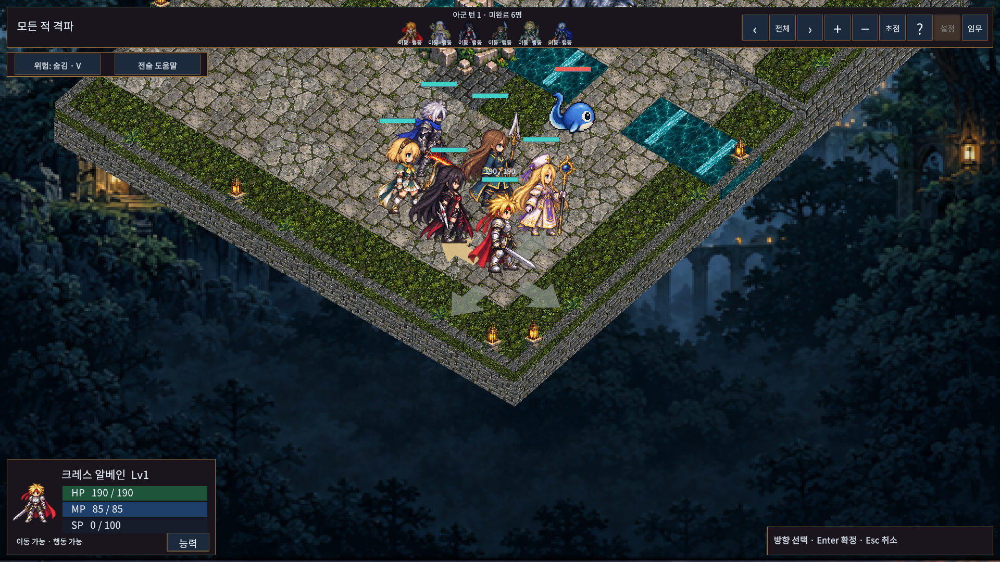

# 지면 방향 선택 — 2026-10-13

첨부한 전술 RPG 화면처럼 대기/방어 시 캐릭터 발 주변에 네 방향의 넓은 화살표를 표시한다. 화면에 떠 있던 작은 청록색 꺾쇠와 별도의 선 미리보기는 제거했다.

- 화살표는 지면과 평행한 반투명 메쉬이며 캐릭터 뒤에 그린다. 기본은 회녹색, 선택 방향은 황동색이다.
- 마우스를 올리거나 방향키를 누르면 선택 방향이 바뀐다. 클릭/Enter로 확정하며 Esc로 취소한다. 확정 전에는 실제 유닛의 방향과 행동 기록을 바꾸지 않는다.
- Canvas에는 투명한 클릭 영역만 둔다. 카메라 투영으로 지면 화살표의 위치와 범위를 따라가며, 작은 화면에는 최소 클릭 크기를 확보한다.
- 다른 상태로 이동하거나 모달을 열면 숨기고, 보드 재생성 시 메쉬를 해제한다. 기존 접지 그림자·HP·이동 경로·전투 규칙과 저장 형식은 유지한다.

## 실제 적용 화면

## 검증

- 최종 실제 Unity 전체 PlayMode **119/119, 219.91초** 통과(`playmode.json`). 카메라4방향×방향4개의 클릭16조합, 호버 미리보기와 실제 방향 분리, 회전 후 방향키/Enter/Esc, 도움말 모달/취소 시 숨김을 포함한다.
- 초기 전체117/118과 방향 관련4/5는 새 검사 코드에서 방향 선택 중 열 수 없는 시스템 메뉴를 사용하고, 취소 뒤 LateUpdate보다 먼저 숨김 여부를 읽어서 실패했다. 실제 접근 가능한 도움말과 렌더링 완료 시점으로 검사를 보정한 뒤 전체119개를 다시 통과했다. 실패 기록은 `playmode-initial.json`, `playmode-facing-initial.json`에 보존한다.
- 최종 코드의 Unity 실제 API 참조 Runtime/Editor/EditMode/PlayMode4개 어셈블리 컴파일 통과(`api-compile.txt`). 전투 규칙 변경이 없어 EditMode/ManagedChecks는 재실행하지 않았다.
- 작은 창1024×768(글자130%)·Full HD1920×1080(글자100%) × 카메라0/90/180/270도 **8조합**에서 화살표4개, 화면 밖 버튼0, 방향 버튼 중앙 레이캐스트 불일치0(`camera-matrix.json`). `wait_for`로 실제 프레임 진행을 확인한 뒤 최종 색상의 Game View PNG8장을 저장했다.
- `Tools/ReviewGroundFacing.ps1`은 별도 임시 저장 경로를 사용한다. 이번 시각 검수는 Editor Game View이며, 모든 지형/카메라 확대율/물리 모니터/DPI에서의 사람 가독성 평가를 뜻하지 않는다.
- 일반 Windows 빌드 **36.280초, 오류0**으로 성공했다(`windows-build.json`). 기존 Pipeline 런타임 미설정과 URP DebugOccluder/DebugOcclusionTest stripping 안내3건은 유지된다. 배포 어셈블리에 개발 검수 타입이 제외됨을 확인했다(`windows-assembly.json`). 이번 Windows 빌드의 독립 프로세스 플레이 검사는 실행하지 않았다.

실행본: `Builds/WindowsGroundFacing/TalesTactics.exe` (폴더 전체 필요). `develop` 개발판이며 공개 릴리즈/main 반영은 하지 않는다.
