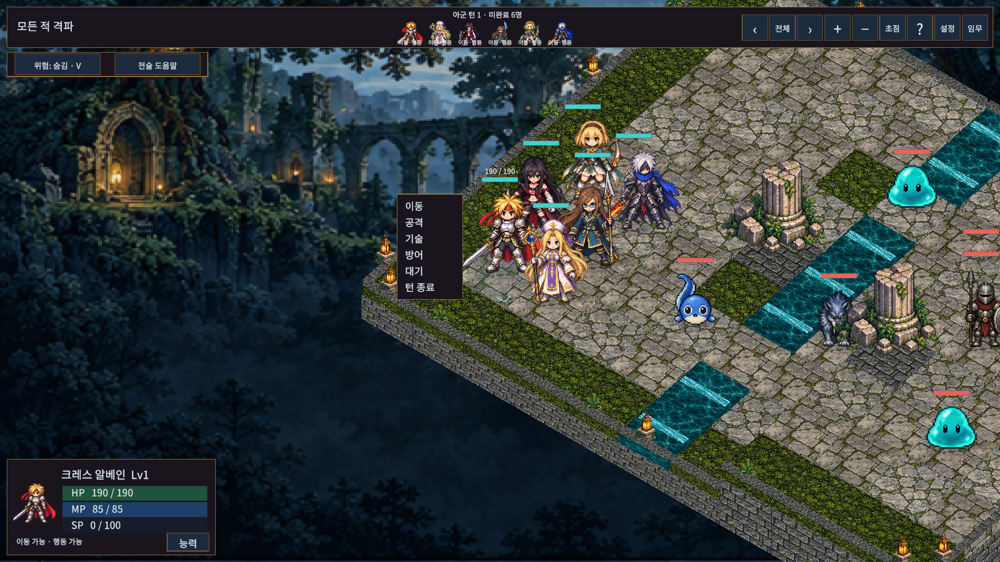
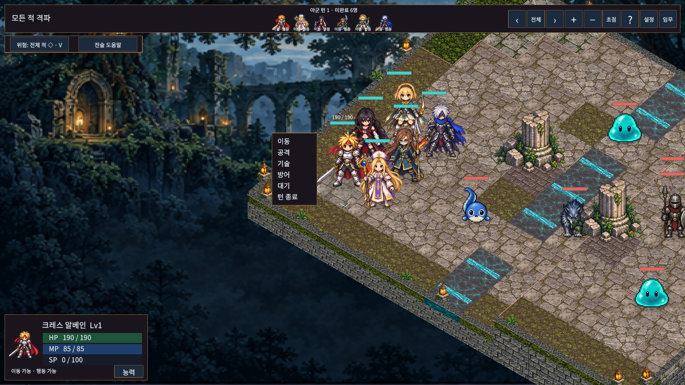
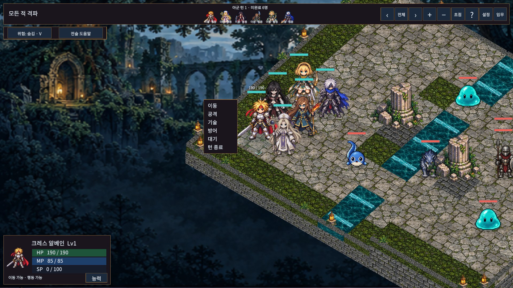
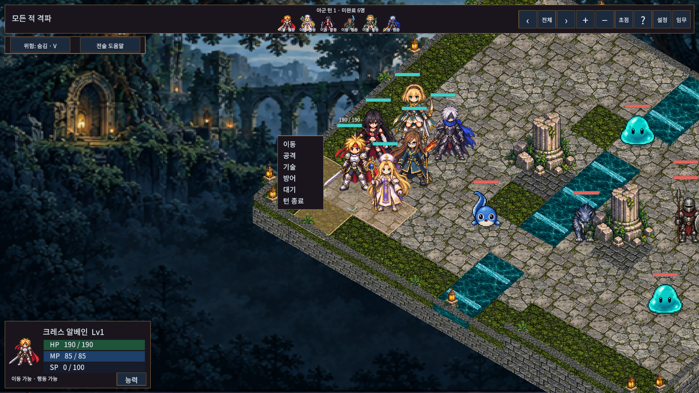

# 지면에 자연스럽게 붙는 선택·위험 표시

## 적용

- 모든 유닛의 진영별 발밑 링을 제거하고 가장자리가 투명해지는 작은 접지 그림자를 넣었다. 그림자는 이동 시 유닛을 따라가며 사망 시 숨긴다.
- 선택·조사·대상·키보드 커서는 지면과 평행한 작은 모서리 표시를 사용한다. 같은 유닛에 선택/조사/호버가 중복되지 않도록 하고, 상시 방향 표식은 제거했다. 대기/방어 중의 방향 선택 UI는 유지한다.
- 적 위험 범위는 투명도90%의 옅은 붉은 면과 얇은 외곽선이다. 같은 높이의 인접 칸 사이에는 선이 없다. 분리된 범위와 높이 차이는 각 경계가 남는다. 숨김/선택 적/전체 적 기능과 실제 위협 판정은 그대로다.
- 이미 확정된 공격 예고는 위험 범위를 꺼도 황색 면과 외곽선으로 유지한다. 사망한 적의 예고는 표시하지 않는다.
- 아군 자유 턴에서 대기 완료한 캐릭터는 채도38%·밝기84%로 표시한다. 다음 아군 페이즈에는 원래 색으로 돌아온다. 움직임·피격/시전 색상과 원본 텍스처는 유지하며, SPD/CT 모드에는 페이즈 완료 표시를 적용하지 않는다.
- 기존 HP바, 이동 경로/도착 모델, 전투 규칙, 맵, 경험치와 저장 형식은 변경하지 않는다.

## 실제 화면

시안 생성 이미지가 아닌 Unity Game View 캡처다. ‘현재 유닛 보기’ 카메라를 사용했다.

## 검증

- 실제 Unity 전체 PlayMode **118/118(219.27초)** 통과. 첫 전체 검사에서116/118이었으며, 이전 LineRenderer를 찾던 목적지 검사1곳을 새 메쉬 표시로 갱신하고 새 런타임 머티리얼도 재도전 때 해제하도록 수정했다. 수정 후 전체118개를 다시 통과했다.
- 신규 기능 PlayMode **2/2**, 실제 Unity API 참조4개 어셈블리 컴파일 경고/오류0건. 코어 규칙 변경이 없어 EditMode/ManagedChecks는 이번에 재실행하지 않았다.
- 실제 화면 **36조합**, 글자 넘침·화면 밖 활성 버튼/HP바0건. PNG12장을 보관했다. 마지막 머티리얼 해제 수정은 렌더링 결과를 바꾸지 않으며 전체 회귀 검사에 포함했다.
- 테스트 도구가 빠른 Play 진입 설정에서0개를 반환한 시도는 통과로 계산하지 않았다. 도메인 재로드를 켜고118개 실제 실행을 확인한 뒤 원래 설정으로 복원했다.
- Windows 일반 빌드 **32.992초**, 최종 개발 빌드 **23.310초** 성공. 각각 오류0·기존 Pipeline/URP 빌드 안내3건. 일반 빌드에 UnitTone 셰이더가 포함되고 개발 전용 검수 타입은 제외됨을 확인했다(`windows-build.json`, `windows-assembly.json`).
- 개발 Windows 실행본의 별도 저장 경로에서 입문 연습·장비 구매/장착·1장26턴/이동26/공격22·승리 저장·재출전 검사 통과(**11.73초**, 자동 검수4배속). 기존 검수 도구의 잠긴 장 검사에 현재 ‘임무 선택’ 화면을 여는 단계를 보완했다(`windows-review-initial.json`, `windows-review.json`). 이후 전체 PlayMode를 반복하지 않았으며 변경은 개발 검수 코드에만 들어간다.
- 숨김 실행의 승리 캡처가 검게 나와 Windows 시각 검증 자료로 사용하지 않았다. 실제 적용 이미지12장은 Editor Game View이며 Windows 기록은 기능 실행 증거다. 기존 URP의 사용하지 않는 후처리 셰이더 경고는 새 UnitTone 오류와 구분한다.

최신 일반 실행본: `Builds/WindowsGroundedMarkers/TalesTactics.exe` (폴더 전체 필요).

재현 스크립트는 `Tools/ReviewGroundedMarkers.ps1`이며 별도 임시 저장 경로에서 실행한다. 일반/위험/확정 예고/완료/이동/방향6화면을3해상도와글자2단계로 검사하고,2560×1080에서는 카메라를90도 회전한다.

고해상도·작은 창에서는 가는 표식의 보이는 정도가 다르다. 모든 물리 모니터/DPI, 모든 지형에서 사람이 플레이한 가독성 평가는 포함하지 않는다.
