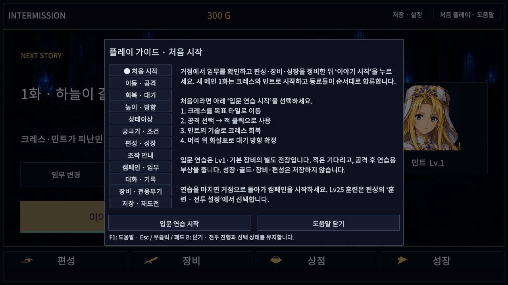
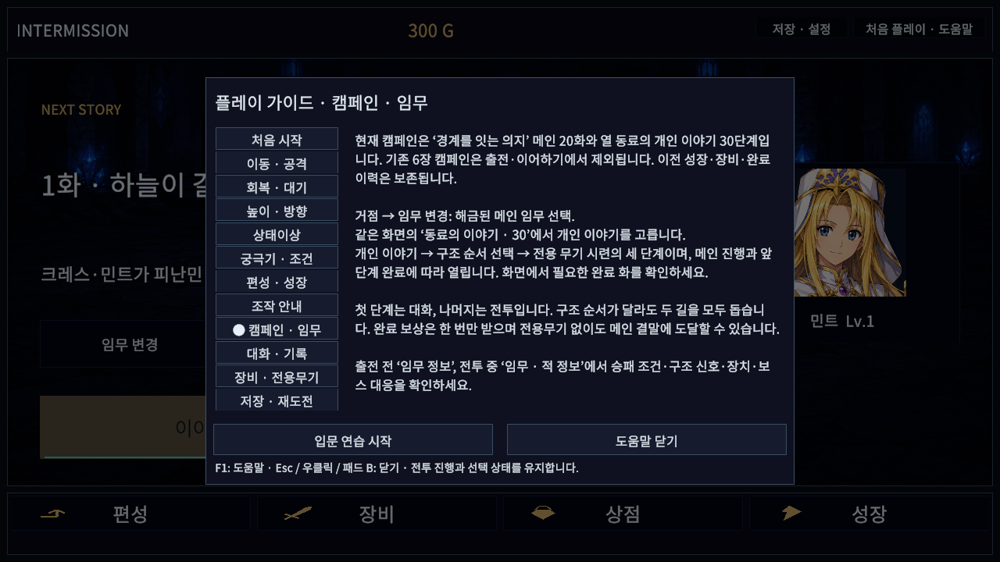
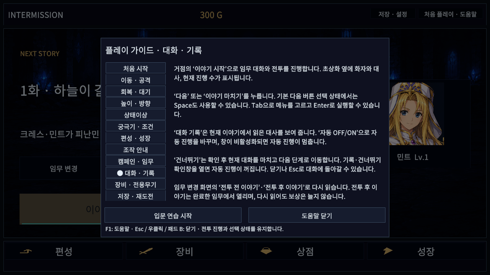
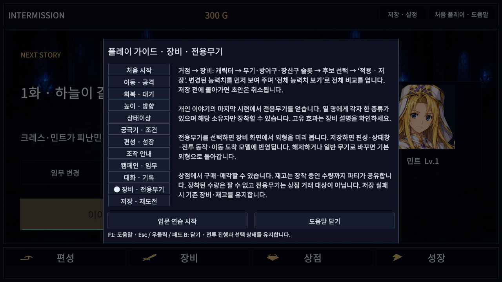
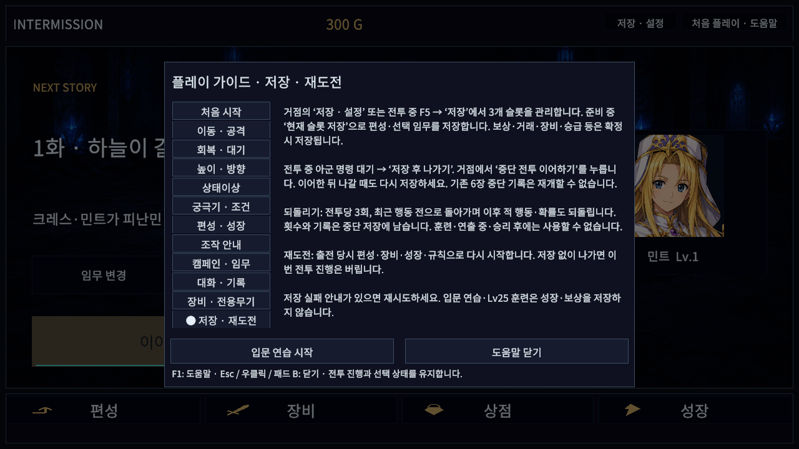

# 도움말·README 현행화 — 2026-10-14

메인20화·개인30단계, 인터미션 거점, 초상화 대화, 전용무기 외형, 성장·저장 기능을 현재 소스와 대조해 안내를 갱신했다. 게임 규칙·저장 형식·Content 에셋은 변경하지 않았다. 공개 preview.6 ZIP과 이후 소스 변경 범위는 루트 README에서 구분한다.

도움말은 기존 8개에서 12개 주제로 늘렸다. 기존 조작 안내 인덱스와 설정 메뉴의 바로가기는 유지한다. 입문 연습의 방향 선택 문구, 임무 변형의 구 캠페인 전용 여부, 현재 메인 6화 승급 조건과 옛 궁극기 체험의 차이도 수정했다.

## 검증 결과

| 검사 | 결과·근거 |
|---|---|
| 실제 Unity6000.6.0f1 그래픽 PlayMode | 관련3/3, 23.7835117초. [XML](playmode.xml) |
| API 참조 컴파일 | Runtime·Editor·EditMode·PlayMode4개 통과. [결과](api-compile.txt). Unity 테스트와 별개 |
| 고정 Game View 화면 검사 | 15화면 × 5해상도 × 글자100/130% =150조합 통과. [보고서](ui-matrix.json) |
| 일반 Windows 빌드 | 성공, 오류0/경고1, 53.8293417초. [BuildReport 요약](build-windows.txt) |
| 별도 Windows 검수 빌드 | 성공, 오류0/경고3, 119.0585877초. [요약](build-review.txt) |
| 일반 실행본 | 12초 유지, 플레이어 로그의 오류·예외0. 종료 요청에 응답하지 않아 해당 검수 프로세스만 종료. [실행 기록](normal-start.json) |
| 일반 DLL 검사 | 검수 타입 제외 확인. [결과](assembly-audit.json) |
| 사용자 저장 | 기존 저장·설정6파일 SHA256 불변. [결과](user-save-audit.json) |
| 검증 소스 일치 | 실제 빌드/검사 사본과 제품 변경4파일·테스트 파일 일치. [해시](source-audit.json) |

화면은 도움말12개와 저장·전투 규칙·기술 숙련 안내3개다. 1280×720, 1024×768, 1920×1080, 2560×1080, 1080×1440의 실제 렌더 크기를 확인했다. TMP 잘림·누락 글리프, 화면 밖/가려진 버튼, 배경 버튼 활성화, 캠페인 상태 변경이 없었다. 버튼 콜백과 중앙 UI raycast 검사이며 사람이 마우스·패드로 전부 조작한 결과는 아니다. 1280×720/130%의 엔진 캡처15장을 검토했다.

PlayMode는 전체 도움말 순환·입력 차단·전투 선택 복원·조작 바로가기와 실제 이동/공격/회복/대기 입문 연습을 검증한다. 이번에는 전체 EditMode353개·PlayMode144개를 재실행하지 않았다. 해당 전체 검증은 이전 [전용무기 단계](../SignatureWeapons/README.md)의 기록이다.

## 발견·수정 및 환경 한계

- 첫 PlayMode 실행은 병행 Pipeline 호출의 시간 초과 로그로 실패했다([기록](playmode-initial-infrastructure.xml)). 이후 검사 중 외부 명령을 중지했다.
- 다음 실행에서 조작 안내 본문의 잘림을 발견했다([기록](playmode-initial-overflow.xml)). 중복 설정 설명을 줄인 뒤 관련3개를 모두 재실행해 통과했다.
- C드라이브 여유 공간 부족으로 첫 Windows 빌드가 실패했다([요약](build-initial.txt)). D드라이브의 검증 사본으로 옮겨 두 빌드 모두 성공했다.
- Windows 검수 창은 환경상 실제 너비604픽셀, 최대 높이1252픽셀로 제한됐다. [Windows 보고서](windows-resolution-limited.json)의150행은 모두 해상도 불일치이므로 요청 해상도 통과로 계산하지 않는다. 좁은 창에서 UI 검사 항목은 통과했으며, 정해진 해상도150조합은 별도 그래픽 Editor Game View로 검증했다.
- 첫 Editor 검수의 임시 해상도 삭제에 잘못된 인덱스를 사용했다([오류](editor-initial-cleanup-errors.txt)). 절대 인덱스로 수정하고 다시 실행했다. 최종 보고서는 정리 후 기록한다.
- 최종 Editor 시작 중 Unity Search의 인덱싱 `ArgumentOutOfRangeException`이 1회 발생했다([발췌](editor-startup-warning.txt)). UI 검사 수집 구간의 오류는0이고 임시 해상도 정리·검수 Editor 종료는 완료됐다. 종료 시 Unity 내부 JobTempAlloc/메모리 정리 경고도 남아 있다. 이를 게임 런타임 오류나 전체 Editor 무오류로 혼동하지 않는다.
- 물리 모니터/DPI·실제 패드·전체 캠페인 수동 완주·장시간 성능 검수는 이번 범위에 포함하지 않는다. 기존 사용자 Editor와 게임 프로세스는 유지했다.

## 실행본과 재현

일반 실행본: `D:/TalesTacticsCrossover/d3d2/Builds/HelpGuideWindows/TalesTactics.exe`. 검증 사본은 `D:/TalesTacticsHelpGuide`, 원본 로그는 `D:/TalesTacticsCrossover/d3d2/Logs/help-guide-*`다. 이 경로들은 이 PC의 검증 산출물이며 Git에 포함하지 않는다.

- `HelpGuideBuild.All`: 검수 define 포함/미포함 Windows 실행본을 각각 생성한다.
- 그래픽 Unity Editor에서 `-executeMethod TalesTactics.Editor.HelpGuideBuild.EditorReview`: 현재 씬의 안내를 고정 Game View로 검사하고 `Logs/HelpGuideEditorReview`에 저장한 뒤 검수 Editor를 종료한다. 사용 중인 Editor가 아닌 별도 검증 사본에서 실행한다.
- Windows 검수 실행본의 `--help-guide-review <32자리 GUID>`: 실행본 아래 `Reviews/<GUID>`로 저장을 격리하고 검사 후 종료한다. 일반 실행본에는 검수 타입이 없다.

## 실제 화면

나머지 캡처: [이동·공격](help-01.png), [회복·대기](help-02.png), [높이·방향](help-03.png), [상태이상](help-04.png), [궁극기](help-05.png), [편성·성장](help-06.png), [조작](help-07.png), [저장 안내](save-guide.png), [전투 규칙](rules-guide.png), [숙련 안내](mastery-guide.png).
