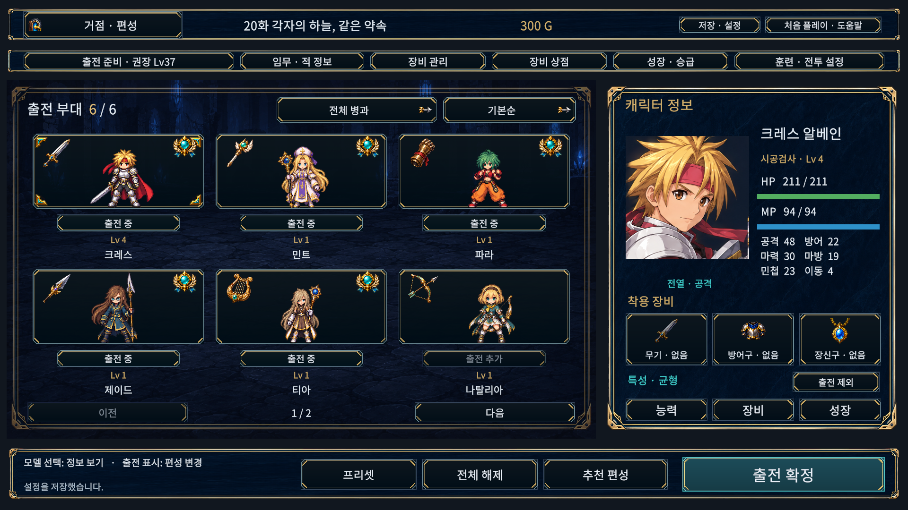
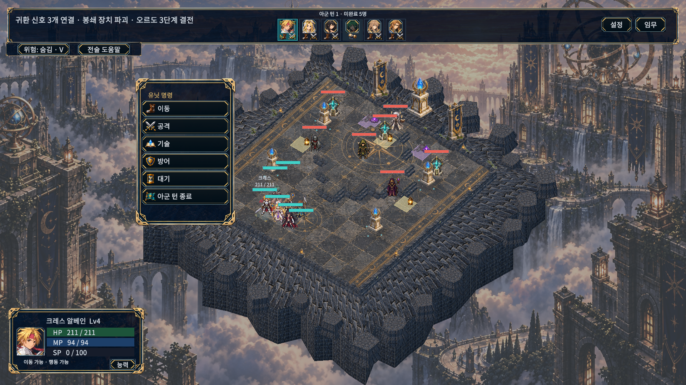

# 공통 아이콘 실제 적용

2026-10-15. 승인한 공통30종과 전장8종을 적용했다. 전투 상단·탐색의 작은 표시에는 별도로 만든 소형8종을 사용한다. 출전은 청록 보석·월계 휘장, 현재 선택은 금속 모서리 장식, 행동 완료는 봉인 두루마리로 구분한다. 편성의 단순 타원과 세로 선택선은 제거했다.

명령7종, 성장 특성5종, 방어구·장신구·빈 장비, 기술 범위·잠금, 이전/다음/닫기/복귀, 보상 금화, 방향 선택과 이동 경로 끝을 그림으로 연결했다. 구조·연결·출구·계약·위험·붕괴·소환·핵 표식은 실제 전장 상태를 따른다. 정확한 타일 경계·이동 범위·경로선, 수치와 키보드/패드 표기는 유지한다. 기존 직업·메뉴·고유 장비 그림도 유지한다.

## 실제 Windows 캡처

[1024×768 편성](PlayerCaptures/formation-six-1024.png) · [성장 특성](PlayerCaptures/growth-six-1920.png) · [방향 선택](PlayerCaptures/facing-0-1024.png) · [기술 범위](PlayerCaptures/skills-1920.png) · [보상 금화](PlayerCaptures/results-six-1920.png).

모두 최종 Windows 검수 실행본에서 엔진이 직접 캡처한 화면이다. 1920 캡처는 글자100%, 1024 캡처는130%다. 별도 검수 저장에서 동료 합류·전투 상태를 구성했으며 사용자 저장을 수정하지 않았다.

## 검증과 수정 이력

- Unity6000.6.0f1 실제 EditMode355/355 통과(3.79초).
- 실제 그래픽 PlayMode 전체163개 최초162통과/1실패(344.40초). 실패는 사용 불가 기술의 예전 `◇` 문자를 찾던 검사였다. 새 자물쇠 아이콘을 찾되 상세 사유·행동 미소비 검사까지 유지하도록 갱신했다. 마지막 타원 제거·방향 대비 보완 이후 관련12/12 통과(17.32초). 최종 단일 전체163/163 실행으로 표현하지 않는다.
- 관련 검사: 원화38종의 영역/로드와 소형8종, 출전/선택/완료 구분, 장식 입력 배제, 편성 선택/변경, 성장, 지면 경계, 카메라4방향의 방향 버튼 조작, 전장 모달 숨김, 붕괴→잔해→제거, 구조 신호 연결, 출구, 보스 예고→핵 노출→해제.
- 최종 Windows49화면×5해상도×글자100/115/130%=735/735. 1280×720, 1024×768, 1920×1080, 2560×1080, 1080×1440에서 넘침·누락 문자·프레임/셀/화면 경계·클릭 경로·아이콘 로드/부모 경계 검사 문제0, 수집 게임 오류0. 최초735검사도 통과했으며 최종 원화 배치 변경 후 다시 확인했다.
- 최종 Windows 검수 빌드53.83초/오류0/경고3, 일반30.20초/오류0/경고1. 일반 DLL에 검수 타입과 기존 FormationRing이 없으며 새 아이콘/전장 표시 타입이 포함됨을 Mono.Cecil로 확인했다.
- 일반 실행본25초 시작 유지·실행 오류0. 기존 사용자 플레이어 유지, 사용자 저장/설정8파일 SHA256 불변.
- API 참조4개 컴파일 별도 통과. Unity 테스트 개수에 합산하지 않는다. 검증 사본과 작업 소스 C#280개 및 관련 PNG5개/영역JSON1개, 총286파일 SHA256 일치.
- 세 원화의 표시 영역 가장자리 알파 최대10/255. 투명 원본을 그대로 사용하며 인접 아이콘을 포함하지 않는 영역으로 표시한다. 원화와 프롬프트는 [제작 기록](IMPLEMENTATION-ART.md)을 따른다.

[원시 XML·화면 보고서·빌드/실행 로그·저장 보존 근거](../Evidence/IllustratedIcons). 기존 URP 효과 셰이더 제거 안내와 Editor 초기화/종료 진단은 원시 로그에 남긴다. 다른 PC/DPI, 물리 패드, 전체 캠페인의 수동 완주 검증은 아니다.

일반 실행본: `D:/TalesTacticsHelpGuide/Builds/IllustratedIconsWindows/TalesTactics.exe`. 같은 폴더의 데이터/DLL이 함께 필요하다. 공개 릴리즈를 배포한 것은 아니다.

재현: `TalesTactics.Editor.UiSafeLayoutBuild.Illustrated`로 일반/검수 빌드를 생성하고, 검수 실행본에 `--ui-safe-layout-review <32자리 GUID>`를 전달한다.
