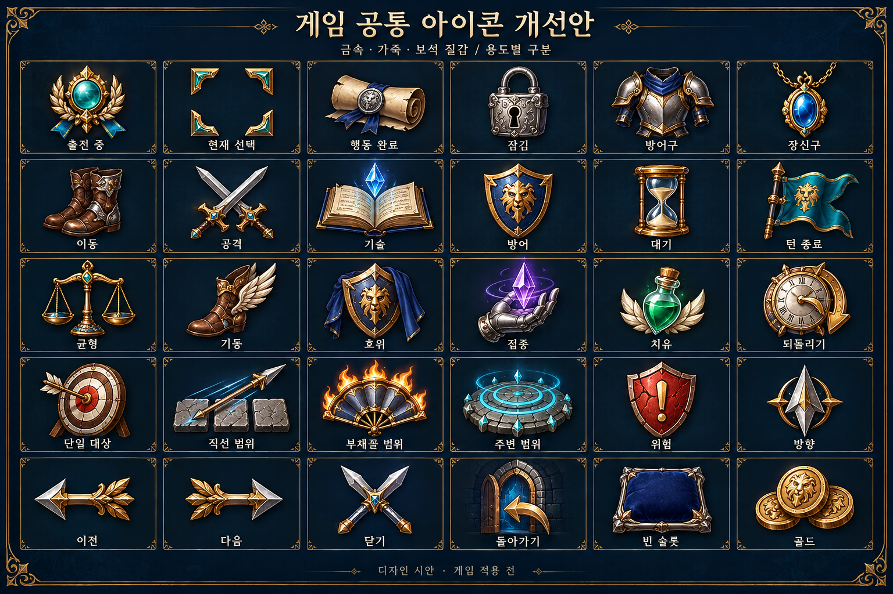
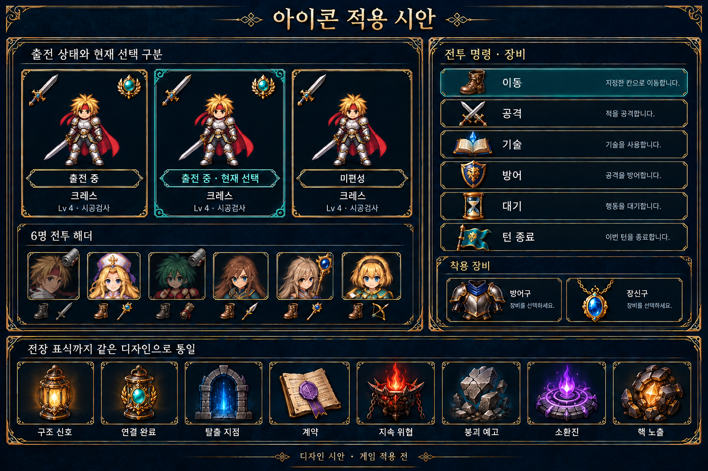

# 공통 아이콘 개선 시안

승인 후 [실제 적용·Windows 캡처·검증 기록](IMPLEMENTATION.md)을 추가했다. 아래는 승인 전 시안 기록이다.

2026-10-15. 요청에 따라 게임 전체의 단순 선·도형 아이콘을 코드 기준으로 조사하고 **우선 시안**을 제작했다. 이번 변경은 문서와 이미지이며 런타임 적용·신규 빌드·Unity 테스트 단계가 아니다.

## 디자인

기존 직업8종과 같은 금속·가죽·보석 질감, 남색 배경, 은색 윤곽과 절제된 금색을 사용한다. 선택은 부드러운 청록으로 표현한다. 공통 UI30종과 전장 표식8종을 제안한다. 38종은 새 디자인 목록이며 기존 도형 종류와 일대일로 대응하는 숫자가 아니다.

현재 편성의 체크는 출전 여부를 뜻하며 현재 살펴보는 캐릭터와 별개다. 출전 중에는 청록 보석·월계 휘장, 현재 선택에는 금속 모서리 장식, 행동 완료에는 봉인한 두루마리를 사용한다. 상태 문구도 함께 유지한다.

3개 카드는 상태 비교를 위한 확대 예시다. 실제 적용은 기존 캐릭터 모델과 6명/페이지 구조를 유지한다. 생성 그림의 캐릭터·문구는 배치 참고이며 원화나 게임 규칙을 바꾸는 지시가 아니다.

## 코드 조사

TacticalIcon은 명시적20종과 기본 검1종을 메시로 그린다. 현재 호출처와 문자 기호, 별도 방향 그래픽 및 전장 마커를 조사했다. 모든 캠페인 화면의 수동 플레이 검수가 아니다.

| 사용처/파일 | 현재 표시 | 변경 방향 |
|---|---|---|
| BattleModelDeploymentHud, BattleIconHud | 출전/완료 check, 선택 세로선 | 출전 휘장·완료 두루마리·선택 모서리 장식 |
| BattleCompactHud | 이동·공격·기술·방어·대기, 취소/턴 종료의 아이콘 재사용 | 장화·쌍검·마도서·방패·모래시계·되돌림 시계·군기 |
| BattleIconHud 전투 상단 | 이동/공격/완료 소형 도형 | 소형 전용 원화, 사용한 행동 명도 저하·완료 표식 |
| BattleIntermissionGrowthHud | 균형=모래시계, 기동=화살표, 호위=다각형, 집중=번개, 치유=더하기 | 저울·날개 장화·망토 방패·손과 수정·회복약 |
| BattleModelDeploymentHud, BattleCharacterStatusHud, BattleIntermissionHud | 방어구 다각형, 장신구 화살표/다각형, 빈 장비 모래시계 | 갑옷·목걸이·빈 받침. 실제 장비 그림 우선 표시 |
| BattleIntermissionMarketHud | 기본 공격 아이콘 | 직업/장비 원화와 같은 검 일러스트 |
| SkillVisualLanguage, BattleIconHud, BattleCharacterStatusHud | single 사각형, line 점선, cone 삼각형, area 십자, heal 더하기, guard 다각형 | 과녁·직선 창격·부채·충격파·회복약·방패와 범위 설명 |
| BattleFacingHud | 단색 입체 화살표 | 은색 나침반 촉. 이전 베이지색 방향 표시의 식별성 계승 |
| BattleTacticalHud, BattleTacticalControls | 위험 ◇, 예측 닫기 × | 위험 방패·공통 금속 X |
| BattleHelpHud, BattleSystemHud, BattleIntermissionMarketHud, BattleIntermissionGrowthHud 등 | 선택 ●, 잠금 ◇ | 상태 장식·자물쇠. 내부 버튼 이름/접근성 라벨과 분리 |
| BattleStoryHud, BattleCharacterStatusHud, BattleIntermissionEquipmentHud, BattlePurchasePreview, BattleResultHud 등 | 이전/다음 ‹ ›, 진행 ▶, 보상 G | 공통 탐색 화살촉·금화 |
| CrossoverTrials, CrossoverBossTactics | 완료 ✓, 경고 [!], 핵 노출 [◇], 준비 [○] | 완료 문구/봉인 표식·위험 방패·노출된 핵. Core 문자열과 Presentation 의미별 표시 분리 |
| BoardReadability, BoardThreatView, BoardMovementPreview | 선택/대상/도착 모서리, 경로 화살촉 | 지면에 맞춘 금속 문양·방향 촉, 정확한 타일 경계 유지 |
| BoardCrossoverView | 구조·연결·탈출·계약·위험·붕괴·소환 영역의 색 구분 | 신호등·연결된 등·석문·계약서·화로·깨진 석판·소환석을 영역색과 함께 표시 |
| TacticalIcon의 남은 정의 | crest/chevron/undo/exit와 과거 martial/bow/song/rifle/spear | 현재 호출되지 않는 정의도 후속 적용에서 제거/새 이미지 연결해 도형 재등장 방지 |

공통 프레임·게이지·범위 영역·경로선은 정보량과 타일 정확성을 유지하며 새 표식과 조합한다. 수치 증감의 +/−/→, 키보드 키 이름, 실제 게임패드 A/B/×/○는 의미에 맞는 조작·수치 표기로 유지한다. 이미 일러스트인 직업·메뉴·전용 장비 그림은 스타일 기준으로 사용한다.

## 후속 적용 검증 기준

- 카드32–48px, 명령/장비32–64px, 전투 상단16–24px에 맞는 소형 전용 원화. 큰 원화를 일괄 축소하지 않는다.
- 6명 헤더 휘장은 초상화 영역 안에 배치하고 얼굴·클릭 영역과 겹치지 않는다. 확대 시안은 실제 픽셀 크기 검증을 대신하지 않는다.
- 선택/출전/완료/잠금/비활성 상태는 색·형태·문구로 구분한다. 장식 이미지는 raycast를 받지 않는다.
- 전장 표식은 작게 표시하고 이동·사거리·위험 경계를 가리지 않는다. 카메라4방향과 지면 높이도 확인한다.
- 적용 후 기존660조합 UI 검사와 아이콘 로드·크기·6명 상태 표시·비활성 대비를 검사하고 실제 Windows 캡처로 확인한다.

이번 단계는 코드 검색·시안2장 육안 검토·파일 저장 확인을 완료했다. 두 이미지는 내장 image_gen으로 제작했으며 최종 프롬프트는 [PROMPTS.md](PROMPTS.md)에 보존했다.
