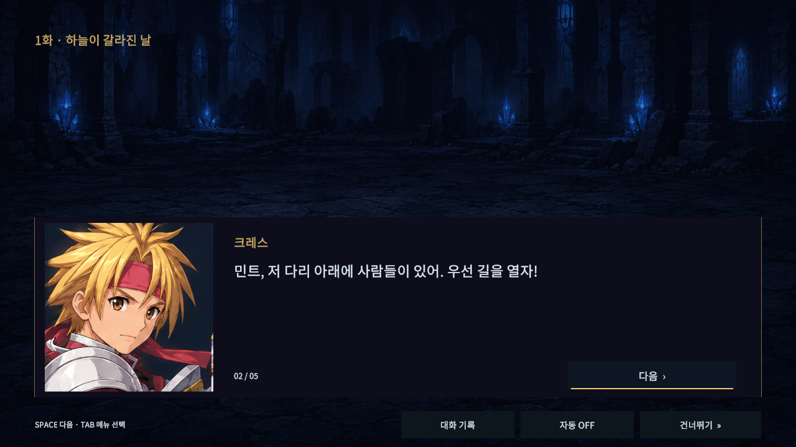
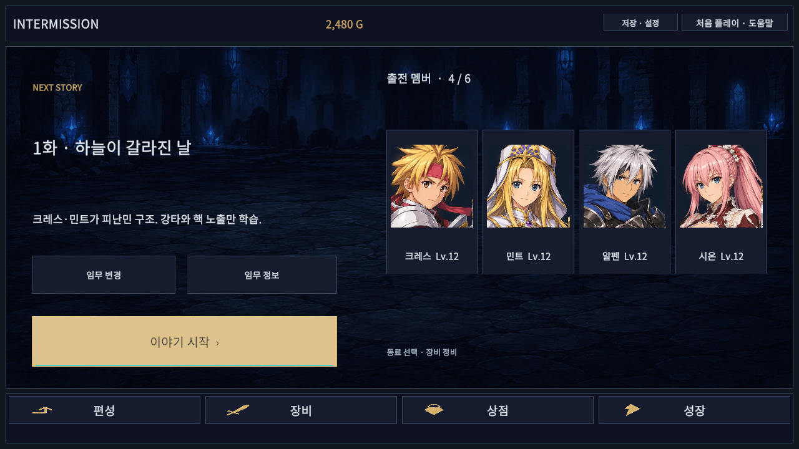
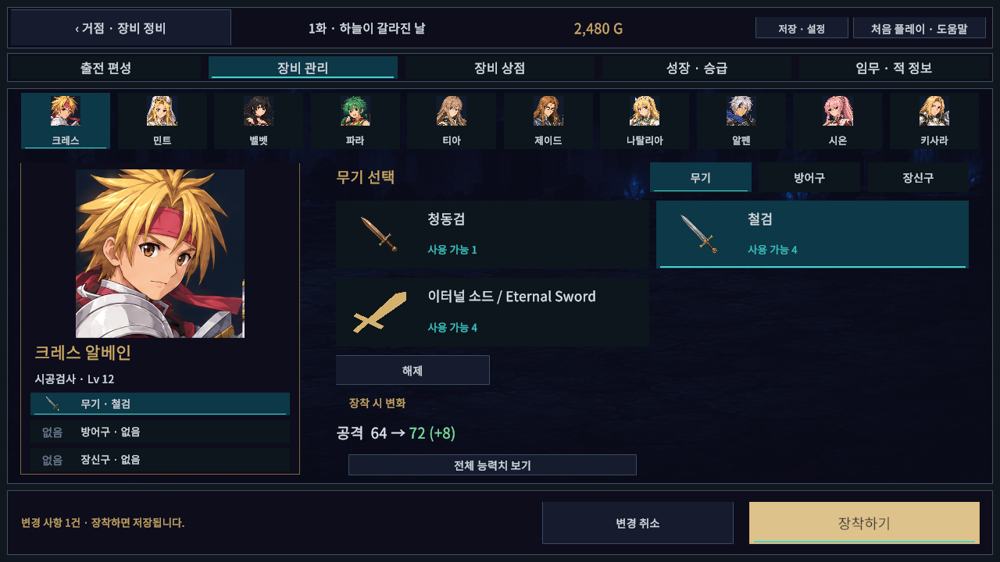

# 초상화 대화와 인터미션 정리

승인한 인터미션 시안을 기존 Unity uGUI에 적용한다. 게임의 초상화·배경·장비 그림을 재사용하며 저장 스키마와 전투·성장·구매 규칙을 변경하지 않는다.

## 화면과 조작

- 게임 시작·재시작·저장 슬롯 전환은 거점에서 시작한다. 현재 임무, 출전 멤버, 편성·장비·상점·성장 메뉴를 표시한다. 임무 변경과 임무 정보는 선택해서 열며 저장·설정과 도움말을 유지한다.
- 거점의 동료 초상화를 선택하면 해당 동료의 장비 화면으로 이동한다. 기존 편성 화면과 프리셋, 상점·성장 화면은 별도 메뉴로 유지한다.
- 장비 화면은 큰 초상화/슬롯과 보유 장비/변경 수치의 두 영역이다. 변경되는 능력치 최대 3개를 먼저 보이고 전체 9개 수치는 상세창에서 비교한다. 여러 슬롯의 변경을 확인하고 `장착하기`로 한 번에 저장한다. 메뉴·캐릭터 변경은 미적용 변경을 취소하며 저장 실패 시 기존 장비를 보존한다.
- 대화는 왼쪽 초상화, 이름, 오른쪽 대사와 다음 버튼을 사용한다. 기존 10명 영웅의 초상화를 화자에 맞게 선택한다. 기록 문장과 초상화가 없는 화자는 대사 영역을 넓혀 표시한다. 새로운 적 초상화나 표정별 원화를 추가한 것은 아니다.
- 다음 버튼에 초점이 있을 때 Space/Enter로 진행한다. Tab으로 메뉴를 순환하며 기존 게임패드 포인터도 사용한다. 자동 진행은 문장 길이에 따라 대기하고, 창이 비활성 상태일 때는 진행하지 않는다.
- 대화 기록은 현재까지 읽은 문장만 2개씩 보여준다. 기록이나 건너뛰기 확인창을 열면 자동 진행을 끄고 뒤쪽 버튼 입력을 차단한다. Escape/패드 취소로 확인창만 닫는다. 건너뛰기 확정은 원래 시나리오의 후속 단계로 연결한다.

## 구현

`BattleIntermissionHub`는 기존 준비 패널을 거점으로 배치한다. `ShowDeployment`는 상세 편성 진입점으로 유지한다. `BattleStoryHud`는 기존 `CampaignStory` 진행 콜백에 표시·기록·자동 진행을 연결한다. 실제 시나리오 대사와 완료·보상 처리는 기존 코드가 담당한다.

`IntermissionUxReview`는 검수 빌드에서만 포함되는 별도 저장 경로의 화면 검사다. 기존 UI 버튼을 호출해 거점·장비·상세 비교·대화·기록·건너뛰기를 검사하고 엔진 화면을 촬영한다. 수동 캠페인 완주나 실제 게임패드 기기 검수와 구별한다.

## 엔진 테스트

- Unity 6000.6.0f1 EditMode **333/333** 통과(10.9514545초).
- 그래픽 Editor 전체 PlayMode **141/141** 통과(299.4822781초). 대화의 화자/초상화 전환, 읽은 기록, 확인창 입력 차단, Space/Enter 한 번 진행, Escape 닫기, 자동 진행 중단/재시작, 거점 이동과 빈 편성, 기존 장비 저장·구매·전투 회귀를 포함한다.
- 실제 Unity API DLL 참조 Runtime/Editor/EditMode/PlayMode 4개 컴파일 통과. 이는 엔진 테스트와 별도 검사다.

최초 PlayMode는 128/140이었다. 검증 사본의 결과 폴더 누락 5건을 보완했고, Editor에서 없는 CanvasGroup의 Unity null 처리 오류 2건을 고쳤다. 변경된 화면 이동·문구에 맞지 않는 기존 기대값 4건을 조정했다. 공격 연출 프레임 검사 1건은 코드를 변경하지 않고 전체 재실행에서 통과했다. 첫 실행과 동시에 플레이어 검수가 진행되어 부하 영향이 의심되지만 단일 원인으로 확정하지 않는다. 키보드 검사 1개를 추가한 최종 전체 실행은 141/141이다.

C 드라이브 용량 안내창을 우회하기 위해 동일한 Assets/Packages/ProjectSettings를 D 드라이브 검증 사본에서 실행했다. 검증 사본과 원본의 C# 소스를 대조하며 동시에 두 Editor가 동일한 Library를 사용하지 않았다. 수동 UI 제어는 창 활성화 실패로 수행하지 못했으며, 엔진에서 생성한 캡처를 시각 검토한다.

## Windows 실행본과 화면 검사

일반 실행본: `Builds/IntermissionUxWindows/TalesTactics.exe` (폴더 전체 필요). 일반 빌드는 오류0/경고1, 49.9770579초이며 검수 도구를 포함하지 않는다. 검수 빌드는 오류0/경고3, 93.8984220초다. 공개 preview.6 릴리즈 파일은 이번 작업으로 갱신하지 않는다.

일반 실행본을 12초간 시작 유지하고 응답 상태와 로그 오류0을 확인했다. 이 작업에서 시작한 플레이어만 종료했으며 기존 사용자 Editor/플레이어를 유지했다. 최종 검수 전후 사용자 저장/설정/백업 6개 파일의 SHA256이 동일하다.

검수 실행본에서 1280×720, 1024×768, 1920×1080, 2560×1080, 1080×1440의 5개 창 크기와 글자100/130%를 조합해 거점·장비·전체 비교·기록 문장·초상화 대화·대화 기록·건너뛰기 확인 **70화면**을 검사했다. 텍스트 넘침·화면 밖 활성 버튼·실행 오류0, 실제 시나리오 대사 **394개**의 1280×720/글자130% 잘림0을 확인했다. 화면 탐색 후 캠페인 데이터도 불변이다.

최초 화면 검사에서 캐릭터 선택줄의 이름과 거점 저장 알림 여백이 부족해 보정했다. OS가 세로 창의 높이를1440으로 제한하여 최종 검수는 실제 가능한1080×1440으로 실행했다. 이 결과를1080×1920 검사로 표현하지 않는다. 글자 크기 확대의 화면 검사와 입력 이벤트 테스트는 자동화 검사이며, 실제 게임패드 기기·수동 캠페인 완주·자동 진행의 실제 포커스 전환은 수동 검수하지 않았다.

- [검증 수치·파일 해시](validation.json)
- [70화면 검사 상세](report.json)
- 원본 엔진 XML/로그: `D:/TalesTacticsCrossover/d3d2/Logs`의 `editmode-intermission-ux.xml`, `playmode-intermission-ux-final.xml`, `build-intermission-ux-final.log`, `intermission-ux-player-final.log`, `intermission-ux-normal-startup.log`.

## 실제 실행 화면

