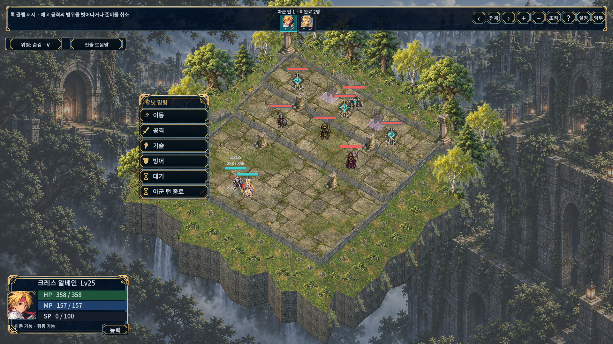
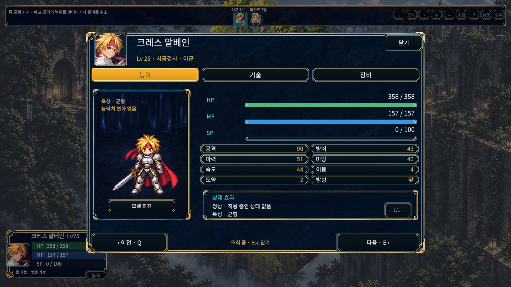
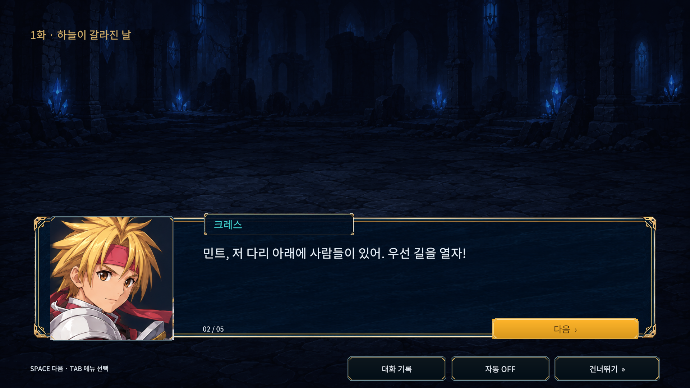

# UI 프레임·전장 표현 적용 — 2026-10-14

승인 시안의 남색 바탕, 금·은 이중 테두리, 모서리 장식, 금색 선택 상태를 실제 uGUI에 적용했다. 초상화·화자 이름표·능력치 행·자원 게이지·확인창을 같은 재질로 묶었다. 아래 PNG는 생성 시안이 아닌 Unity 실행 화면이다.

[거점](hub.png) · [기술](skills.png) · [장비](equipment.png)

## 구현

- `OrnatePanel`: 실제 9-slice 이미지. 창 크기에 맞춰 모서리 크기를 제한하고 기존 창의 표시·알파를 유지한다.
- `OrnateButtonGraphic` / `HudButtonAccent`: 절단 모서리의 이중 금속선, 상단 하이라이트, 포커스·선택·비활성 색상. 장식은 raycast를 받지 않는다.
- `PixelLivingTerrain`: 지면 이끼 혼합, 불규칙한 연속 외곽 지형, 나무·관목·양치식물과 절벽. 숲/성소/수문에는 식생, 협곡/관측소/중계소에는 해당 재질의 외곽을 적용한다. 회전 시 전방의 큰 나무를 숨겨 유닛과 선택 칸을 가리지 않게 한다.
- `TerrainDetailBillboard`: 공용 메시 16개와 명시적인 UV 영역으로 작은 식생 아틀라스를 표시한다. 메시·머티리얼·런타임 스프라이트는 전장 종료 시 해제한다.
- 지형 셰이더: 표면의 미세 명암, 나뭇잎 사이 빛, 수면의 반짝임. 보드의 통행·높이·충돌·전투 난수와 분리된 표시 코드다.

시안은 아트 방향이며 생성 이미지의 가상 수치·배치·캐릭터를 게임 데이터로 옮기지는 않았다. 실제 전투는 기존 2.5D 보드와 캐릭터 원화를 사용한다. 정적인 생성 시안과 픽셀 단위로 동일하다는 보장은 하지 않는다. 공개 preview.6 ZIP을 바꾼 작업은 아니다.

## 화면 검증

고정 Game View 1280×720, 1024×768, 1920×1080, 2560×1080, 1080×1440 × 글자100/130% × 거점·대화·확인창·전투·능력·기술·장비7화면 = 70조합. 글자100%에서 각 해상도별 전장4방향20조합, 현재 캠페인6종 지형×4방향24조합을 추가해 **114조합**을 확인했다. [보고서](ui-matrix.json).

실제 화면 크기, TMP 잘림·누락 문자, 버튼 범위·중앙 raycast, 수집한 실행 오류가 모두0이다. 6종 지형의 모든 통행 가능 칸을4방향에서 실제 `Board.Pick`으로 확인했다. 메인1화 크레스·민트 Lv25는 검수용 저장 fixture이며 사용자 저장과 분리된다. 현재 캠페인의 다른 지형은 이야기 해금 fixture로 확인했다.

초기 화면에서 능력치 행의 두꺼운 테두리 겹침, 잘린 외곽 잔디 조각, 작은 식생의 아틀라스 전체 표시를 발견했다. 얇은 행 프레임·연속 지형·명시적 UV 메시로 수정했다. 첫 80조합의 검사 후 기술 목록·실제 버튼 raycast·6종 지형 검사를 추가해 최종114조합을 실행했다.

기술 목록의 글자가 테두리에 가까워 한 페이지4행과 본문 안쪽 여백으로 보완한 뒤114조합을 다시 검사했다. 현재 캠페인의 대사394개를1280×720과1024×768/글자130%에서 각각 표시해 **788건**의 본문 잘림0을 확인했다.

RTX3060 그래픽 Editor·1920×1080에서 각 지형30프레임 준비 후180프레임씩 `Time.unscaledDeltaTime`을 수집했다. 지형별 평균3.46~4.30ms,95백분위4.10~6.24ms였다. 장식 Renderer315~653개, 장식 메시6,584~18,070삼각형이다. 이는 동일 PC의 짧은 정상 전장 측정이며 GPU 단독 시간·다른 기기·장시간·동시 기술 이펙트의 성능 보장이 아니다. 원본 수치는 화면 보고서의 `timings`에 있다.

## Unity 테스트

실제 그래픽 Unity6000.6.0f1 전체 PlayMode155개를 실행해154통과/1실패(341.0406296초)를 확인했다. [최초 결과](playmode-initial.xml). 실패는 `WalkingThroughAllyKeepsOccupancyAndAllowsUndoFromSmallMenu`의 이전120×180 고정 명령창 크기 기대값이었다. 새 프레임과 아이콘을 포함한 창의 제한된 화면 점유율·모든 버튼의 창 내부 배치를 검사하도록 바꿨고, 아군 통과·점유 유지·이동 취소 검사는 유지했다.

기술 행 여백과 테스트 기대값 수정 후 관련7개 재검사 **7/7통과·19.6184107초**를 확인했다. [최종 관련 결과](playmode-final.xml). 새 프레임/포커스/비활성, 지형 난수·규칙 불변, 나무와 아틀라스 메시 해제, 기존6종 맵의4방향 타일 선택, 모든 동료·적의 상태·기술·장비 페이지, 이동·취소를 포함한다. 최초 전체 실행의 실패1건도 여기에 포함돼 통과했다. 단일 최종 전체155/155 실행으로 표현하지 않으며 이번 EditMode 전체 재실행은 아니다.

[API 참조4개 컴파일](api-compile.txt)은 별도로 통과했고 Unity 테스트 결과로 세지 않는다. [검증 사본의 변경 소스·에셋 SHA256 일치](source-audit.json)를 확인했다.

## Windows 빌드·저장 감사

일반 Windows 빌드 성공·오류0/경고1·63.9202369초, 검수 빌드 성공·오류0/경고3·115.6360366초. [일반 결과](build-windows.txt) · [검수 결과](build-review.txt). 일반 DLL에서 검수 타입을 제외하고 검수 DLL에는 `OrnateReview`가 있는 것을 [확인](assembly-audit.json)했다. 최초 감사의 대소문자 구분 없는 검색은 실제 게임 기능인 `MissionMapPreview`까지 검수 타입으로 잘못 분류했다. 타입 이름의 대소문자를 구분해 다시 감사했으며 빌드 결함은 아니었다.

일반 플레이어12초 실행 유지, 실행 오류·예외0을 확인하고 해당 검수 프로세스만 닫았다. [실행 기록](normal-start.json). 사용자 저장·설정6파일의SHA256은 시작 전후 [동일](user-save-audit.json)하며 기존 Editor/플레이어를 유지했다.

실행본: `D:/TalesTacticsCrossover/d3d2/Builds/OrnateWindows/TalesTactics.exe`. Git에는 빌드·캐시를 넣지 않는다. Editor 로그에는 기존 라이선스 초기 연결 메시지, Search 초기화 예외와 종료 정리 경고가 있으나 화면 검사에서 수집한 실행 오류0, 실제 BuildReport 두 빌드 모두 성공이다.

## 에셋과 재현

Panel / Trees / Ground PNG는 이번 작업에서 `image_gen.imagegen`으로 생성했다. [정확한 생성 프롬프트와 처리 기록](image-generation.json). Panel은 170px9-slice, Trees는 측정한 상단54%/하단46% 영역을 쓴다. 원본 이미지를 후처리로 덧그리거나 게임 캡처에 합성하지 않았다.

`OrnateBuild.EditorReview --ornate-full`은 별도 그래픽 Editor의 고정 Game View를 검사한다. `OrnateBuild.All`은 일반/검수 Windows 빌드를 만든다. 검수 플레이어는 명시적 `--ornate-review <32자리 GUID>`에만 동작한다. 일반 빌드에는 `OrnateReview`가 포함되지 않는다.

검증 사본은 `D:/TalesTacticsHelpGuide`, 원본 로그는 그 아래 `Logs/Ornate`, 원본 화면은 `Logs/OrnateEditorReview`다. 현재 워크트리는 C: 여유 공간 부족으로 자신의 Assets/Docs만 각각 `D:/TalesTacticsOrnateAssets` / `D:/TalesTacticsOrnateDocs`에 옮긴 junction을 사용한다. 경로는 그대로 유지하며 문서1698파일 수 일치를 확인했다. `C:/dev/TalesTactics`의 기존 Editor·게임·에셋은 유지했다.

실물 게임패드·다른 PC/DPI·전체 캠페인 수동 완주·장시간 성능 벤치마크는 이번 검수 범위가 아니다.
