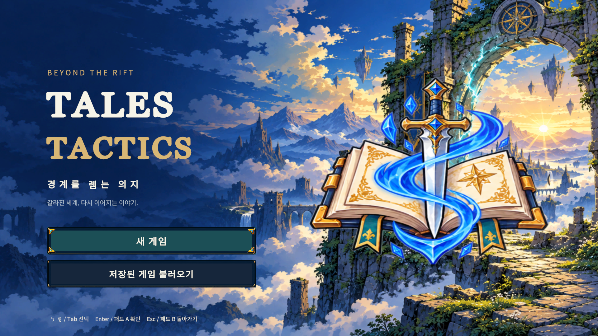
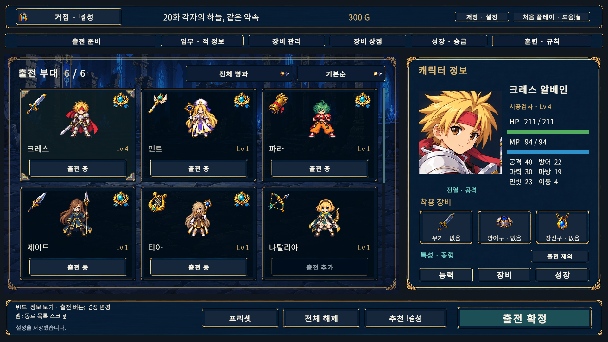
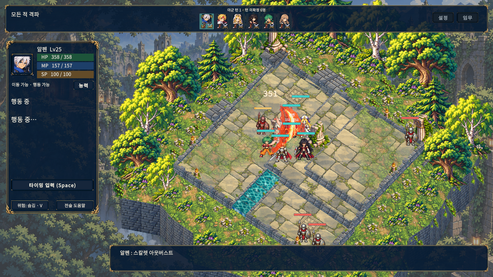

# SD 미술 전환

`develop`의 현재 디자인은 사용자가 확인한 디스가이아풍 시안을 바탕으로 만든 SD 애니메이션 RPG 스타일이다. 아래 이미지들은 시안이 아니라 **실제 Unity 실행 화면**이다. 공개 배포 중인 preview.8과 이 개발 버전은 구분한다.

[실제 화면 갤러리](gallery.html) · [원화·생성 프롬프트와 경로](ART.md) · [전체 검증 이력](../VALIDATION.md)

## 적용 범위

| 영역 | 적용 내용 |
|---|---|
| 캐릭터 | 기존에 참조하는 주인공·일반 적·고유 보스·전용무기 159장·4,898프레임 교체. 별도 10인 초상화 아틀라스 1장 교체 |
| 타이틀·거점 | 셀 명암의 배경, 책과 검 문장, 남색·황동 테두리, 청록 선택 상태 |
| 메뉴·아이콘 | 공통 창·버튼·카드, 메뉴·직업·장비·명령 일러스트 69개, 작은 카드의 중복 테두리 제거 |
| 전장 | 지면·절벽·건축·나무·풀·6종 파노라마, 측정한 아틀라스 영역, 새 전장 카메라 미리보기 20장 |
| 기술 | 기존 3종과 추가 179개 프로필에 셀 명암·남색 윤곽·겹친 검격·속성별 형상과 움직임 강조 |

스프라이트 이름·GUID·local ID, 기존 애니메이션 프레임 수와 게임 판정 시점은 유지했다. 새 원화의 실제 알파 영역으로 rect·pivot·outline·PPU를 측정해 교체했다. 전용무기는 기본 무기와 별도 외형을 유지한다. 전투 수치·격자·난수·캠페인 저장 형식은 바꾸지 않았다.

사용자가 요청했던 6인 편성, 마우스 스크롤, 합류한 동료만 표시, 순서대로 보는 이야기, 창 내부 배치도 유지한다. 강한 노란 선택 배경을 추가하지 않는다.

## 실제 화면

UI 갤러리는 실제 검증 fixture의 20화·6인 편성을 포함하므로, 새 게임 초기 인원이 6명이라는 뜻은 아니다. 기술 캡처는 분리된 훈련 저장과 고정 30fps 검수 환경에서 얻은 이미지이며 프레임 성능 측정이 아니다.

## 제작·검증 재현

- 원화 집합·기존 참조와 측정: [SD 캐릭터 기록](../SdCharacters/README.md), [전체 manifest](../SdCharacters/production-manifest.json).
- Unity 적용 이후 확인: `TalesTactics.Editor.SdArtValidation.AuditProduction(output)`는 실제 메시·rect·PPU·pivot·이름·ID·PNG 해시와 전용무기 참조를 검사한다.
- `UiSafeLayoutReview`는 80상태×5해상도×글자 100/115/130%를 검사한다. 이미지 육안 검토를 경계 수치 검사와 별도로 수행한다.
- `SkillRosterVfxReview`는 아군 88종의 일반/축소 실제 실행과 독립 Resolver의 결과, 격자·난수·효과 정리·6모델 보존을 확인한다.
- `SdArtValidation.Windows()` / `.Review()`는 일반/검수 Windows 빌드를 만든다. Editor 전용 원화 적용기와 미리보기 생성기는 일반 플레이어에 포함하지 않는다.

최종 적용 159장의 후보와 이전 크레스 후보 1장, 총 160장은 로컬 `C:/dev/TalesTactics/Temp/SdCharacters/ApprovedCandidates`에 보관했다. 최종 159개 적용 PNG의 SHA256이 승인 후보와 일치함을 확인했다. Git에는 기존 production 위치의 새 PNG/meta와 측정·프롬프트 기록을 남긴다. 측정 JSON의 후보 경로는 임포트 당시 이력이며 새 클론에서 바로 재임포트할 경로는 아니다. 원본 생성 결과는 삭제하지 않았다.

## 검증 범위와 한계

원시 결과는 [Validation](Validation/)에 보존한다. 검증용 프로젝트는 `D:/TalesTacticsHelpGuide`, 소스는 `C:/dev/TalesTactics`이다.

| 최종 실제 검사 | 결과 |
|---|---|
| [Unity EditMode](Validation/editmode-final.json) | 379/379, 2.09초 |
| [통합 Unity PlayMode](Validation/playmode-final.json) | 239/239, 597.95초 |
| [마지막 긴 이름 표시 수정의 장비 회귀](Validation/signature-label-regression.json) | 10종 미리보기·취소·저장·재불러오기·해제 테스트 1/1 |
| [새 원화·참조·mesh·rect·PPU·pivot](Validation/production-final.json) | 159장·4,898프레임 |
| [UI 경계](Validation/ui-final.json) | 80상태×5해상도×3글자배율 = 1,200/1,200, 문제·수집 오류0 |
| [아군 기술 실제 실행](Validation/vfx-final.json) | 88종×일반/축소 = 176/176, 판정·격자·난수·6모델·효과 정리·저장 불변 |
| [일반 Windows 빌드](Validation/build-windows.json) | 27.25초, 오류0·경고2 |
| [검수 Windows 빌드](Validation/build-review.json) | 17.69초, 오류0·경고2 |
| [일반 실행 시작](Validation/windows-startup.json) | 25.77초 유지·응답, 로그 오류0 |
| [실제 Windows 전용무기](Validation/windows-signature-run.json) | 장비20·전장8검사, 기본/편성 포함 실제39 PNG, 오류0 |
| [실제 Windows 전장·보스·개인 이야기](Validation/windows-crossover-run.json) | 실제440 PNG, 수집 오류0 |
| [검수 코드 분리](Validation/player-type-isolation.json) | 일반 DLL의 Review·Fixture·Editor 제작 타입 제외 |
| [사용자 저장·설정](Validation/user-files-final.json) | 8파일 최종 SHA256 일치(창 상태 설정1파일 원상 복원), 기존 실행 중 플레이어 보존 |
| [검증 소스 대조](Validation/source-sync.json) | 변경 에셋 412개 C/D SHA256 일치 |
| [선별 실제 PNG](Validation/capture-manifest.json) | 36개 원본 해시·크기 확인 |

실행본은 `D:/TalesTacticsHelpGuide/Builds/SdArtWindows/TalesTactics.exe`이다. 검수 빌드는 별도 `Builds/SdArtReview`이며 공개 릴리즈 패키지가 아니다.

전체 최초 PlayMode237/239에서 옛 Point 필터 기대값과 음악의 고정0.15초 시작 대기를 확인했다. 새 SD Bilinear 계약 및 실제 로드·재생·샘플 진행 확인으로 보완했고, 최종 전체239개를 다시 실행했다. 복수 필터 선택과 모드 전환 뒤의 0개 실행은 통과로 세지 않고 원시 결과를 남겼다. 전체 실행은 발견된239개와 실제 시작·완료239개를 대조했다. 이어 Windows 검수에서 긴 전용무기 병기명2종의 넘침4건을 찾아 비교 카드 본문을 아이콘/이름으로 나누고 한글·원문을 줄바꿈했다. 이 마지막 표시 수정 후 관련 PlayMode회귀1/1, UI1,200개와 Windows검수를 다시 통과했다. 전체239개 결과는 이 마지막 표시 수정 이전 결과로 구분한다. 초기 실패 [원시 증거](Validation/windows-signature-before-label-fix.json)도 보존한다.

Windows 보스 검수는 20화 전장·임무, 고유 보스20종의 전장 카메라4방향과 정면 능력창·기술60종의예고/준비/발동·쓰러짐, 개인 이야기30단계 메뉴/대화를 구성한 표현 fixture다. 피해 대상과 상태를 준비한 화면이며, 적 AI 전수 실행이나 균형 검증으로 표현하지 않는다. direction 캡처는 전장 카메라를 회전하며 능력창의 정면 모델까지 4방향으로 바꾼 검사는 아니다. 일반 실행 시작 검사는 숨김 실행·로그 확인이며, 실제 화면은 별도 검수 실행본에서 촬영했다.

기계적인 알파/참조 검사를 그림체나 모든 프레임의 자연스러움에 대한 보증으로 표현하지 않는다. 원화는 각 시트와 포즈를 육안 검토했으며, [등록 감사](../SdCharacters/registration-audit.json)는 하단 무기·벌린 두 발의 중앙값 변화 때문에 단순한 발 위치 수치가 오판할 수 있음을 별도로 기록한다. 장시간 성능, 다른 PC/DPI, 전체 캠페인 수동 완주·모든 동작의 사람 입력 검수는 이번 자동 검증과 구분한다.

크레스 공격 윤곽은 후속 원화로 보완했지만, 일부 연속 동작은 대기 원화보다 원본 정보량이 적어 선명도 차이가 남는다. 실제 56프레임 촬영 중 준비·돌진·접촉·복귀4장을 검토했으며, 가로 확대 오류나 보이는 부위의 몸 분리는 발견하지 못했다. 모든 프레임이 대기 원화와 같은 선명도라는 의미는 아니다. [수치·실제 캡처·검수 한계](Validation/cless-motion-visual-review.json).

오리진 정면 원화는 몸과 네 팔·무기의 큰 형태가 이어지지만, 얼굴·손·칼날 세부는 제이드 대기 원화보다 부드럽다. 전장 카메라 회전 캡처의 능력창 모델은 정면을 유지하고 전장 보스는 창에 가리므로, 이 파일들로 보스 원화 4방향 검증을 주장하지 않는다. [Windows 원화 육안 검수](Validation/windows-art-visual-review.json).

일반 Windows 시작 검수는 첫 고정12초 확인에서 아직 응답하지 않아 종료한 기록을 보존했고, 장면 로드 후 5초 연속 응답을 기다려 25.77초에 통과했다. 다른 작업이 함께 실행 중이었으므로 순수 시작 성능 수치로 해석하지 않는다. 최종 빌드 경고2종은 기존 조건부 컴파일 및 자동화 플러그인 구성에 관한 것이다. [시작 검사·빌드 경고 기록](Validation/windows-validation-notes.json).

정상 플레이어의 창 상태 자동 저장으로 설정파일1개가 잠시 바뀌었다. 최대화 여부와 기존 기본값의 직렬화 외 차이가 없고 백업 해시가 작업 전 값과 일치함을 확인한 뒤 원본 바이트로 복원했다. 진행도6파일은 처음부터 변경되지 않았고, 최종 진행도·설정8파일 모두 작업 전 해시와 일치한다. [조건부 복원 근거](Validation/window-setting-restoration.json).
