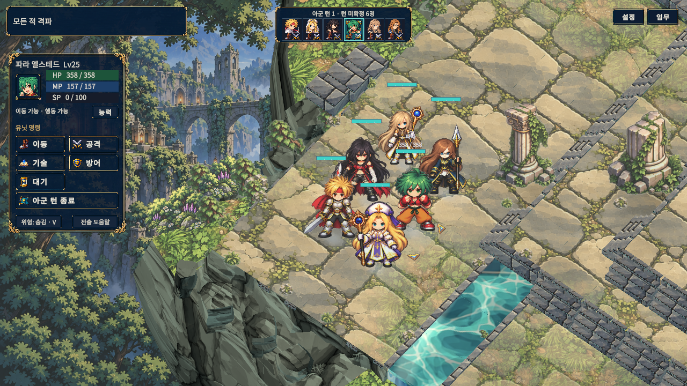

# 바닥 반복과 전장 외곽 개선

2026-11-01 `develop`의 `ea6dde6e0e72c0a82e945ff1558417578404c2f5` 이후 작업이다. 이전 [전장 환경 통합](../EnvironmentIntegration/README.md)에서 남았던 반복 바닥·물결과 직선 외곽을 보완한다. 최종 소스의 실제 Unity 테스트와 Windows 빌드·화면 검수를 완료했다. **[같은 카메라의 변경 전후 비교](comparison.html)** · [실제 Windows 캡처 출처](Evidence/actual-capture-manifest.json).

## 변경한 화면 표현

| 영역 | 현재 구현 | 보존한 내용 |
|---|---|---|
| 유적·성소 바닥 | 새 `RuinsFloorWeathered` 원화에서 반복 꽃 문장 5개와 장식 테두리를 제거하고 크기·형태가 다른 마모 판석으로 바꿨다. theme 0/1의 바닥 로드 경로만 새 이미지로 전환했다. | 베이지·회색 돌, 올리브 이끼, 정면 평면 시점과 셀 색면. 기존 `RuinsFloor` 및 협곡·관측소·수문 원본 이미지는 보존했다. |
| 넓은 바닥 명암 | 전체 맵에 한 번 적용하는 바닥 UV는 유지하고 세계 좌표의 저주파 풍화 명암과 불규칙 이끼 군집을 더했다. 균일한 가장자리 녹색 띠는 끊어진 이끼 포켓으로 바꿨다. | 돌 줄눈과 보행 면, 기존 환경광·팔레트. 타일별 UV 회전이나 무작위 원화 조각 교체를 하지 않는다. |
| 수면·폭포 | 타일마다 재시작하던 물결 좌표를 세계 좌표의 두 흐름으로 바꿨다. 수면은 XZ, 수직 폭포는 가로축과 높이 좌표를 사용한다. 아틀라스 가장자리를 반사해 연결하고 밝은 반짝임을 억제한다. | 실제 수로·하안선·물 타일·폭포 위치와 크기. 물 표현은 새 이동 경로나 지형 판정을 만들지 않는다. |
| 전장 기초 | 연속적인 네 겹 테두리 대신 아래쪽으로 갈라진 바위 단면·조각난 마감석을 만든다. 공유 좌표에서 단면을 생성하고 모서리, 다른 높이의 인접 외곽, 물·마른 땅 접점의 끝면을 닫는다. | 서 있는 타일 윗면은 반 타일 경계를 유지한다. 바위 선반은 보행 면 아래·격자 밖에 배치하며 충돌체를 추가하지 않는다. |
| 외곽 실루엣 | 사면마다 넓은 바위 돌출부, 좁은 골, 높이가 다른 연결 선반을 배치한다. 실내 계열 벽면은 온전한 구간과 무너진 기초를 섞고, 바위·나무·꽃이 일정한 띠를 만들지 않도록 조정한다. | 기존 장 테마, 전투 격자와 타일 높이·연결 관계. 건축 벽면은 실제 바위 단면을 따라가도록 배치한다. |
| 모서리 보행 공간 | 기존 북쪽 버팀기둥과 관련 봉화·수문 받침을 외곽으로 옮겼다. | 기능 오브젝트와 전투 규칙은 유지하며 장식이 타일 중앙을 차지하지 않도록 한다. |

변경은 전장 표현에 한정된다. 캐릭터 원화·모션·기술, 전투 판정, 난수 사용, 보상, 저장 형식과 UI 동작은 새로 설계하지 않았다. 이전에 적용한 캐릭터·지형 공통 환경광과 발 접촉 그림자도 유지한다.

## 원화와 출처

새 원화는 내장 `image_gen`의 이미지 편집으로 만들었으며 기본 출력과 프로젝트 PNG의 SHA가 같다. 요청 크기는 2048×2048이었지만 도구는 원본과 같은 **1254×1254**를 반환했다. 크기를 늘리거나 다시 샘플링하지 않았으며 2K 원화로 표시하지 않는다. 원본 텍스처는 보존하고 새 파일·새 GUID로 적용했다.

[아트 출처·원본/결과 비교](art-provenance.md) · [정확한 프롬프트·경로·SHA](Validation/floor-art.json).

## 최종 검증 상태

| 검증 | 최종 결과 |
|---|---|
| 실제 Unity EditMode 전체 | **437/437 · 21.21초**, 실패·건너뜀·미결정 0. [원본](Validation/full-editmode-final.json) |
| 실제 Unity PlayMode 전체 | **258/258 · 647.92초**, 실패·건너뜀·미결정 0. [원본](Validation/full-playmode-final.json) |
| 지형 표적 PlayMode | **5/5 · 7.76초**, 실패·건너뜀·미결정 0. [원본](Validation/terrain-tests-final.json) |
| Editor 전장 캡처 | **90/90**, 오류·배치 issues 0. [원본](Validation/editor-captures-final.json) · [요약](Validation/editor-summary.json) |
| 일반·검수 Windows 빌드 | 모두 성공·오류 0. 일반 **105.69초/경고4**, 검수 **40.46초/경고6**. [일반](Validation/windows-normal-build.txt) · [검수](Validation/windows-review-build.txt) |
| Windows 실제 전장 캡처 | **90/90**, 오류·배치 issues 0, 정상 종료0·강제 종료 없음. [원본](Validation/windows-captures-final.json) · [검증 요약](Validation/windows-summary.json) |
| 사용자 저장·설정 보존 | Windows 검수 직전/직후 전체 **4,534파일**과 디렉터리 목록 동일. 전체 작업의 테스트 산출물 변화는 별도로 기록했다. |
| 일반/검수 DLL 분리 | 통과. 일반 DLL에 검수 타입·저장 격리 진입 코드 없음. [검사 원본](Validation/windows-type-isolation.json) |

일반 실행본은 `D:/TalesTacticsBuildArchive/TerrainRefinementWindows20261101/TalesTactics.exe`, 검수 실행본은 별도 `TerrainRefinementReview20261101` 폴더에 있다. 일반 빌드의 경고4개는 Pipeline 런타임 설정 누락1, 기존 `DEVELOPMENT_BUILD` 사용 중단 예정1, URP 내부 디버그 셰이더 stripping2이다. 검수 빌드 경고6개는 Pipeline1, 기존 검수기의 `FindObjectsByType` 계열 사용 중단 예정4, `DEVELOPMENT_BUILD`1이다. 새 지형 컴파일 오류나 미컴파일 변경 경고는 없다. 일반 실행본을 시작해 수동 플레이하거나 공개 릴리즈한 검사는 아니다.

작업 전체 시작/종료를 비교하면 기존 파일 삭제는 없고 게임 저장·설정의 바이트도 유지됐다. Unity 테스트가 `TestResults.xml`을 갱신하고 `StorageTests` 아래 격리 테스트 파일 **106개**를 추가했다. 따라서 전체 작업 동안 사용자 폴더가 완전히 불변이었다고 표현하지 않는다. 이 산출물을 임의 삭제·복원하지 않았으며, 이후 Windows 검수의 직전/직후 전체 트리 동일 결과와 구분한다. [전체 작업 비교](Validation/whole-task-user-tree.json).

구현된 지형 회귀는 전체 캠페인 맵의 결정적 메시·좌표 유한성·16비트 인덱스/정점 예산·새 충돌체 없음·보행 중심 보호·지형/난수 불변과 외곽 높이/모서리/물 접점 닫힘을 검사한다. GPU 표면 검사는 같은 세계 좌표를 한 면 또는 UV가 재시작되는 여러 타일로 그려 바닥·수면·두 방향 폭포의 일치를 비교한다. 먼저 로컬 UV 경로가 실제로 차이를 내는 음성 대조를 확인하므로 빈 화면의 우연한 일치를 통과로 세지 않는다.

검수 실행기는 메인 1/11/12/15/16/17/20화와 6인 훈련으로 6개 지형 테마를 다룬다. 0/90/180/270° 회전, 합법 이동, 인물 근접, 피격 포즈와 1280×720/1024×768 명령·기술 UI를 수집한다. Editor 표본의 지형 하위 MeshFilter는 247~401개, 총 정점은 20,464~29,668개였다. 이는 형상 계측이며 FPS나 GPU 시간 검증이 아니다.

최초 표적 검사는 [2/4 통과](Validation/terrain-tests-attempt1.json)였다. 북쪽 버팀기둥이 발밑 공간을 침범해 바깥쪽으로 옮겼고 관련 봉화·수문 받침도 점검했다. GPU 음성 대조가 차이 0을 낸 것은 오프스크린 투영 Y 반전과 뒷면 컬링을 반영하지 않은 검사 설정 때문이었다. 방향·깊이 설정을 교정했으며 기존 오차 임계값은 유지했다. 이후 [4/4](Validation/terrain-tests-attempt2.json)를 통과했다.

추가 검토에서 단차 외곽의 열린 연결 면을 찾아 육지·물 접점을 보완했고, 자연/건축 × 4방향 × 인접 육지/낮은 물/높은 물의 **24조건** 회귀를 추가했다. 연결 면을 제외한 음성 대조도 검사한다. 이 보완을 위해 당시 진행 중이던 전체 PlayMode는 [취소](Validation/cancelled-playmode-status.json)했으며 완료·실패 수치로 세지 않는다. 최종 표적 5/5는 새 원화와 접합 보완을 모두 포함한다. [도구 연결·초기 실패 이력](Validation/initial-incidents.json).

## 시각 검수와 범위

새 원화의 반복 꽃 문장·프레임 제거를 실제 장면에서도 확인했다. 최종 Editor 표본 1화 표준/근접, 6인 근접, 작은 명령·기술 UI 5장을 직접 열어 [6축 평가와 SHA](visual-review.md)를 남겼다. Windows 최종 캡처6장도 직접 확인했다. 전체/근접/6인, 16화 수로, 20화 관측소, 작은 기술 UI의 보정하지 않은 PNG는 `Evidence`에 보존했다. 1화 전체/근접·6인 근접의 [전후 카메라 위치·회전·배율 일치](Validation/comparison-cameras.json)를 확인했다. 별도로 1화 270°·12/16/17/20화 5장을 확인해 외곽 돌출부·골, 낮은 잔해, 봉화·수문 받침과 외벽 연결에서 뚜렷한 새 틈이나 발밑 침범이 보이지 않음을 확인했다. 이는 명시한 10장 범위의 검토이며 자동 90장 전체의 수동 미술 승인은 아니다.

최종 소스의 별도 Editor 세션도 [90/90·오류 0](Validation/editor-palette-session.json)으로 종료했다. 이 세션의 실제 전장에서 [읽기 전용 재질 스캔](Validation/visual-palette-scan.json)을 실행했다. renderer306·공유 재질11·TMP23·Image41, 검사 오류0, 기본 재질/무스프라이트 UI/기본 텍스트 후보0이었다. 중립색 재질4개는 `Highlights`, `Runtime unit tone`, `Terrain foliage tone`, `Sprites`로 기존 정점색·Sprite 텍스처·개별 환경광 속성을 사용하는 재질이다. 흰 tint의 원화 Image15·SpriteRenderer16도 원화 색을 보존하는 기존 사용으로 별도 기록했다. 후보 분류를 렌더 오류나 모든 장면의 색상 검사로 해석하지 않는다. 첫 시도는 검수 세션 종료 후여서 실행을 거절했고, 이후 살아 있는 별도 세션에서 수집했다.

[Editor 최종 상태](Validation/editor-final-state.json)는 중지·TestBattle 장면·백그라운드 실행 false이며 auto-tick true/16ms와 영속 SessionState 값은 시작 전과 일치한다. 테스트로 바뀐 동적 폰트와 생성 CSV2개는 이번 작업 시작 때 보관한 바이트 백업으로 복원했다. 기존 dirty12파일은 모두 최초 SHA와 같으며 사용자 변경을 HEAD로 되돌리지 않았다. [복원 근거](Validation/protected-restoration.json).

플레이 가능한 맵은 여전히 기존 사각 격자와 높이·수로 구성을 사용한다. 외곽 장식이 비정형이어도 새 비정형 맵 설계나 자유 지형 이동을 구현한 것은 아니다. 관측소·협곡·수문 바닥의 고유 문양은 이번 새 원화 대상이 아니며, 모든 반복 형태를 제거했다고 주장하지 않는다. 셰이더는 바닥 샘플 수를 유지하고 물 샘플 수를 3→2로 줄였지만, 저주파 산술과 외곽 메시를 추가했으므로 프레임률 향상으로 해석하지 않는다.

## 관련 구현과 참고

- [표면 셰이더](../../Assets/TalesTactics/Resources/TalesTactics/TerrainArt/Terrain.shader)
- [외곽 기초·모서리·단차·물 접점](../../Assets/TalesTactics/Runtime/Presentation/PixelTerrainPerimeter.cs)
- [전장 구성·원화 로드·벽면](../../Assets/TalesTactics/Runtime/Presentation/PixelBattlefield.cs)
- [주변 바위·식생](../../Assets/TalesTactics/Runtime/Presentation/PixelLivingTerrain.cs)
- [지형 회귀](../../Assets/TalesTactics/PlayModeTests/TerrainPresentationTests.cs)

기존 Unity 6000.6.0f1 / URP17.6의 커스텀 셰이더 계열을 유지했다. 형상·백그라운드 실행은 [Mesh API](https://docs.unity.com/en-us/engine/6000.6/script-reference/unityengine/mesh)와 [Application.runInBackground](https://docs.unity.com/en-us/engine/6000.6/script-reference/unityengine/application/runinbackground)를 참고했다. craft-game-floors의 art-direction·toon-shading·visual-scorecard 지침을 참고했고, [Unity Shader Graph17.6 Custom Function 문서](https://docs.unity3d.com/Packages/com.unity.shadergraph@17.6/manual/Custom-Function-Node.html)를 확인했다. Shader Graph나 새 렌더 패키지를 설치한 작업은 아니다.
