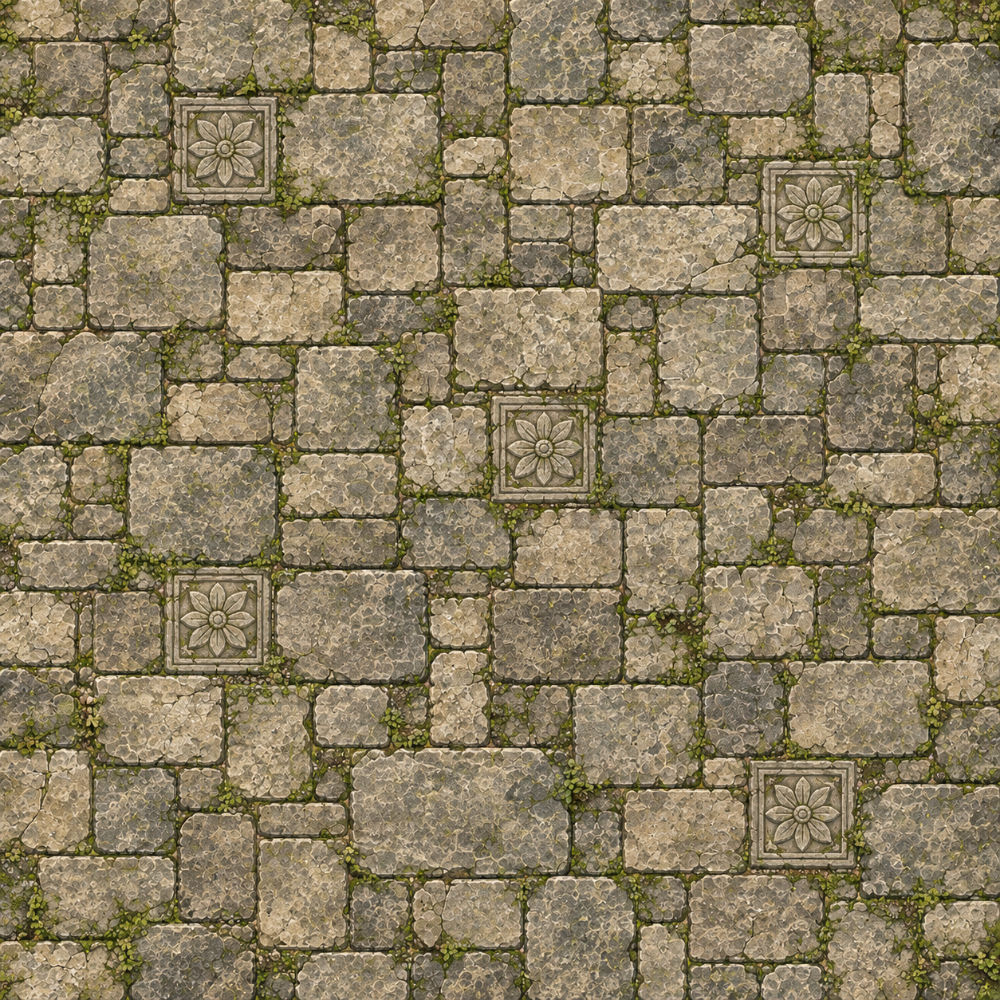
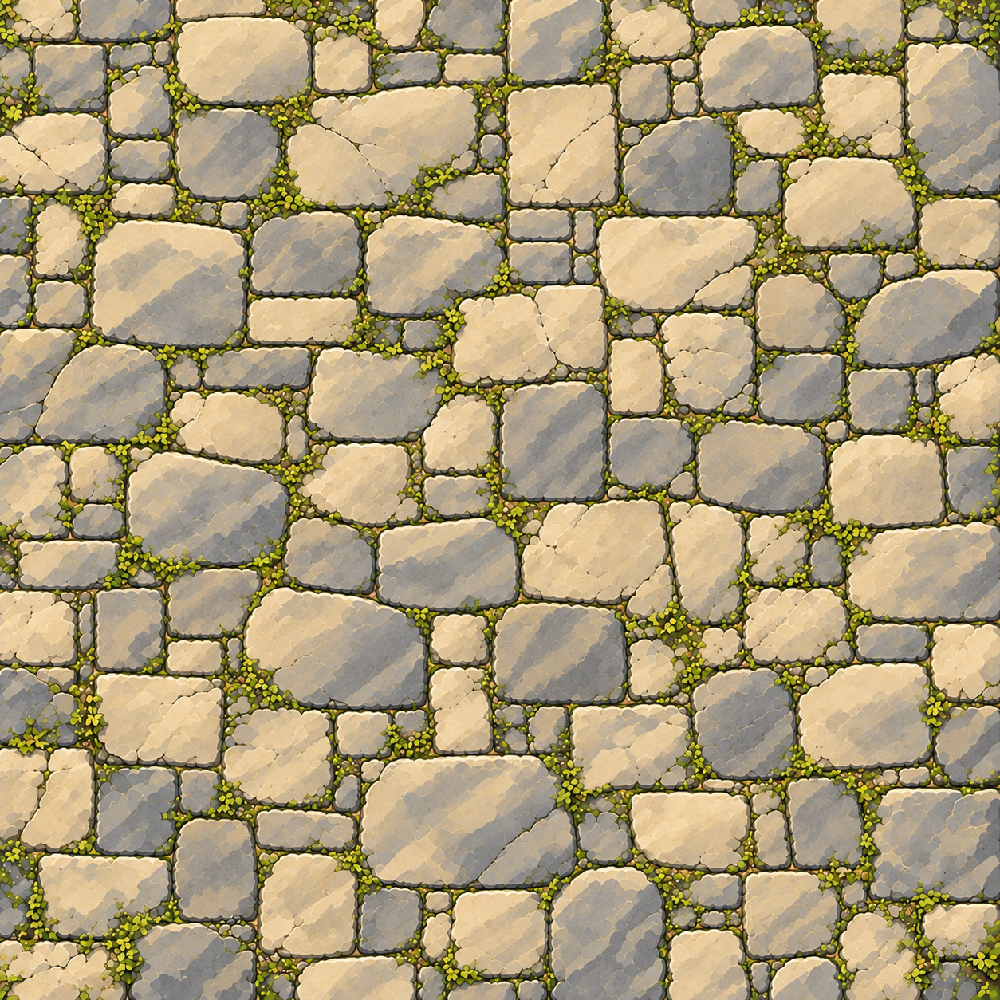

# 바닥 원화 출처와 적용 계약

2026-11-01 내장 `image_gen`의 `precise-object-edit` 방식으로 기존 `RuinsFloor.png`를 편집했다. CLI/API fallback과 외부 이미지 다운로드는 사용하지 않았다. 아래 그림은 **텍스처 원화 비교이며 실제 게임 캡처가 아니다.**

## 원본과 결과

원본에는 꽃 문장 5개와 각각의 장식 프레임이 반복되어 있다. 기존 원본 파일은 보존했다.

새 결과는 그 문장·프레임을 제거하고 크기와 형태가 다른 마모 판석으로 연결했다. 베이지·회색 돌, 올리브 이끼, 평면 시점과 셀 색면은 유지했다. 원화 검수에서 문자·UI·오브젝트·높이 단계·주변 풍경이 추가되지 않았음을 확인했다.

## 파일 정보

| 구분 | 값 |
|---|---|
| 편집 대상 | `Assets/TalesTactics/Resources/TalesTactics/TerrainArt/RuinsFloor.png` |
| 원본 SHA256 | `f121c920500b29b8d8a491b0e5a706c90579422f7218cae4b28d5a4ee9282e57` |
| 프로젝트 결과 | `Assets/TalesTactics/Resources/TalesTactics/TerrainArt/RuinsFloorWeathered.png` |
| 결과 SHA256 | `4cb5c4ce07fe39a7e211816ddffde5846fd5aa0acb4ba21d446ee80c7e54e7b1` |
| 결과 크기 | 1254×1254, 3,100,314bytes |
| 새 GUID | `f831cf5bb86f4a6195a477f11d3de830` |
| 임포트 | 원본 TextureImporter 설정 복사, GUID만 새로 부여 |
| 리샘플·확대 | 수행하지 않음 |

생성 요청에는 2048×2048을 명시했으나 도구는 원본 해상도인 1254×1254를 반환했다. 이를 그대로 복사했고 생성 출력과 프로젝트 결과의 SHA가 같다. 원본 파일 SHA도 편집 전과 같다. 최종 Unity 실제 표시 확인은 [작업 검증 상태](README.md#최종-검증-상태)에서 별도로 관리한다.

정확한 프롬프트 전체, 기본 생성 파일의 절대 경로, 원본/생성물/프로젝트 파일의 SHA·바이트·해상도와 검수 판정은 [floor-art.json](Validation/floor-art.json)에 보존했다. 생성 출력의 기본 저장 경로는 로컬 증거이며 다른 개발 환경에 동일한 파일이 있다고 가정하지 않는다. 게임은 프로젝트의 sibling PNG만 참조한다.

## 적용 범위

`PixelBattlefield`의 theme0/1 바닥만 `RuinsFloorWeathered`를 로드한다. 전체 전장에 한 번 적용하는 기존 세계 좌표 UV를 유지하며 이미지를 셀별로 회전하거나 무작위 조각으로 재배치하지 않는다. `CanyonFloor`, `ObservatoryFloor`, `SluiceFloor` 원화는 그대로 둔다. 원본과 새 결과 모두 완전한 평면 바닥 이미지이며, 가짜 높이·통로·지형 판정을 그림으로 추가하지 않는다.

새 원화 제거 대상은 반복 꽃 문장과 프레임이며 돌 줄눈 자체를 없애는 작업이 아니다. 적용 후 인물 발·이동 범위와 판석의 가독성을 실제 화면에서 함께 확인해야 한다.
