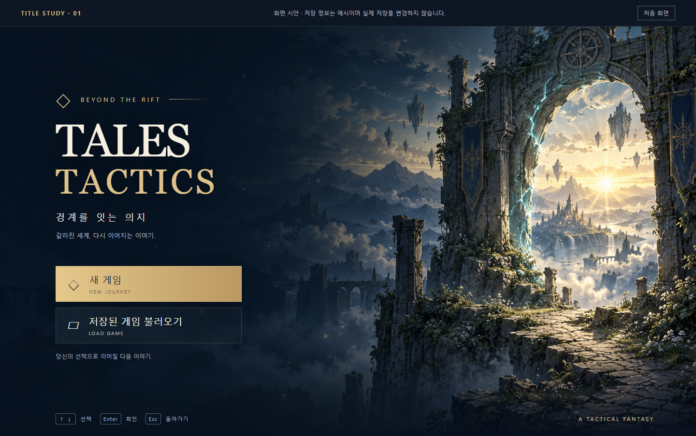
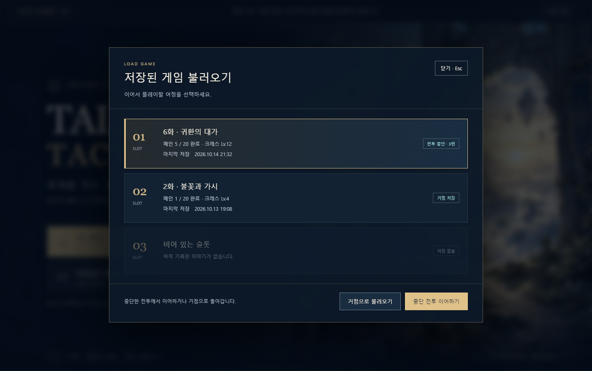
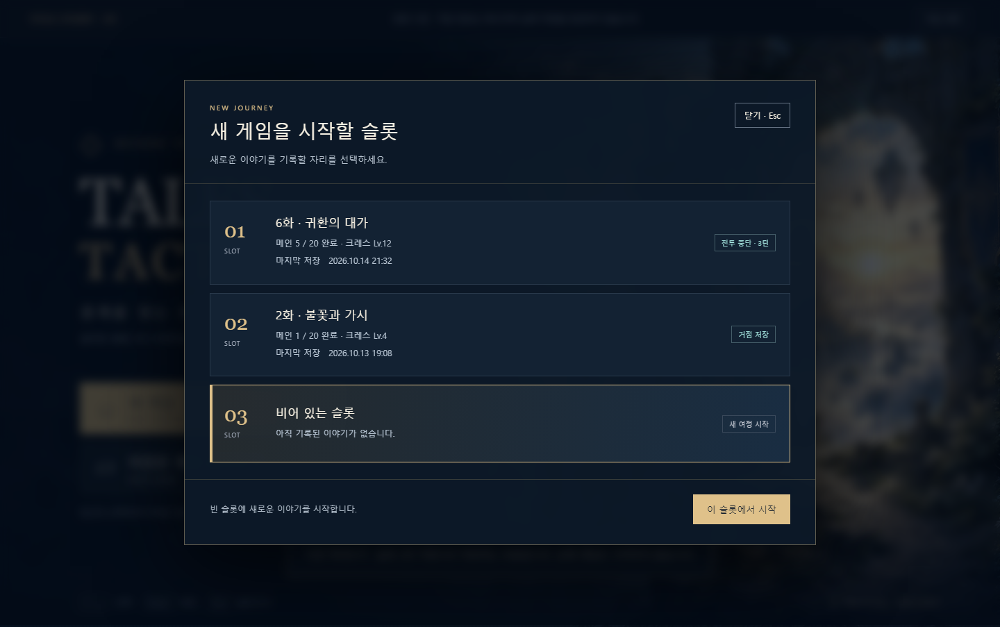
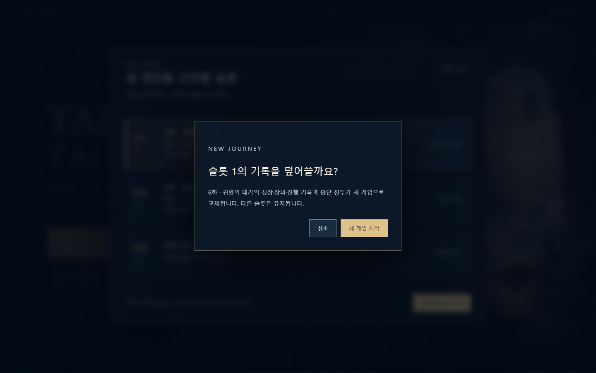

# 타이틀 화면 시안 — 2026-10-14

이 문서는 시안 제작 당시 기록이다. 이후 사용자 승인에 따라 [Unity 타이틀 화면에 적용](../TitleScreen/README.md)했다.

[클릭 가능한 시안](proposal.html). 브라우저에서 파일을 직접 열면 동작한다. 현재 단계는 사용자 요청에 따른 **시안 제작**이며 Unity 시작 화면·저장 로직에는 아직 적용하지 않았다. 저장 슬롯의 진행·레벨·시각은 예시다.

## 디자인

짙은 남색·차분한 금색·아이보리로 기존 거점 UI와 연결한다. 오른쪽의 균열 너머 빛과 길은 ‘경계를 잇는 의지’를 표현하며 왼쪽에 제목과 두 가지 메뉴를 배치한다. 배경은 새로 생성한 일러스트이고 글자·버튼은 HTML로 별도 렌더링한다. 상단 시안 안내 바는 검토용이며 최종 게임 화면에 포함하지 않는다.

## 메뉴 흐름

- **새 게임** → 저장 슬롯3개 → 빈 슬롯 우선 선택 → 시작 확인 → 메인1화의 거점으로 연결 예정. 기존 슬롯을 선택하면 성장·장비·진행·중단 기록 교체를 설명하고 덮어쓰기를 재확인한다. 확인창은 취소에 초기 포커스를 둔다.
- **저장된 게임 불러오기** → 슬롯별 선택 임무·메인 완료 수·대표 캐릭터 레벨·저장 시각 → 불러오기. 빈 슬롯은 선택하지 못한다.
- 중단 기록이 있는 슬롯은 **중단 전투 이어하기 / 거점으로 불러오기**를 나눠 표시한다. 실제 구현에서는 현재 저장 호환성과 원본 보호 검사를 먼저 수행해야 한다.
- 마우스 클릭, Tab, 위·아래 방향키, Enter, Esc로 이동한다. 모달이 열리면 배경 메뉴를 차단한다. 실제 게임패드 입력은 Unity 적용 단계에서 연결한다.

## 후속 Unity 적용 범위

현재 런타임은 인터미션 거점에서 시작한다. 적용 시 기존 uGUI와 저장 슬롯1–3을 사용해 `타이틀 → 슬롯 읽기/새 캠페인 → 거점/중단 전투` 진입을 연결한다. 저장 목록 표시는 파일을 읽기만 해야 하며 메뉴 표시·취소로 저장을 만들거나 기존 기록을 바꾸지 않는다. 새 게임 덮어쓰기에는 기존 백업·실패 보호 경로를 유지한다.

저장 없음·손상·미지원 버전·복구 가능한 백업의 안내, 구 캠페인 중단 기록 차단, 모든 슬롯이 찬 상태, 저장 실패 시 타이틀 유지와 실제 키보드/패드 포커스는 구현 단계의 검증 대상이다. 시안은 정상 저장2개+빈 슬롯1개로 핵심 화면과 흐름을 보여 준다. 제목 장면의 사운드·모션·설정/종료 메뉴는 이 시안의 범위에 추가하지 않았다.

## 시안 검증과 생성 기록

Edge headless에서 1440×900, 1280×720, 1024×768, 390×844의4폭 × 타이틀/불러오기/새 게임/덮어쓰기4화면 =16조합을 확인했다. 이미지 로드·가로 넘침·버튼 너비와 메뉴 선택, 빈 슬롯 차단, 중단/거점 분기, 확인 취소·Esc·방향키/Enter 이동을 검사했다. JavaScript 오류0. [검사 스크립트](verify.cjs) · [결과](validation.json).

캡처를 직접 검토하고 좁은 화면에서 제목이 잘게 줄바꿈되지 않도록 헤더를 조정한 뒤 재검사했다. 좁은 화면의 슬롯 목록은 대화상자 안에서 세로로 스크롤한다. Unity 테스트·게임 빌드·실제 저장 입출력 검증은 수행하지 않았다. 실행 중인 Unity와 사용자 저장에는 접근하거나 변경하지 않았다.

배경: [title-background.png](title-background.png). 내장 `image_gen.imagegen`으로 생성했으며 [최종 프롬프트와 생성 방식](image-generation.json)을 보존한다. 외부 원작 배경이나 음악을 다운로드하지 않았다. `verify.cjs`는 Node.js와 Playwright 및 Edge가 있는 환경에서 실행한다.
