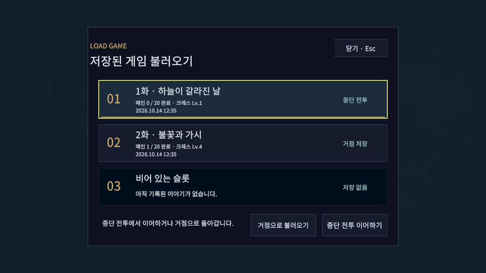
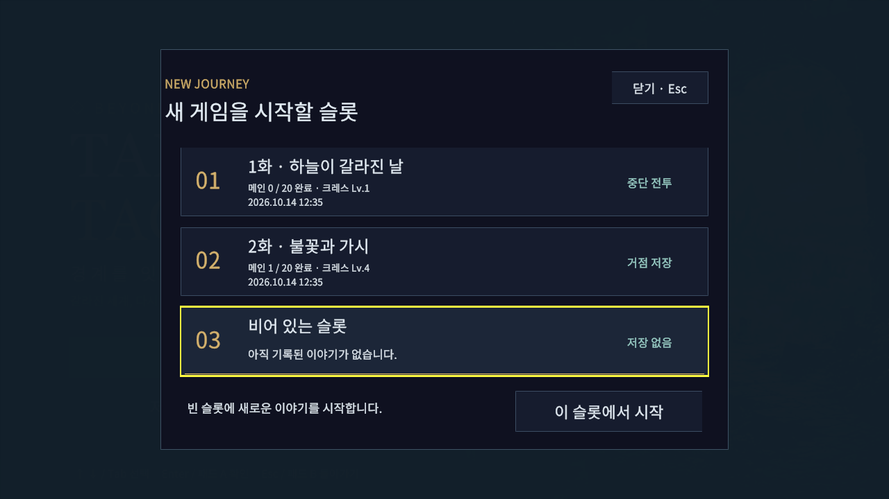
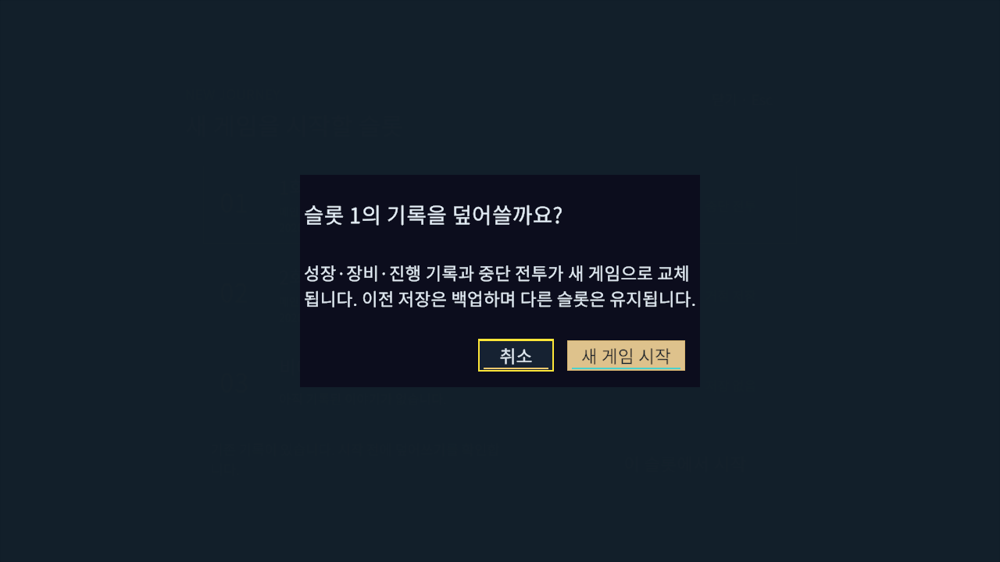

# 타이틀 화면 적용 — 2026-10-14

승인한 [타이틀 시안](../TitleProposal/README.md)을 Unity uGUI에 연결했다. 실행하면 타이틀에서 시작하며 **새 게임 / 저장된 게임 불러오기**로 진입한다. 배경은 시안에서 생성한 이미지를 그대로 사용한다.

## 연결된 동작

- 새 게임은 빈 슬롯을 우선 선택한다. 모든 슬롯이 차 있으면 기존 슬롯을 선택하고 덮어쓰기를 확인한다. 확인창의 초기 선택은 취소다. 새 저장이 성공해야 크레스·민트의 메인1화 거점으로 이동한다.
- 기존 정상 저장은 `.bak`으로 백업하며 다른 슬롯은 유지한다. 저장에 실패하면 타이틀과 현재 캠페인을 유지하고 재시도 안내를 표시한다.
- 불러오기는 실제 슬롯3개의 선택 임무·메인 완료 수·크레스 레벨·저장 시각·중단 전투 여부를 표시한다. 목록 열기·선택·취소는 파일을 쓰지 않는다. 빈 슬롯은 불러올 수 없다.
- 중단 기록은 **중단 전투 이어하기 / 거점으로 불러오기**를 선택한다. 중단 재개는 검증 후 저장에 성공해야 시작하며, 실패하면 선택 전 프로필을 유지한다. 구6장 중단 기록은 거점만 불러온다.
- 손상·미지원 파일은 원본 보호 안내와 함께 차단한다. 유효한 백업이 있으면 기존 복구 경로를 사용한다. 마지막 슬롯 설정을 저장하지 못해도 이미 성공한 새 게임은 유지하고 별도 안내를 표시한다.
- 거점의 **저장 · 설정 → 저장 후 타이틀로**로 돌아간다. 준비 저장이 실패하면 거점을 유지한다. 전투 중에는 기존 중단 저장 후 거점으로 돌아오는 흐름을 사용한다.
- 마우스·키보드·기존 패드 포인터를 사용하며 모달 뒤의 버튼과 일반 F1/F5 전투 단축키를 차단한다.

## 엔진 회귀 검증

실제 Unity6000.6.0f1 그래픽 PlayMode 전체153개를 실행했다. 최초 결과는148통과/5실패(324.43622초)였으며, 5건 모두 검증 사본에 `Docs` 또는 `Docs/BattleFlow` 결과 CSV 출력 폴더가 없어 발생했다. 출력 폴더를 만든 뒤 실패한5개를 재실행해 **5/5 통과**(20.3631016초)했다. 따라서153개 사례의 실패가 해소됐으며, 단일 전체 실행153/153으로 표기하지 않는다. [최초 XML](playmode-initial.xml) · [재검사 XML](playmode-retry.xml) · [집계](regression-summary.json).

새 타이틀 관련9개는 전체 실행에서도 통과했다. 이후 저장 실패→재시도 성공 시 남을 수 있는 이전 오류 안내를 성공 안내로 교체하고 **9/9를 다시 통과**(14.1381868초)했다. [최종 타이틀 XML](title-final.xml). 실제 저장 백업/교체/실패, 빈 슬롯/모든 슬롯 사용 중, 손상·미지원·백업 복구, 구 캠페인 및 손상 중단 기록, 중단 재개 쓰기 실패의 프로필 복원, 설정 원본 보호, 키보드 Enter/Esc·가상 패드 A/B의 단일 입력을 포함한다.

Runtime·Editor·EditMode·PlayMode의 [API 참조 컴파일4개](api-compile.txt)는 별도 검사이며 Unity 테스트 결과가 아니다. 이번에는 EditMode 전체를 재실행하지 않았다.

## 화면 검증

고정 Game View에서 1280×720, 1024×768, 1920×1080, 2560×1080, 1080×1440 × 글자100/130% × 타이틀/불러오기/새 게임/빈 슬롯 확인/덮어쓰기 확인5화면 = **50조합**을 확인했다. 실제 크기·TMP 잘림·누락 문자·버튼 범위·중앙 raycast·배경 입력 차단·저장 불변 검사에 오류가 없었다. 1280×720/130% 엔진 캡처를 검토했다. [보고서](ui-matrix.json).

초기6개 테스트는 `CanvasGroup` 조회에서 Unity의 특수 null 동작을 일반 C# null 병합 연산자로 처리해 실패했다([기록](initial-startup-failure.xml)). 명시적인 Unity null 검사로 바꾸고 6/6을 재확인했다([기록](title-initial-passed.xml)). 이후 키보드·가상 패드, 모든 슬롯 사용 중/설정 보호, 재개 저장 실패의 검사를 추가했다.

## Windows 빌드와 실행

일반 Windows 빌드 **성공·오류0/경고1·51.2431184초**, 검수 빌드 **성공·오류0/경고3·101.0885995초**. [일반 결과](build-windows.txt) · [검수 결과](build-review.txt). 일반 DLL에서 검수 타입이 제외된 것을 [확인](assembly-audit.json)했다. 일반 플레이어는12초 실행을 유지했고 실행 로그 오류·예외0을 확인한 뒤 검수 프로세스만 종료했다([기록](normal-start.json)). 종료 직후 잠겨 있던 로그 파일의 해시는 핸들 해제 후 읽었다.

사용자 저장·설정6파일의 SHA256은 시작 전후 동일하다([저장 감사](user-save-audit.json)). 실행 중인 기존 Unity Editor와 게임 프로세스를 유지했다. 빌드 사본의 소스가 변경 파일과 일치함을 [확인](source-audit.json)했으며 [승인 배경과 런타임 배경의 해시](background-audit.json)도 같다. 원본 Editor 로그에는 기존 라이선스 클라이언트 초기 연결 메시지와 종료 정리 경고가 남지만 실제 BuildReport는 두 빌드 모두 성공이다.

일반 실행본: `D:/TalesTacticsCrossover/d3d2/Builds/TitleScreenWindows/TalesTactics.exe`. Git에는 빌드 파일을 포함하지 않으며 공개 preview.6 ZIP을 갱신한 작업은 아니다.

## 범위와 재현

`TitleScreenBuild.All`로 검수 define 포함/미포함 Windows 빌드를 만든다. `TitleScreenBuild.EditorReview`는 **별도 그래픽 검증 Editor**에서 고정 Game View 검사를 실행하고 종료한다. Windows 검수 실행본은 `--title-screen-review <32자리 GUID>`를 명시한 경우만 별도 폴더에 테스트 저장을 생성한다. 일반 빌드에는 검수 타입을 포함하지 않는다.

이 PC의 검증 사본은 `D:/TalesTacticsHelpGuide`, 로그는 그 아래 `Logs/TitleScreen`이며 Git에 포함하지 않는다. 사용자 저장·기존 실행 중 Editor/게임과 분리했다. 사운드·타이틀 애니메이션·별도 설정/종료 메뉴를 추가한 작업은 아니다. 실물 USB/Bluetooth 패드·다른 PC/DPI·전체 캠페인 수동 완주·장시간 성능 검수는 이번 결과에 포함하지 않는다.

이미지 출처와 최종 생성 프롬프트는 [시안 생성 기록](../TitleProposal/image-generation.json)에 있다. 런타임 배경은 `Assets/TalesTactics/Resources/TalesTactics/TitleBackground.png`다. README와 게임 도움말의 시작 안내도 타이틀 흐름에 맞춰 갱신했다.
