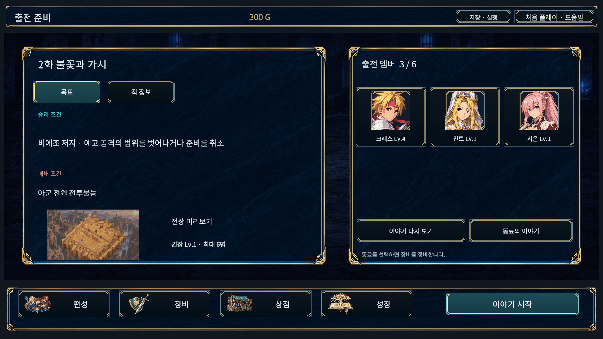
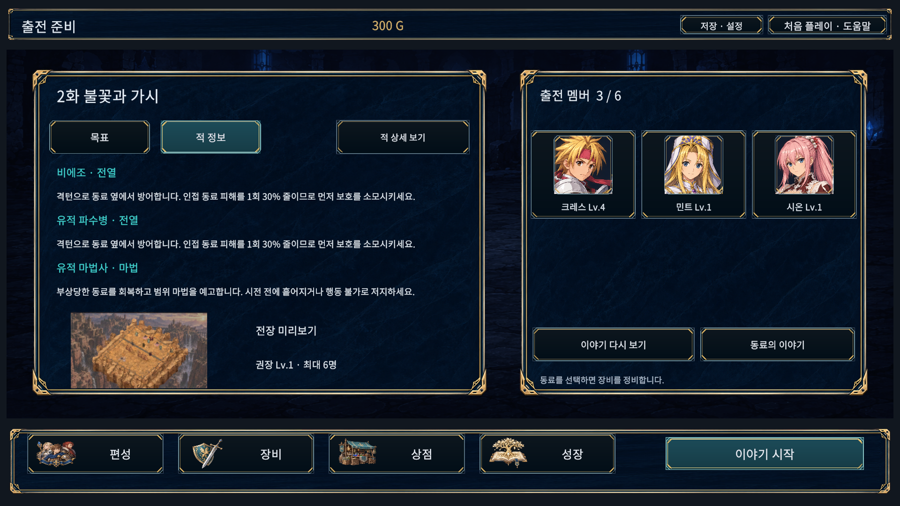
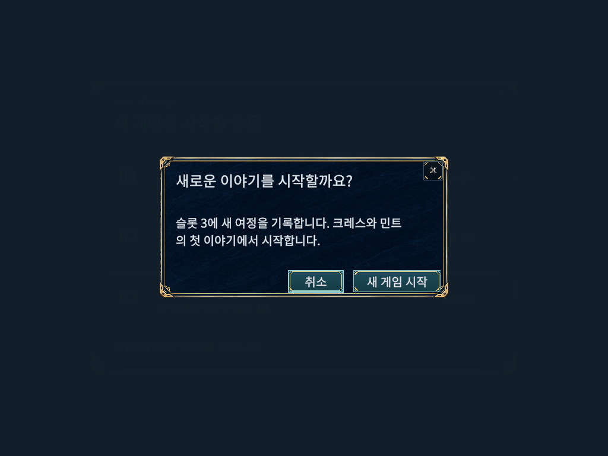

# 사용자 테스트 피드백 UI 개편

2026-10-14. 시안이 아닌 Unity 6000.6.0f1의 실제 실행 캡처다. Captures는 Editor Game View, PlayerCaptures는 Windows 검수 실행본의 렌더 결과다. 이미지 생성은 메뉴 아이콘 아틀라스 제작에만 사용했다.

## 적용 내용

- 밝은 노란 선택 면을 차분한 청록색으로 바꾸고, 금속 테두리와 밝은 글자를 유지했다. 타이틀에는 책·검·균열 엠블럼, 정비 메뉴에는 편성·장비·상점·성장 일러스트를 넣었다.
- 새 게임은 슬롯 클릭 → 확인 → 시작으로 줄였다. 덮어쓰기 백업과 취소 동작은 유지한다. 슬롯·확인창은 공통 배경과 X 아이콘을 사용한다.
- 출전 준비 화면에 현재 임무의 목표·적 정보·전장 미리보기·멤버를 모았다. 이전 메인 임무 선택 화면을 거치지 않고 첫 미완료 메인으로 진행한다. 동료 이야기에서 돌아와도 현재 메인으로 복귀한다.
- 현재 전투 전 이야기와 마지막 완료 임무의 후일담은 다시 볼 수 있다. 조회는 보상·진행 상태를 변경하지 않는다. 메인 완료 후에는 메인 시작을 비활성화하고 동료 이야기를 이용할 수 있다.
- 버튼 크기, 프레임 안쪽 여백, 하단 알림 영역, 에피소드 제목 구분을 정리했다. 도움말과 README도 새 동선으로 갱신했다.
- 메인20화 미리보기는 실제 전장을 640×360으로 촬영한 정적 이미지다. 진행 중 유닛 상태를 실시간 반영하는 미니맵은 아니다.

## 화면

Captures의 1920 이미지는 기본 글자 크기, 1024 이미지는 글자130%다.

## 검증

- 실제 Unity EditMode353/353, 전체 PlayMode157/157. PlayMode에는 슬롯 취소 시 저장 미생성, 슬롯 확정, 자동 메인 선택, 개인 이야기 복귀, 후일담 조회의 저장 불변 검사가 포함된다.
- Runtime/Editor/EditMode/PlayMode API 참조 컴파일4개 통과. 이 검사는 Unity 테스트와 별개다.
- 최종 실제 Game View19화면 × 5해상도 × 3글자 크기 = 285조합. TMP 넘침·누락 글리프·화면 밖 텍스트/버튼·같은 부모의 텍스트와 버튼 겹침·버튼 중심 레이캐스트·모달 뒤 버튼 활성·미리보기 영역 이탈 검사0건, 수집한 게임 오류0건.
- 해상도1280×720,1024×768,1920×1080,2560×1080,1080×1440. 글자100/115/130%. 프레임 진행 후 캡처했으며 임시 해상도와 격리 저장을 사용했다.
- 별도 Windows 검수 프로세스에서도 같은285조합의 검사·수집 게임 오류0건. 일반 빌드는36.32초/오류0/경고1건, 검수 빌드는55.19초/오류0/경고3건. 일반 DLL에서 검수 타입 제외, 검수 DLL에서 포함을 Mono.Cecil로 확인했다.
- 일반 Windows 실행본29초 시작 유지/로그 오류0건. 사용자 저장·설정 파일은 이번 검증 구간의 전후 SHA256이 동일하다. 기존 Pipeline 런타임 미설정 및 URP 셰이더 제거 안내는 남아 있다.
- 최신 일반 실행본: `D:/TalesTacticsHelpGuide/Builds/UiRefinementWindows/TalesTactics.exe`. 폴더 전체가 필요하다. 공개 릴리즈를 새로 배포한 것은 아니다.
- 초기 전체 PlayMode149/157은 기존 임무 선택 버튼/이전 복귀 화면/포커스 두께를 전제로 한 검사와 개인 재전 진입 검사였다. 새 동선에 맞게 갱신한 뒤 전체157개를 다시 실행했다. 이후 미리보기 영역과 선택 화살표의 표시만 수정했고 최종 화면285조합 및 EditMode를 실행했다.
- 중간 화면 검수에서 미리보기의 AspectRatioFitter 부모 설정과 편성 화살표 겹침을 발견해 수정했다. 중간 보고서는 실패 이력으로 보존했다.
- Editor 시작 시 Search 인덱스 초기화 예외가 발생했으나 게임 검수 오류는 없었다. 종료 시 Unity의 임시 할당 진단이 있다. 다른 PC/DPI·물리 게임패드·전체 시나리오 수동 완주 검증은 이번 범위가 아니다.

재현: `UiRefinementBuild.EditorReview`는 그래픽 Editor의 격리 검수를, `UiRefinementBuild.All`은 검수/일반 Windows 빌드를 만든다. `UiRefinementReview`는 일반 Windows 빌드에 포함하지 않는다. `MenuPreviewBake`는 Editor 전용이며 `--bake-menu-previews`가 있을 때만 검수 저장에서 실행한다.
