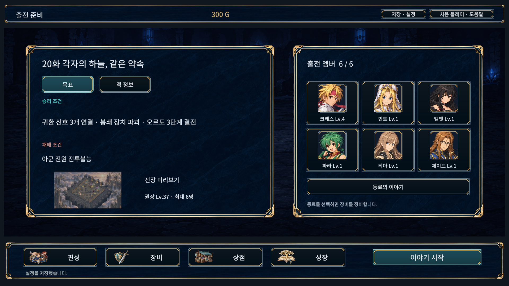
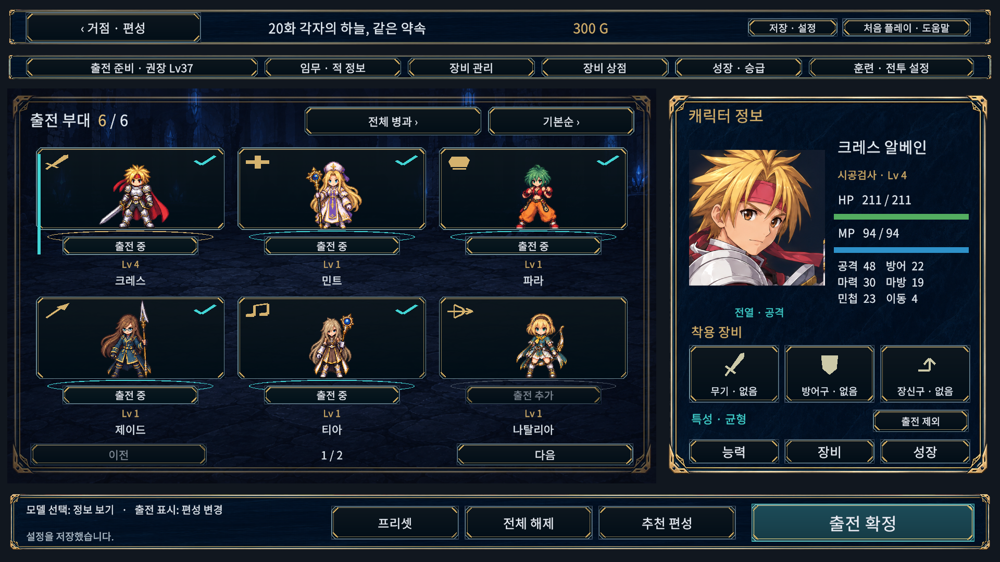
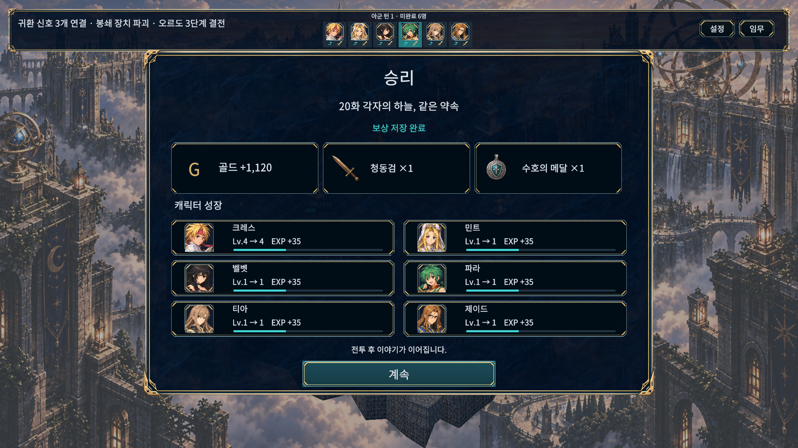
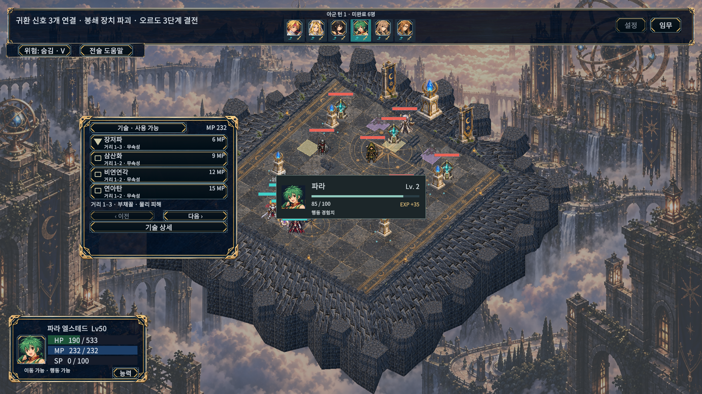

# UI 배치와 6명 편성 대응

2026-10-15. 사용자 테스트의 두 번째 수정 묶음이다. 아래 캡처는 이미지 시안이 아니라 실제 Unity/Windows 실행 화면이다.

## 변경 내용

- 장식 프레임 안에 공통 여백을 적용했다. 텍스트·카드·버튼이 테두리를 침범하지 않도록 인터미션, 적 정보, 장비, 성장, 저장·설정, 대화, 명령·기술, 상태창을 조정했다. 반복 프레임에서 여백이 누적되어 내용이 줄어드는 현상도 회귀 검사한다.
- 합류한 캐릭터만 편성·장비·성장·동료 이야기 목록에 표시한다. 편성은 한 페이지에 6명(3×2), 이후 동료는 다음 페이지로 조회한다. 출전 중인 6명은 거점과 전투 상단에 함께 표시한다.
- 전투 상단의 회전·확대/축소·전체 보기 버튼을 제거하고 설정과 임무 버튼을 남겼다. 기존 카메라 조작 키는 유지한다.
- 경험치 알림은 화면 중앙에서 순서대로 표시한다. 승리 화면은 중앙의 작은 창으로 바꾸고, 골드·아이템 그림과 최대 6명의 초상화/레벨/경험치 카드를 표시한다.
- 전투 전 이야기 → 전투 → 결과의 계속 → 전투 후 이야기 → 다음 장 출전 준비로 연결한다. 별도 후일담/다음 장 선택 및 건너뛰기 버튼을 제거했다. 동료 이야기의 다시 읽기는 유지한다.
- 후일담 진행 위치를 저장한다. 재실행하면 읽던 대사에서 이어지고, 진행 저장 실패 시 다음 장 이동을 차단한다. 보상과 후일담 대기 상태를 함께 저장해 보상 중복을 방지한다. 기존 Version3 저장 파일의 새 필드 누락도 허용한다.

## 검증 방법과 한계

`UiSafeLayoutBuild.EditorReview`는 그래픽 Editor의 고정 Game View에서 검수한다. `UiSafeLayoutBuild.All`은 별도 검수 빌드와 일반 Windows 빌드를 만든다. Windows 검수에는 `--ui-safe-layout-review <32자리 GUID>`를 사용하며 저장 위치는 실행본 아래 독립된 Reviews 폴더다. 일반 빌드에는 검수 클래스가 포함되지 않는다.

검수 범위는 44화면 × 5해상도(1280×720, 1024×768, 1920×1080, 2560×1080, 1080×1440) × 글자100/115/130%다. TMP 넘침·누락 문자·화면 밖 요소·프레임 안쪽 경계·카드 내부 경계·텍스트와 버튼 겹침·버튼 중심 클릭 경로·모달 뒤 버튼·맵 미리보기 영역을 검사한다. 1920 캡처는 글자100%, 1024 캡처는 글자130%다.

자동 검수는 전체 캠페인 수동 완주, 다른 PC의 DPI, 물리 게임패드 시험을 대신하지 않는다.

## 테스트 이력

- 실제 Unity EditMode355/355(2.93초), 그래픽 Editor 전체 PlayMode160/160(331.34초) 통과. 후일담 재개·저장 실패 시 진행 차단·보상 중복 방지, 미합류 숨김·6명 페이지, 반복 프레임의 여백 안정성 검사를 추가했다.
- 전체 테스트 후 편성 카드 상하 간격과 결과 화면 전술 버튼 표시를 조정하고 관련 PlayMode7/7(10.33초)을 통과했다. 이후 Windows에서 발견한 저장 알림 높이 수정은 Editor/Windows 화면 검수로 확인했다.
- API 참조 Runtime/Editor/EditMode/PlayMode4개 컴파일은 별도 통과했으며 Unity 테스트로 합산하지 않는다.
- 초기 PlayMode를 batchmode로 실행한121/160은 WaitForEndOfFrame·입력에 부적합한 실행 방식이었다. 그래픽 Editor로 다시 실행한158/160에서는 기술 행의 이전 고정 높이 기대값과 상태 기술창 넘침이 남았다. 클릭 크기/글자 넘침 검사와 기술 페이지당3행으로 수정하고 전체160개를 재실행했다.
- 660조합 자동 검사 이후 육안으로 발견한 편성 카드 이름과 다음 행 사이 간격도 보완하고, 검수에 각 편성 셀 내부 경계 검사를 추가했다. 첫 Windows 검수에서는 저장 알림의 높이 부족3건(657/660 통과)을 발견해 해당 영역을 늘렸다. 실패 보고서는 Evidence에 보존한다.

## 최종 실행 검증

- 최종 그래픽 Editor660/660, Windows 실행본660/660 화면 조합에서 검사 문제0·수집 게임 오류0. 실제 Windows 캡처11장을 보존했다.
- 일반 Windows 빌드30.21초/오류0/경고1, 검수 빌드50.26초/오류0/경고3. Mono.Cecil로 일반 DLL의 검수 클래스 제외와 검수 DLL의 포함을 확인했다.
- 일반 실행본36.8초 시작 유지·실행 오류0. 사용자 저장/설정8파일은 검증 전후 SHA256이 동일하다. 테스트로 실행한 새 프로세스만 종료했다.
- 작업 브랜치와 Unity 검증 사본의 C#276파일 해시가 일치한다. 소스 해시·테스트 XML·화면 보고서·빌드 로그는 Evidence에 있다.
- Editor Search 초기화 예외와 종료 시 임시 메모리 진단, 기존 URP 셰이더 제거 안내가 로그에 남는다. 게임 검수에서 수집한 실행 오류와는 구분한다.
- 일반 실행본: `D:/TalesTacticsHelpGuide/Builds/UiSafeLayoutWindows/TalesTactics.exe`. 실행에는 같은 폴더의 데이터 파일도 필요하다. 공개 릴리즈 배포는 하지 않았다.

## 실제 Windows 화면

작은 화면의 [편성](PlayerCaptures/formation-six-1024.png), [전투 결과](PlayerCaptures/results-six-1024.png), [장비](PlayerCaptures/equipment-six-1024.png), [성장](PlayerCaptures/growth-six-1024.png), [저장 알림](PlayerCaptures/system-2-1024.png)과 [적 상세](PlayerCaptures/enemy-detail-1920.png), [대화](PlayerCaptures/dialogue-1920.png)도 확인할 수 있다.
