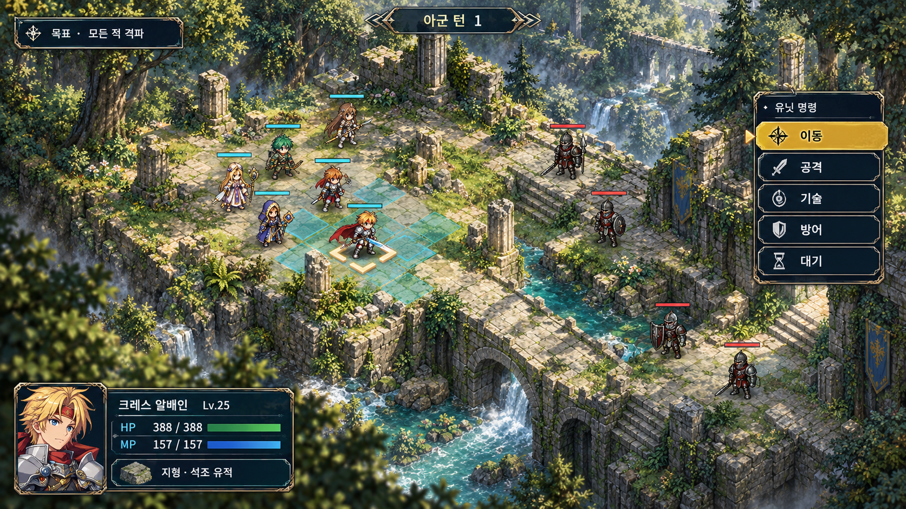
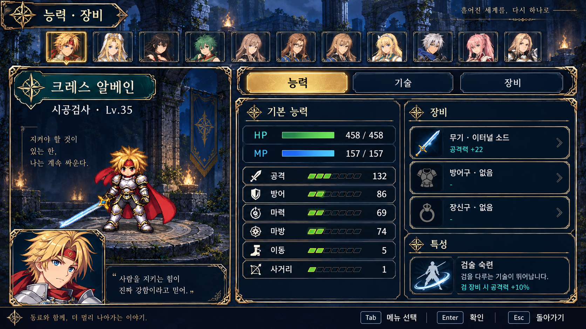
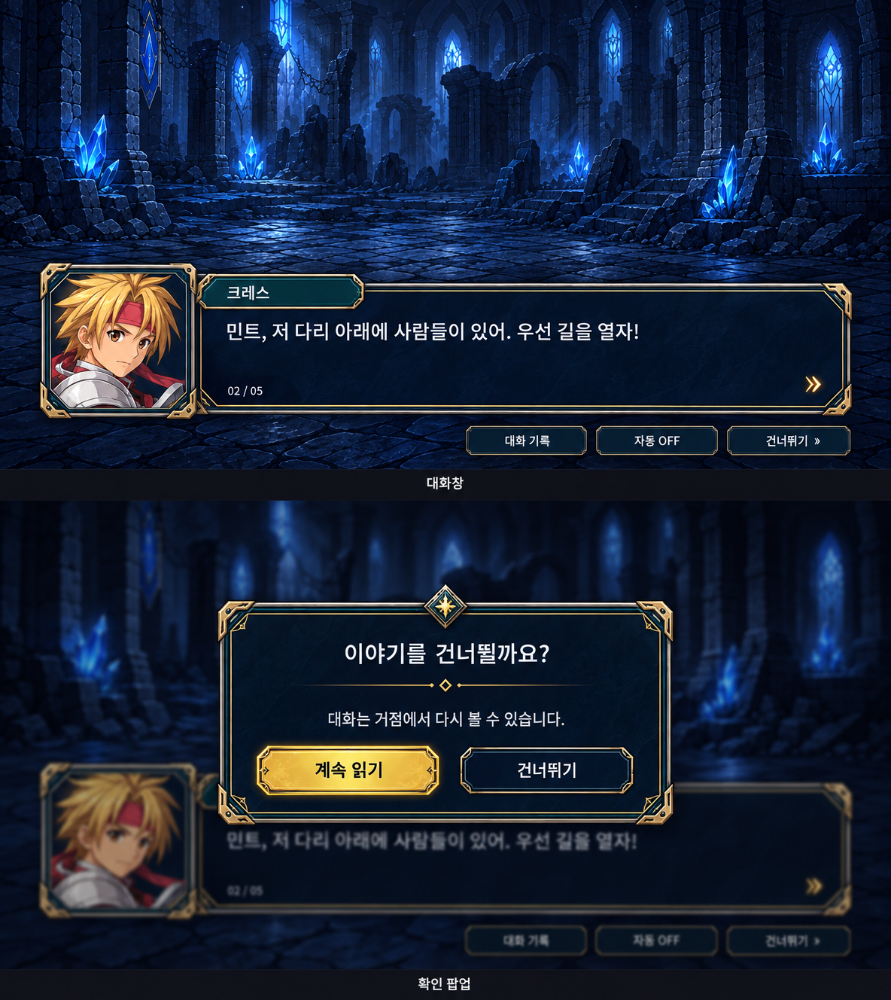

# UI 테두리·전장 품질 시안

2026-10-14 · 디자인 검토용. 실제 Unity 적용 화면이 아니다.

사용자가 첨부한 전술 RPG의 상태창·대화창·전장 화면에서 금속 테두리, 선택 강조, 정보 구획, 지형 밀도와 명암을 참고했다. 현재 TalesTactics의 판타지 캐릭터·유적·청록색과 금색 계열에 맞춰 새 시안 3장을 만들었다.

## 전투 화면과 맵

- 외곽 금속 테두리 + 내부 얇은 선 + 금색 모서리 보강 + 그림자로 패널의 깊이를 만든다.
- 선택한 명령은 금색 면과 화살표, 미선택 명령은 어두운 남색으로 구분한다. 금색 테두리를 모든 항목에 동일한 강도로 쓰지 않는다.
- 숲 가장자리·이끼·풀·바위·깨진 기둥·단차·물길·접지 그림자를 더하고, 중앙 이동 공간과 캐릭터 실루엣은 비워 둔다.
- 보드와 주변 배경의 색온도·광원·그림자를 맞춘다. 이동 범위는 필요할 때만 청록색으로 표시한다.

그림의 다리·계단·수로 배치는 품질 목표를 보여 주는 예시다. 실제 구현은 기존 타일 좌표·고저차·이동 가능 영역·시야·카메라 회전과 일치하는 지형 및 장식 에셋이 필요하다. 이 이미지를 배경에 붙이는 것만으로 구현이 끝나지 않는다.

## 스테이터스 창

초상화 탭, 캐릭터 표시, 능력치, 장비를 각각 같은 계열의 프레임으로 묶는다. 이름표는 청록색, 현재 선택은 금색, HP/MP는 서로 다른 색으로 구분한다. 외곽 프레임은 강하게, 내부 행은 얇게 처리한다.

이미지 생성 과정에서 초상화가 중복되어 11개로 표현되었다. 실제 동료는 기존 10명을 유지한다. 수치·분절 게이지·특성 효과·장식 대사는 배치 예시이며 게임 데이터나 새 성장 규칙의 변경안이 아니다. 실제 적용 시 모든 수치·텍스트는 기존 데이터와 현행 UI 기능에 연결한다.

## 대화창·확인 팝업

초상화의 독립 프레임, 본문 이중 테두리, 돌출된 이름표를 하나의 디자인으로 통일한다. 팝업은 두꺼운 모서리 장식과 그림자로 배경에서 분리하며, 안전한 기본 선택인 계속 읽기를 강조한다. 작은 글자 주변에는 장식을 두지 않는다.

실제 구현과 Unity 실행 캡처는 [적용 기록](../OrnatePresentation/README.md)에서 확인할 수 있다. 아래는 시안 제작 당시 계획과 검사 범위다.

## 적용 시 작업과 검증

1. 공통 uGUI 프레임을 크기 변경 가능한 9-slice 에셋으로 만들고, 모서리는 글자 확대에도 찌그러지지 않게 유지한다.
2. 팝업·대화·상태·장비·버튼에 기본/선택/포커스/비활성 상태를 적용한다. 금속 색상은 배경과 충분한 명암 차이를 유지한다.
3. 맵의 지형별 재질·장식·조명·물 표현을 나누어 구현한다. 조작 가능한 공간을 장식이 가리지 않게 하고 카메라 회전 시 겹침을 확인한다.
4. 작은 창·세로 창·넓은 창·글자 130%, 키보드/패드 포커스, 모달 뒤 입력 차단, 전투 가독성과 프레임 시간을 검증한다.

이번에는 생성 결과의 구도·테두리·문구를 육안 확인하고 파일 및 문서 링크만 검사했다. Unity 코드·에셋·저장·빌드는 변경하지 않았으며 새로운 Unity 테스트나 성능 검증 결과가 아니다.

내장 image_gen 도구로 제작했다. [최종 프롬프트와 입력 역할](image-generation.json). 첨부 원본은 로컬 참조로만 사용했으며 저장소에 복사하지 않았다.
