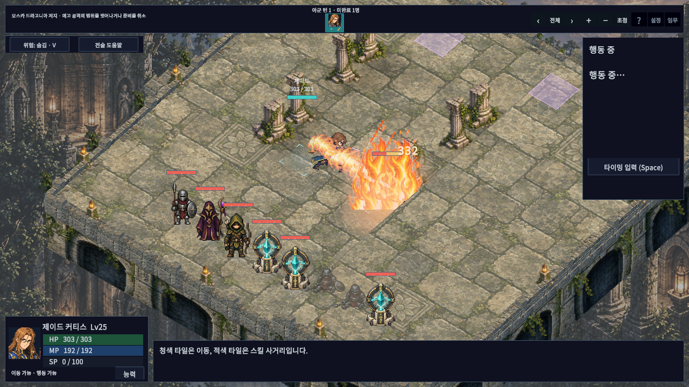
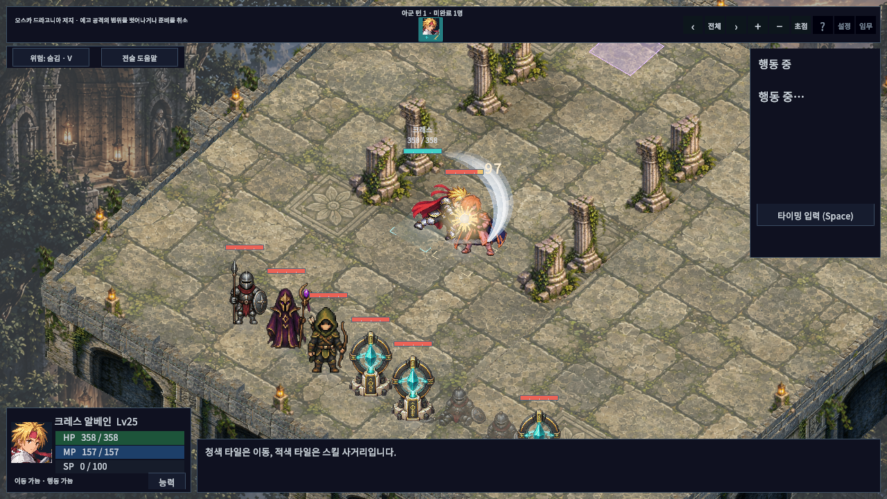

# 불꽃·검격 시안 품질 보완

최신 실행본: `Builds/VfxQualityWindows/TalesTactics.exe` (폴더 전체 필요). 일반·검수 Windows 빌드 모두 오류0/경고3으로 성공했다. 일반 런타임 DLL에는 `VfxQualityReview`와 `CombatPresentationReview`가 포함되지 않는다.

2026-10-14 최종 실제 그래픽 Editor PlayMode **137/137 통과**(328.6093196초), API 참조4개 컴파일 통과. 준비 중 피해/난수/격자 위치/전역 시간 불변, 피해 단일 처리·재시작 정리, 검격 정점 회귀 및 기존 전투·UI 검사를 포함한다. EditMode 전체 검사는 이번 표시 계층 변경에서 재실행하지 않았다. 최종 플레이어 촬영은4장면×75프레임=300프레임, 수집 오류0. 원본 로그/XML은 `D:/TalesTacticsCrossover/d3d2/Logs`, 요약과 해시는 [validation.json](validation.json)에 있다.

이전 구현은 작은 타격점 효과를 추가한 수준이었으며 생성된 [불꽃·검격 시안](../PresentationProposal/vfx-concept.png)의 연출 규모와 진행 과정을 충분히 재현하지 못했다. 이번 변경은 실제 전장 화면과 기술 실행 영상을 기준으로 확인한다.

## 변경

- 불꽃: 시전자 주변의 발광 중심·회전 잔불 → 목표를 향해 전진하는 화염 흐름 → 여러 높이와 프레임의 화염이 목표를 감싸는 폭발 → 상승 연기·잔불 순서로 재생한다. 지면에는 일시적인 주황빛을 표시한다. 기존 투명 화염/연기 아틀라스를 재사용하며 새 생성 이미지를 실제 결과로 제시하지 않는다.
- 검/클로/불꽃검: 공격자 자세를 따라가는 위치에서 넓은 곡면 궤적을 그린다. 청색 외곽·밝은 중심·흰 칼날 가장자리의 세 층을 사용하고, 준비 마지막 구간에서 접촉과 후속 동작까지 이어진다. 불꽃검은 궤적에 불꽃을 더한다.
- 물리 동작: 준비 시 체중을 뒤로 옮긴 뒤 접촉 전에 전진을 가속하고, 접촉 정지 후 관성이 남는 후속 자세로 복귀한다. 기존 방향별 동작 원화를 재사용한다. 새 전신 원화 제작이나 검 픽셀 위치의 자동 추적을 뜻하지 않는다.
- 물리 타격점: 밝은 중심, 길이가 서로 다른 불티, 지면 먼지를 추가한다. 최소 준비/복귀는 일반 공격·기술0.36/0.65초, 불 속성0.6/0.8초다. 기존 기술의 더 긴 시간은 유지한다.

기존 속성별 효과·개별 기술 패턴·효과 완화 설정을 유지한다. 추가 화염·검격 메시 효과는 최대16개 풀에서 재사용하며 준비 효과도 같은 수명 관리에 포함한다. 기존 기술 패턴의 LineRenderer는 별도다. 화면 확대나 전역 timeScale을 자동 변경하지 않는다. 전투 피해는 기존 Resolver가 발동 시 한 번 처리한다.

## 검증 방식

`VfxQualityReview`는 검수 빌드에서만 포함되며 별도 저장 경로를 사용한다. 배치를 고정한 전장에서 제이드의 메테오 스톰과 크레스 기본 공격을 실제 `BattleDirector.Execute` 경로로 실행한다. 전체 전장/기존 초점 기능을 각각 촬영한다. 30fps 고정 시간으로 저장한 엔진 프레임을 영상으로 인코딩하며 실시간 성능 벤치마크나 물리 입력 수동 완주로 표현하지 않는다.

## 실제 촬영과 한계

| 효과 | 전체 전장 | 초점 화면 |
|---|---|---|
| 불꽃 | [화염 영상](fire-wide.mp4) | [화염 영상](fire-focus.mp4) |
| 검격 | [검격 영상](sword-wide.mp4) | [검격 영상](sword-focus.mp4) |

검수 영상은 생성 시안이 아니라 Windows 플레이어가 출력한 1280×720 엔진 프레임이다. 실제 기술 실행 전 배치와 레벨을 고정한 검수 장면이므로 정상 캠페인 수동 플레이 영상이나 실시간 30fps 성능 증거로 표현하지 않는다. 입력은 검수 코드가 기존 실행 경로를 호출한다.

캐릭터 원화·무기 픽셀 궤적·시안의 세부 그림을 완전히 복제한 결과는 아니다. 화염의 단계와 규모, 검격 잔상 및 동작의 무게감을 실제 렌더링으로 개선했다. 대표 불/검 기술 외의 모든 기술을 사람이 수동 검수한 것은 아니며 장시간 성능 측정은 포함하지 않는다.

## 수정 중 발견한 문제

- 첫 촬영 도구가 카탈로그 순번으로 캐릭터를 고르면서 불 스킬이 없는 캐릭터를 선택했다. 고유 ID 선택으로 수정했다.
- 검격 리본 끝점의 `sin(π)`가 부동소수점 오차로 음수가 되어 분수 거듭제곱에서 NaN을 만들었다. 음수 하한을 차단하고 검/클로/불꽃검의 준비·타격 정점이 유한한지 검사한다.
- 최초 전체 PlayMode는 136/137 통과했다. `TargetPreviewExecutesAndTurnEnds`가 240프레임 뒤 아직 연출 중인 상태에서 다음 버튼을 찾았다. 실제 준비/복귀 시간과 여유 시간을 상한으로 기다리고, 명령 상태 복귀를 명시적으로 확인하도록 수정했다. 피해·행동 완료·방향 확정·다음 유닛 검사는 유지한다.
- 첫 정상 촬영 후 전체 전장의 검격 반경/폭을 늘리고 불꽃에 겹친 창의 직선을 제거했다. 최종 영상은 이 조정 이후 다시 촬영했다.

최종 검사와 빌드 근거는 `validation.json`에 기록한다.
