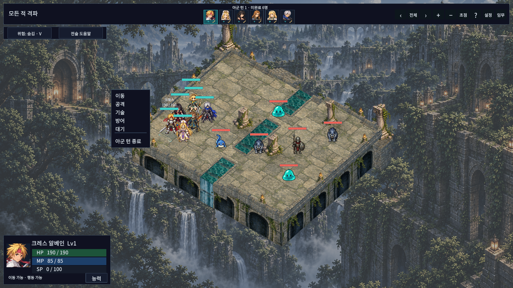
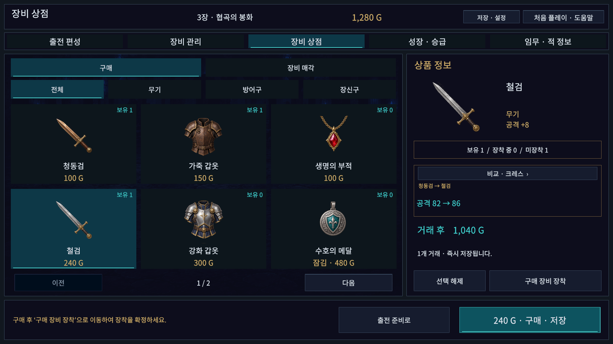
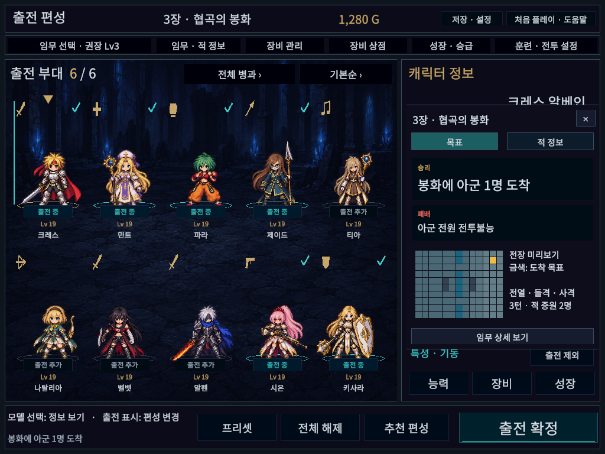

# 그래픽·UI/UX 일괄 개선

## 적용 범위

- 원경의 대비·채도를 낮추고 바닥의 세부 대비와 캐릭터 환경색을 조정한다. 외벽 높이를 줄이고 유적 외곽 계단·협곡 잔교와 바위를 추가한다. 이동/호위 목표에 금색 표식을 표시한다.
- 공통 버튼의 주 행동·탭·보조 제어를 구분하고 선택/마우스 호버/포커스에 별도 밑줄을 제공한다. 편성 조회 표시와 실제 출전 체크를 분리한다.
- 상단 아군 초상에 이동/행동 가능 아이콘과 완료 체크를 표시한다. 화면 HP바가 겹칠 때 위치를 보정하고 선택 캐릭터는 이름과 수치를 함께 표시한다. 대기와 아군 전체 턴 종료 사이에 여백과 구분선을 둔다.
- 기술 목록에 단일/직선/부채꼴/범위/회복 아이콘·사거리·속성을 표시한다. 상태창은 기본 글자에서 기술5개, 확대 글자에서4개를 보여 준다.
- 출전 전 임무창에 실제 맵 데이터의 미리보기와 초기 적 병과를 표시한다. 상점에서는 장착 가능한 캐릭터를 바꾸며 현재 장비와 상품의 능력치 차이를 구매 전에 비교한다. 비교는 별도 EquipmentLoadout 초안으로 계산하여 캠페인과 재고를 변경하지 않는다.

기존 모션의 준비·접촉·회수와 카메라/피격 리듬은 회귀 검수 범위다. 이번 변경으로 새 모션 원화를 추가하거나 기존 전투 규칙·저장 형식을 바꾸지는 않는다.

## 상용 게임 비교 기준

[Tactics Ogre: Reborn 공식 소개](https://www.square-enix-games.com/en_GB/news/tactics-ogre-reborn)는 UI와 조작 편의성, 전투 진행 개선을 강조한다. [Triangle Strategy 공식 소개](https://www.square-enix-games.com/en_US/games/triangle-strategy)의 HD-2D 전술 화면과 함께 정보 우선순위와 지형 가독성의 참고 방향으로 삼았다. 위 구현 항목과 색상/간격은 이 프로젝트에 맞춘 판단이며, 해당 게임의 에셋이나 UI 코드를 복제한 것이 아니다.

## 검증

| 범위 | 실제 확인 결과 | 증거 |
|---|---|---|
| 상태창: 3해상도 × 2글자설정 × 3탭 × 영웅/적20종 | 360조합, TMP 넘침/화면 밖 버튼0 | status-matrix.json |
| 출전·임무·장비·상점·성장·구매 후 장착: 5해상도 × 2글자설정 | 60조합, TMP 넘침/화면 밖 버튼0 | aspect-matrix.json |
| 전장: 6장 × 3해상도 × 4회전 | 72조합, 이동 가능 타일 오선택/HP바 겹침/화면 이탈/문자 넘침0 | camera-matrix.json |
| 기술 메뉴: 영웅10명 × 3해상도 × 2글자설정의 전체 페이지 | 126페이지, TMP 넘침/화면 밖 버튼0 | skill-menu-matrix.json |
| 실제 Unity EditMode | 202/202 통과, 0.62초 | editmode.json |
| 최종 실제 Unity PlayMode | 126/126 통과, 245.67초 | playmode.json |
| 실제 Unity API 참조 컴파일 / 수정 셰이더 | 어셈블리4개 통과 / 셰이더3종 오류·경고0 | shaders.json |

화면 행렬의 상태창/전장/기술 메뉴 해상도는1024×768·1920×1080·2560×1080이며, 준비 화면에는1280×800·1366×768도 포함한다. 글자 설정은1.0/1.3이고 전장은1024에서1.3, 나머지에서1.0을 사용했다. 캡처는 실제 Editor Game View이며 시안이 아니다. 기술 메뉴 검수는 매 페이지에서 실제 프레임이 진행된 뒤 측정했다. 상태창 행렬은 한 프레임 안에서20종을 생성하여 레이아웃을 계산하고, 대표 캡처는 다음 프레임 이후 저장했다.

초기 검사에서 발견한 기술 행/상점 비교/카메라 기호의 문자 넘침과 임무 미니맵 CanvasRenderer 누락, 모달 뒤 편성 버튼의 불투명한 배경을 수정했다. 실패 JSON은 initial/before-comparison-fix 이름으로 보존했다. 기존 메뉴 크기 검사도 새120×180 기본 명령 메뉴에 맞게 갱신했다.

최종 PlayMode에는 기존 전투·모션·상태창 회귀와 구매 비교의 저장 불변/실제 구매1회/미니맵 메시 생성/카메라4방향 HP바 겹침 검사가 포함된다. 신규2개를 포함해 최종 전체126개를 통과했다. 초기 전체123/126 결과와 상태창 수정 후1/1 결과도 보존했다. 엔진 독립 ManagedChecks 실행 결과로 바꾸어 표현하지 않는다.

## Windows 실행 결과

- 일반 빌드35.716초 / 개발 빌드30.722초, 모두 성공·오류0. 각각 기존 경고3개(Pipeline 런타임 설정 미사용1, URP 디버그 셰이더 제거2)가 있으며 수정 셰이더3종의 자체 진단은0이다.
- `build-code-isolation.json`: 일반 DLL에서 검수 타입3종 제외, 개발 DLL에서 포함 확인.
- `windows-player-run.json`: GUID 격리 슬롯,1장26턴·22공격·14.03초·승리/실제 저장/종료0.4배 시간 배율의 자동 submit 검수이며 수동 완주는 아니다. 사용자 파일6개 SHA256 불변.
- `windows-startup.json`: 일반 실행본12초 시작 유지, 로그 오류/예외0. 사용자가 실행 중이던 이전 게임 프로세스는 유지했다.
- 실행: `Builds/WindowsVisualUx/TalesTactics.exe`. 같은 폴더의 데이터와 DLL을 함께 사용한다. 새 공개 Release 업로드는 하지 않았다.
- 검수 후 Play 종료·TestBattle 씬/dirty=false·Full HD·빠른 Play 옵션·runInBackground=false 복원. 임시 해상도31개와 Assets 캡처 사본/동적 폰트/테스트 CSV 부수 변경을 정리했다.

## 실제 적용 화면

[기존 전투 HUD](../MotionStatus/battle-hud.png)와 [개선 후 전투 HUD](chapter1-1920-0.png)를 비교할 수 있다.

- 전장: [협곡](chapter3-1920-0.png), [관측소](chapter4-1920-0.png), [수문](chapter5-1920-0.png), [최종장](chapter6-1920-0.png).
- UI: [편성](formation-1920-1080-1.png), [기술 메뉴](skills-1920-0.png), [상태창 기술](status-기술-1920-1.png), [글자 확대](status-기술-1024-1.3.png).

## 재현과 범위

`Tools/ReviewVisualUxStatus.ps1`, `ReviewVisualUxPreparation.ps1`, `ReviewVisualUxBattle.ps1`, `ReviewVisualUxSkills.ps1`는 Unity Play Mode에서 격리 저장 경로/임시 캠페인을 사용한다. 실제 사용자 저장을 쓰지 않는다. `BuildVisualUx.cs.txt`는 Play를 종료한 뒤 일반/개발 Windows 실행본을 만들고, `RunVisualUxPlayerReview.ps1`는 개발 실행본에서 별도 GUID 저장 슬롯으로 정상 이동/공격·승리·저장을 검사한다.

기존 모션을 포함한 회귀 테스트와 로컬 실행 검수 범위이며, 다른PC/DPI·물리 게임패드·모든 장의 사람 손 완주·장시간 성능 검수 또는 상용 출시 판정은 포함하지 않는다. 원경은 회전 가능한3D 월드가 아니라 배경 평면이다. 접지 음영은 기존 표현을 사용하며 실시간 GI를 추가하지 않았다.
